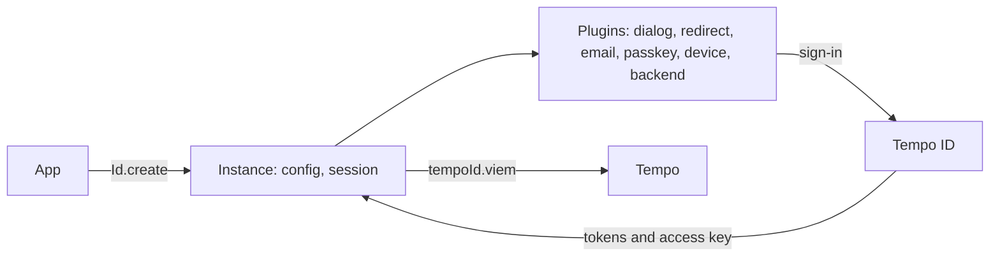

<p align="center">
  <picture>
    <source media="(prefers-color-scheme: dark)" srcset=".github/logo-dark.svg">
    <source media="(prefers-color-scheme: light)" srcset=".github/logo-light.svg">
    
  </picture>
</p>

<p align="center"><b>Sign-in, sessions, and access keys for Tempo apps.</b></p>

<p align="center">
  <a href="docs/README.md">Docs</a> · <a href="#install">Install</a> · <a href="#usage">Usage</a> · <a href="#examples">Examples</a> · <a href="#development">Development</a>
</p>

---

> [!WARNING]
> `accounts@1` is in alpha, under the `alpha` dist-tag. Its API is not stable yet.

## Overview

`accounts` is the SDK of [Tempo ID](https://github.com/tempoxyz/id), Tempo's sign-in for every app. An app uses it to sign users in, keep their session, and get a scoped access key for each session. The access key signs Tempo transactions through Viem, with the limits the user approved.



## Install

```sh
npm i accounts@alpha viem
```

| Entry                 | Holds                                                                                      |
| --------------------- | ------------------------------------------------------------------------------------------ |
| `accounts`            | `Id`, `Actions`, `Store`, `Session`, `AccessKey`, `Permissions`, and the types             |
| `accounts/cloudflare` | `DurableObject.sessions`, for a backend's sessions on Cloudflare Workers                   |
| `accounts/expo`       | The `expo` preset of an Expo app                                                           |
| `accounts/internal`   | `Authorization`, `Funding`, `Pending`, and `User`, the types that the actions build        |
| `accounts/mpp`        | `mpp`, the plugin that pays MPP endpoints with the access key                              |
| `accounts/plugins`    | `backend`, `device`, `dialog`, `email`, `passkey`, `redirect`, `relay`, and `viem`         |
| `accounts/react`      | `react`, the plugin that adds `tempoId.useSession()`                                       |
| `accounts/wagmi`      | `tempoId`, a wagmi connector, and `wagmi`, the plugin of a wagmi config                    |

## Usage

Create an instance with `Id.create`, and add a plugin from `accounts/plugins` for each sign-in method. Without a sign-in plugin, users sign in through Tempo ID in a dialog on the page:

```ts
import { Id } from 'accounts'
import { viem } from 'accounts/plugins'

const tempoId = Id.create({
  // Each sign-in requests an access key that may spend up to 10 OUSD for a day.
  accessKey: {
    expiry: '1d',
    limits: [{ limit: '10', token: 'ousd' }],
  },
  plugins: [viem()],
})

await tempoId.dialog.signIn()
await tempoId.token.transferSync({ amount, to, token })
```

The [docs](docs/README.md) cover each sign-in flow, with a [guide](docs/guides/README.md) per flow and a page per [API](docs/api/README.md).

## Examples

[`examples/`](examples/README.md) holds one small app for each platform: `backend`, `cli`, `mobile`, `wagmi`, and `web`. Each is a standalone project that installs `accounts` from npm.

[`playgrounds/`](playgrounds/README.md) holds one configurable app per flow. Tempo ID's end-to-end suite drives them, and deploys them beside each Tempo ID deployment.

## Development

```sh
pnpm install
pnpm check:types   # the package, the examples, and the playgrounds
pnpm test          # the tests in src/ and scripts/
pnpm check         # format and lint
```

The playgrounds sign in through a running Tempo ID. `pnpm dev` in [`tempoxyz/id`](https://github.com/tempoxyz/id) starts one with every playground, as its [local development docs](https://github.com/tempoxyz/id/blob/main/docs/development/local.md) describe.

## License

[MIT](LICENSE-MIT) or [Apache 2.0](LICENSE-APACHE), at the option of the user.
