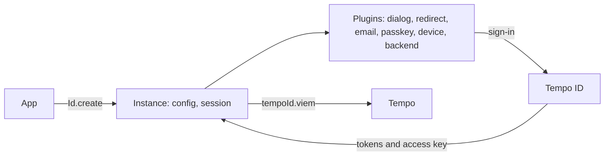

# Documentation

`accounts` signs users in through Tempo ID, and keeps their session, their access key, and a Viem client that signs with it. An app creates one instance with `Id.create`, and adds a plugin for each sign-in method it offers. [Tempo ID's docs](https://github.com/tempoxyz/id/blob/main/docs/README.md) describe the service over HTTP.



## Install

```sh
npm i accounts viem
```

| Entry                     | Holds                                                                     |
| ------------------------- | ------------------------------------------------------------------------- |
| `accounts`            | `Id`, `Actions`, `Store`, `Session`, `AccessKey`, `Permissions`, and the types  |
| `accounts/internal`   | `Authorization`, `Funding`, `Pending`, and `User`, the types that the actions build and return |
| `accounts/plugins`    | The plugins: `backend`, `device`, `dialog`, `email`, `passkey`, `redirect`, `relay`, and `viem` |
| `accounts/react`      | `react`, the plugin that adds `tempoId.useSession()` |
| `accounts/expo`       | The `expo` preset of an Expo app |
| `accounts/mpp`        | `mpp`, the plugin that pays MPP endpoints with the access key |
| `accounts/cloudflare` | `DurableObject.sessions`, for a backend's sessions on Cloudflare Workers  |
| `accounts/wagmi`      | `tempoId`, a wagmi connector, and `wagmi`, the plugin of a wagmi config    |

## Quick start

An instance without a sign-in plugin signs in through Tempo ID's sign-in in a dialog on the page. In a browser, the page's origin serves as the client ID, with no registration.

```ts
import { Id } from 'accounts'

const tempoId = Id.create()

button.onclick = async () => {
  const session = await tempoId.dialog.signIn()
  console.log(`Signed in as ${session.user.email}`)
}
```

## Setup

1. Select the client ID. A web app can use its page's origin, and a CLI can use `cli:` and its name. Any other app registers as an OAuth app, with every redirect URI it uses, and passes its client ID as `clientId` to [`Id.create`](api/Id.create.md). A backend also receives a client secret.
2. Select the plugins of the app's sign-in. A sign-in form on the app's own page, with [`email`](api/plugins.email.md) or [`passkey`](api/plugins.passkey.md), needs a first-party app. Tempo ID accepts the page's calls only from the origin of one of its redirect URIs ([app registry](https://github.com/tempoxyz/id/blob/main/docs/apps.md#app-registry)). Other apps sign in on Tempo ID's pages, with [`dialog`](api/plugins.dialog.md) or [`redirect`](api/plugins.redirect.md).
3. Select the deployment. An instance calls `https://id.tempo.xyz` by default. A self-hosted deployment passes its origin as `url`.

A mobile app registers its custom scheme as its redirect URI. A CLI needs no registration of its own. It signs in as Tempo ID's `tempo-cli` app, as another device app that a deployment registers, or as an unregistered `cli:` client ID.

## Guides

The [guides](guides/README.md) cover each sign-in flow, from a dialog to a CLI, then what an app does with the session: access keys, sessions, React, Viem, wagmi, and errors.

## API reference

The [API reference](api/README.md) documents every export: `Id`, each plugin, `expo`, `DurableObject`, the `tempoId` connector, `Actions`, `Store`, and the types that each one takes or returns.

## Limitations

- The `email` and `passkey` plugins and `tempoId.authorize` serve only a first-party app's web page. Other apps, and every native app without a backend, sign in through a dialog or a redirect. A native app with a backend can use [backend sign-in](https://github.com/tempoxyz/id/blob/main/docs/backend-sign-in.md).
- A passkey-owned account signs its access key headlessly only on a page that the passkey's relying party covers: in `passkey.signIn`, `email.signIn`, and `tempoId.authorize` with `passkey`. Elsewhere the call throws `webauthn_required`, and the approval page of a redirect signs the access key.
- A dialog sign-in with a [funding hint](https://github.com/tempoxyz/id/blob/main/docs/funding-hints.md) runs in a popup, since a frame cannot show the funding page.
- Tempo ID offers no SSO connections, so no sign-in returns the `sso` step.
