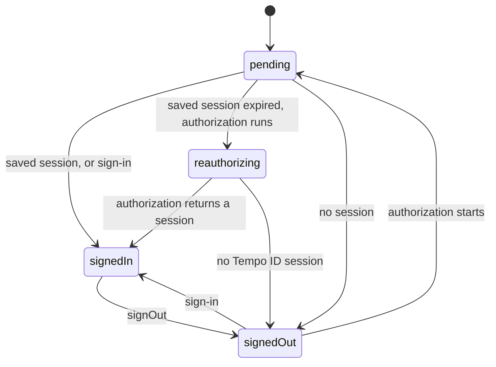

# Accounts.create

## Overview

Creates a Tempo ID instance: its configuration, the session of its user, and one namespace for each plugin. Each plugin adds a sign-in method or another set of actions, such as [`email`](plugins.email.md) or [`viem`](plugins.viem.md), under its own name, such as `tempoId.email`. An app bundles only the plugins that it imports.

The instance holds the session of one user in two cases:

| Runtime                              | Session                                                          |
| ------------------------------------ | ---------------------------------------------------------------- |
| A browser                            | Saved to `store`, which defaults to IndexedDB                    |
| Any other runtime, with a `store`    | Saved to `store`, such as [`Store.file`](Store.file.md) in a CLI |
| Any other runtime, without a `store` | None. A backend's instance serves many users                     |

An instance without a session runs its plugins' actions, and returns their results, but keeps nothing. A backend keeps each user's session with the [`backend`](plugins.backend.md) plugin instead.

An instance without a sign-in plugin (`backend`, `device`, `dialog`, `email`, `passkey`, or `redirect`) receives the [`dialog`](plugins.dialog.md) plugin with its default options. Its code loads from a chunk of its own on the first call of an action, so an app that names its sign-in plugins bundles none of it. In a browser, the chunk starts to load as the instance is created, and then preloads the dialog's frame.

Every instance holds the [`funding`](plugins.funding.md) plugin, which opens Tempo ID's deposit page. An instance without it receives it with its default options. Pass `funding()` only to set its options.

## Usage

```ts
import { Accounts } from 'accounts'
import { email, viem } from 'accounts/plugins'
import { Expiry, Scopes } from 'viem/tempo'
import { tempo } from 'viem/tempo/chains'
import * as Tokens from 'viem/tokens'

const ousd = Tokens.ousd(tempo.id).address

const tempoId = Accounts.create({
  // Each sign-in requests an access key that may transfer up to 10 OUSD for a day.
  accessKey: {
    expiry: '1d',
    limits: [{ limit: '10', token: 'ousd' }],
  },
  plugins: [email(), viem()],
})

const session = await tempoId.session.get()
```

With no options, the instance signs in through the dialog, with the page's origin as its client ID:

```ts
const tempoId = Accounts.create()

button.onclick = () => tempoId.dialog.signIn()
```

## Return type

`Accounts.Accounts<plugins>`

The instance. Each plugin's namespace sits beside these members, under the plugin's `id`. No plugin may take the name of a member, or `Accounts.create` throws.

### account.get

- **Type:** `(parameters?: { accessToken?: string; getFn?: GetFn }) => Promise<TempoAccount | undefined>`

Returns the user's [Tempo Account](types.md#tempoaccount) that Tempo ID selects for the app, on the instance's chain, as [`Actions.account.get`](Actions.account.get.md) does. A user without one in the app's realms receives one, if the app's first realm creates accounts. `accessToken` authenticates the read in place of the session cookie. `getFn` runs the ceremony of a passkey owner in place of `navigator.credentials.get`.

```ts
const account = await tempoId.account.get()
```

### account.upgrade

- **Type:** `(parameters?: { addOwner?: 'privy'; getFn?: GetFn }) => Promise<TempoAccount>`

Upgrades a wallet.tempo passkey's account to a [configurable account](https://github.com/tempoxyz/id/blob/main/docs/configurable-accounts.md), when a sign-in returns `upgradeAvailable: true`, as [`Actions.account.upgrade`](Actions.account.upgrade.md) does. The session's access key registers first, so it keeps working. The passkey signs once. The session's account then becomes the upgraded account. `addOwner: 'privy'` adds the user's Privy wallet as a second owner in the same transaction.

```ts
const session = await tempoId.email.signIn({ code, email: address })
if (session.upgradeAvailable) await tempoId.account.upgrade()
```

### authorize

- **Type:** `(parameters?: { accessKey?: Permissions | (() => Permissions | undefined) | false; challenge?: string; getFn?: GetFn; passkey?: boolean }) => Promise<(Session & { upgradeAvailable: boolean }) | undefined>`

Requests the app's tokens, and an access key, for the user's Tempo ID session in the browser, with no sign-in, as [`Actions.authorize`](Actions.authorize.md) does. Sets the instance's session, and returns it. Returns `undefined`, and empties the session, when the browser holds no Tempo ID session. Only a [first-party app](https://github.com/tempoxyz/id/blob/main/docs/apps.md#first-party-apps) authorizes this way, and the access key must fit the [headless ceiling](https://github.com/tempoxyz/id/blob/main/docs/permissions.md#headless-ceiling), unless the app holds `tempo-id:sign`.

`accessKey` defaults to the instance's `accessKey`, and `false` requests no access key. `passkey: true` lets a passkey that owns the account sign the access key on the page, so call it from a click.

While it runs, [`session.status`](#sessionstatus) is `pending`. To restore the saved session first, and show an expired one while the authorization renews it, call [`session.get`](#sessionget) with `reauthorize`.

```ts
const session = await tempoId.session.get({ reauthorize: true })
```

### config

- **Type:** [`Accounts.Config`](types.md#config)

The instance's configuration, with its defaults. Every low-level action of [`Actions`](Actions.md) takes it.

```ts
const tokens = await Actions.refresh(tempoId.config, { refreshToken })
```

### session.actor

- **Type:** `Actor | undefined`, from `xstate`

The XState actor of the session, or `undefined` for an instance without a session, such as a backend's. The state of its snapshot is the [status](types.md#sessionstatus), and `context.session` is the session. `subscribe` calls its observer at each change, such as for `useSelector` from `@xstate/react`. Read the actor, and send it no event: the instance's actions change the session.



```ts
const subscription = tempoId.session.actor!.subscribe((snapshot) => {
  if (snapshot.matches('signedOut')) showSignIn()
})
```

### session.get

- **Type:** `(parameters?: { reauthorize?: boolean | AuthorizeParameters | (() => Promise<Session | undefined>) }) => Promise<Session | undefined>`

Returns the [session](types.md#session). The first call reads the saved session. Each call first runs the plugins' `restore` hooks, such as the [`redirect`](plugins.redirect.md) plugin's, which completes a redirect's callback. Returns `undefined`, and empties the session, when the saved access key expired. Makes no request unless a hook does.

With `reauthorize`, a call that finds no session, or an expired one, authorizes the browser's Tempo ID session, as [`authorize`](#authorize) does. After a [`signOut`](#signout) without `everywhere`, `reauthorize` authorizes nothing until the next sign-in, since the Tempo ID session stays. `true` uses the instance's `accessKey`, an object passes the parameters of `authorize`, and a function runs as the authorization. One authorization spans the restore, so [`session.status`](#sessionstatus) is `pending` throughout, or `reauthorizing` with the expired session. The result holds no `upgradeAvailable`. A function can call `authorize` itself to read it. With `true` or an object, a refusal that only an interactive sign-in resolves (`reauthentication_required`, `upgrade_required`, or `webauthn_required`) returns `undefined`, so the page shows its sign-in. A `webauthn_required` from a passkey's ceremony that ran on the page and failed, such as a dismissed prompt with `passkey: true`, throws with the ceremony's error as its `cause`. A function receives every refusal itself.

```ts
const session = await tempoId.session.get({ reauthorize: true })
if (!session) showSignIn()
```

### session.refresh

- **Type:** `() => Promise<Session | undefined>`

Refreshes the session's tokens with its refresh token, as [`Actions.refresh`](Actions.refresh.md) does, saves them, and returns the session. Returns `undefined` without a session or a refresh token.

```ts
const session = await tempoId.session.refresh()
```

### session.status

- **Type:** `{ get: () => Session.Status; subscribe: (listener: (status: Session.Status, previous: Session.Status) => void) => () => void }`

The [status](types.md#sessionstatus) of the session, `pending`, `reauthorizing`, `signedIn`, or `signedOut`, with the session to show. `get` returns it, and returns the same object while the status is unchanged. `subscribe` calls its listener with each new status and the one before it, and returns the function that unsubscribes. An instance without a session, such as a backend's, is `signedOut`, and never calls the listener.

```ts
const { session, status } = tempoId.session.status.get()

const unsubscribe = tempoId.session.status.subscribe((status, previous) => {
  if (status.status === 'reauthorizing') showRenewing(status.session.user)
  if (previous.status === 'signedIn' && status.status === 'signedOut')
    showSignIn()
})
```

The pair fits `useSyncExternalStore` as it is. [`tempoId.useSession()`](react.react.md) reads it in React.

```tsx
const status = useSyncExternalStore(
  tempoId.session.status.subscribe,
  tempoId.session.status.get,
)
```

### session.subscribe

- **Type:** `(listener: (session: Session | undefined, previous: Session | undefined) => void) => () => void`

Calls `listener` with each new session and the one before it, at each sign-in and sign-out. Returns the function that unsubscribes. An instance without a session never calls it.

```ts
const unsubscribe = tempoId.session.subscribe((session) => render(session))
```

### signOut

- **Type:** `(parameters?: { everywhere?: boolean }) => Promise<void>`

Empties the session at once, also when a request fails, and deletes the saved session. It then revokes the session's refresh token at `POST /oauth2/revoke`. The user's Tempo ID session, and every other app's session, stay signed in. The instance saves a signed-out mark, so [`session.get`](#sessionget) with `reauthorize`, and the [`react`](react.react.md) plugin's first render, sign the user in again only after the next sign-in, such as through [`authorize`](#authorize). Access tokens work until they expire, at most 5 minutes, and the access key until its `expiry`, but the instance forgets both.

With `everywhere: true`, a first-party app also ends the user's Tempo ID session with `POST /v1/auth/logout`, which signs the user out of every app that relies on it, as [`Actions.signOut`](Actions.signOut.md) does. Tempo ID accepts that request only from an enabled first-party app's origin, or from its own. The logout ends only the session whose cookie the instance's requests send, so a native app's sign-out with the [`redirect`](plugins.redirect.md) plugin and `open` leaves the system browser's session. Any other app's `everywhere` throws [`Accounts.EverywhereNotAllowedError`](errors.md#accountseverywherenotallowederror), and signs nothing out.

Outside a page, the sign-out rejects with the request's error when Tempo ID does not answer the revocation. It also rejects when a refresh in progress had an attempt that received no answer, since that refresh may have rotated the token, so the sign-out does not revoke it. On a page, both reject only when no logout runs. The session stays empty in both cases.

```ts
// Signs out of this app only.
await tempoId.signOut()

// Signs out of every app on the user's Tempo ID session.
await tempoId.signOut({ everywhere: true })
```

## Parameters

`Accounts.create` takes the options of [`Accounts.from`](Accounts.from.md) but `par`, which each plugin of a redirect or a dialog sets, and these:

### accessKey (optional)

- **Type:** [`Permissions`](types.md#permissions) `| (() => Permissions | undefined)`

The access key of each sign-in that names none, as [`Permissions`](types.md#permissions), or a function that the instance calls at each sign-in to return it. A duration expiry, such as `'7d'`, counts from the sign-in. Without an expiry, Tempo ID fills the app's refresh token lifetime, as [Default expiry](https://github.com/tempoxyz/id/blob/main/docs/permissions.md#default-expiry) describes. Without this option, a sign-in without `accessKey` requests no access key.

```ts
const tempoId = Accounts.create({
  accessKey: {
    expiry: '7d',
    limits: [{ limit: '100', token: 'ousd' }],
  },
})
```

### plugins (optional)

- **Type:** `readonly Plugin[]`
- **Default:** `[]`, with the `dialog` plugin added

The plugins, each of which adds a namespace with its `id`. The built-in plugins come from `accounts/plugins`, and [`Plugin.from`](Plugin.from.md) defines another. Each plugin's `setup` runs once, in the order of `plugins`.

```ts
import { email, passkey, viem } from 'accounts/plugins'

const tempoId = Accounts.create({ plugins: [passkey(), email(), viem()] })
```

| Plugin                            | Namespace          | For                                         |
| --------------------------------- | ------------------ | ------------------------------------------- |
| [`backend`](plugins.backend.md)   | `tempoId.backend`  | A backend's sessions, one for each user     |
| [`device`](plugins.device.md)     | `tempoId.device`   | The device grant, such as in a CLI          |
| [`dialog`](plugins.dialog.md)     | `tempoId.dialog`   | Tempo ID's sign-in in a dialog or popup     |
| [`email`](plugins.email.md)       | `tempoId.email`    | An emailed code in the app's own UI         |
| [`funding`](plugins.funding.md)   | `tempoId.funding`  | Tempo ID's deposit page, on every instance  |
| [`passkey`](plugins.passkey.md)   | `tempoId.passkey`  | A passkey in the app's own UI               |
| [`redirect`](plugins.redirect.md) | `tempoId.redirect` | A redirect to Tempo ID's pages              |
| [`viem`](plugins.viem.md)         | `tempoId.viem`     | A Viem client with the session's access key |

### Configuration

`chainId`, `clientAssertion`, `clientId`, `clientSecret`, `dev`, `dpop`, `fetch`, `redirectUri`, `scope`, `store`, and `url`, as [`Accounts.from`](Accounts.from.md#parameters) documents them. `store` also decides whether the instance holds a session outside a browser.

```ts
const tempoId = Accounts.create({
  clientId: 'cli:acme-deploy',
  plugins: [device({ onCode })],
  store: Store.file('~/.config/acme-deploy/session.json'),
})
```

## Errors

### `Accounts.ClientIdRequiredError`

Thrown outside a browser without `clientId`, where no page's origin can serve as one.

### `Accounts.EverywhereNotAllowedError`

Thrown by `signOut` with `everywhere` from an app that is not first-party.

### `Error`

Thrown for a plugin whose `id` is a member of every instance: `account`, `authorize`, `config`, `session`, or `signOut`.

### Action errors

The members and the plugins' actions throw [`Accounts.RequestError`](Accounts.RequestError.md) for each refusal, and the classes that [Error classes](errors.md) lists, such as [`Accounts.SupersededError`](errors.md#accountssupersedederror) for a sign-in that another sign-in or a sign-out overtook.
