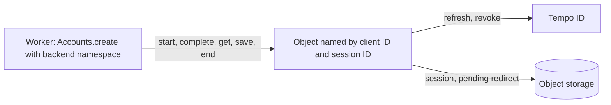

# DurableObject.sessions

## Overview

Returns a Durable Object class, from `accounts/cloudflare`, that holds a backend's sessions on Cloudflare Workers, one object for each session ID. The [`backend`](plugins.backend.md) plugin with `namespace` calls it. Every request of a session reaches one object, so concurrent requests share one refresh, and the object's storage holds the session through [`Store.durableObject`](Store.durableObject.md). The object's `alarm` deletes expired entries, such as an abandoned redirect.

An object's name holds the app's client ID beside the session ID, so one class serves several apps. `config` returns the configuration of the app `clientId` from the Worker's bindings. Each object calls it, never module scope.



## Usage

```ts
import { Accounts } from 'accounts'
import { DurableObject } from 'accounts/cloudflare'
import { backend } from 'accounts/plugins'

type Env = {
  CLIENT_ID: string
  CLIENT_SECRET: string
  SESSIONS: backend.Namespace
}

export const SESSIONS = DurableObject.sessions((env: Env) => ({
  clientSecret: env.CLIENT_SECRET,
}))

// In each request of the Worker:
const tempoId = Accounts.create({
  clientId: env.CLIENT_ID,
  clientSecret: env.CLIENT_SECRET,
  plugins: [backend({ namespace: env.SESSIONS })],
})
```

The Worker's Wrangler configuration binds the class with a SQLite migration:

```jsonc
{
  "durable_objects": {
    "bindings": [{ "class_name": "SESSIONS", "name": "SESSIONS" }],
  },
  "migrations": [{ "new_sqlite_classes": ["SESSIONS"], "tag": "v1" }],
}
```

## Return type

`DurableObject.sessions.Class<env>`

A Durable Object class, whose objects serve the RPC methods that the `backend` plugin calls: `start`, `complete`, `get`, `save`, `end`, and `alarm`. Export it from the Worker's entry under the name of its binding.

## Parameters

### config

- **Type:** `(env: env, options: { clientId: string }) => Pick<Accounts.create.Options, 'clientAssertion' | 'clientSecret' | 'dpop' | 'fetch' | 'scope' | 'url'>`

Returns the configuration of the app `clientId` from the Worker's bindings: its client authentication, which only a backend holds, and its URLs. It throws for an app that the Worker does not serve. The object passes `clientId` itself.

```ts
export const SESSIONS = DurableObject.sessions(
  (env: Env, options: { clientId: string }) => {
    if (options.clientId !== env.CLIENT_ID) throw new Error('Unknown app.')
    return { clientSecret: env.CLIENT_SECRET, url: env.TEMPO_ID_URL }
  },
)
```

## Errors

The objects throw the errors of the [`backend`](plugins.backend.md#errors) plugin's actions, which reach the Worker's call: [`Accounts.PendingNotFoundError`](errors.md#accountspendingnotfounderror) and [`Accounts.RequestError`](Accounts.RequestError.md).
