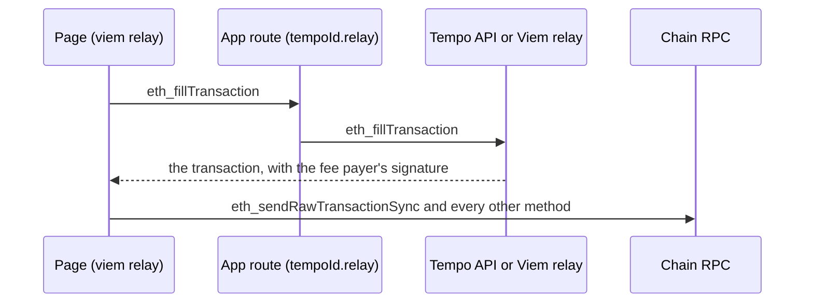

# relay

## Overview

A plugin, from `accounts/plugins`, that adds `tempoId.relay`: the handler of the app's relay route on its server. A page's [`viem`](plugins.viem.md) plugin with [`relay`](plugins.viem.md#relay-optional) sends the sponsorship requests of each transaction to the route. A fee payer then pays the fees, and the page holds no key that pays them.

The plugin has two modes:

| Options                              | Fee payer                                  | Request goes to                                                 |
| ------------------------------------ | ------------------------------------------ | --------------------------------------------------------------- |
| `apiKey`                             | The sponsor of the app's Tempo API key     | The Tempo API's `/rpc/sponsor/<chainId>`, with `tempo-api-key`  |
| `account`, or Viem's relay `plugins` | `account`, through Viem's `Relay.feePayer` | Viem's relay, over the chain and transport of the `viem` plugin |



1. The page's transport sends a fill, or a raw transaction without its fee payer's signature, to the route. Every other request goes to the chain's RPC.
2. The route relays the request, and the fee payer signs for its fees.
3. The page sends the signed transaction to the chain's RPC.

In the Viem relay mode, the plugin builds Viem's relay over the chains and transports of the `viem` plugin. Without a `viem` plugin in `plugins`, it adds the Viem client itself, as `viem()` does, so the instance holds `tempoId.viem` too. Viem's fill names no chain, so the route relays the instance's chain, or `chainId`. An app that relays several chains serves an instance, and a route, for each.

`tempoId.relay.fetch` is a function of the Fetch API, so it runs in any server that serves Fetch requests, such as Hono, a Worker, or Bun.

> [!WARNING]
> Guard the route, such as with the app's session. The handler checks no caller, so any caller that reaches the route spends the fee payer's balance, within the limits of the API key or of the relay's plugins.

## Usage

```ts
import { Accounts } from 'accounts'
import { relay } from 'accounts/plugins'
import { privateKeyToAccount } from 'viem/accounts'

// The Tempo API's sponsor pays the fees.
const tempoId = Accounts.create({
  clientId: 'https://app.example',
  plugins: [relay({ apiKey: env.TEMPO_API_KEY })],
})

// The app's own fee payer pays the fees.
const tempoId = Accounts.create({
  clientId: 'https://app.example',
  plugins: [relay({ account: privateKeyToAccount(env.FEE_PAYER_KEY) })],
})

app.post('/api/relay', (c) => tempoId.relay.fetch(c.req.raw))
```

## Return type

The plugin adds `tempoId.relay`, and the members of the `viem` plugin when `plugins` holds none.

### relay.fetch

- **Type:** `(request: Request) => Promise<Response>`

Serves a request to the relay route, and returns its JSON-RPC response. A method other than `POST` returns 405. In the Tempo API mode, an unreachable Tempo API returns 503 with the reason `temporarily_unavailable`.

## Parameters

### account (optional)

- **Type:** `LocalAccount`

The fee payer, which signs for the fees of each transaction through Viem's `Relay.feePayer`, before `plugins`.

```ts
const tempoId = Accounts.create({
  plugins: [relay({ account: privateKeyToAccount(env.FEE_PAYER_KEY) })],
})
```

### apiKey (optional)

- **Type:** `string`

The app's Tempo API key, with the `rpc-relay:sponsor` scope. With it, the plugin runs in the Tempo API mode, and the key's sponsor pays the fees.

```ts
const tempoId = Accounts.create({
  plugins: [relay({ apiKey: env.TEMPO_API_KEY })],
})
```

### apiUrl (optional)

- **Type:** `string`
- **Default:** `'https://api.tempo.xyz'`

The origin of the Tempo API, in the Tempo API mode.

### chainId (optional)

- **Type:** `number`
- **Default:** The instance's `chainId`

The chain whose transactions the route relays.

### plugins (optional)

- **Type:** `readonly Relay.Plugin[]`

Viem's relay plugins from `viem/tempo`, after `account`'s `Relay.feePayer`. The Viem relay mode also takes Viem's `resolveTokens` and `timeout`.

```ts
const tempoId = Accounts.create({
  plugins: [
    relay({
      plugins: [
        Relay.feePayer({ account: privateKeyToAccount(env.FEE_PAYER_KEY) }),
      ],
    }),
  ],
})
```

## Errors

### `Error`

Thrown by `relay.fetch` in the Viem relay mode when `chainId` is not a chain of the `viem` plugin. Return the chain's definition as the `viem` plugin's `chain`.
