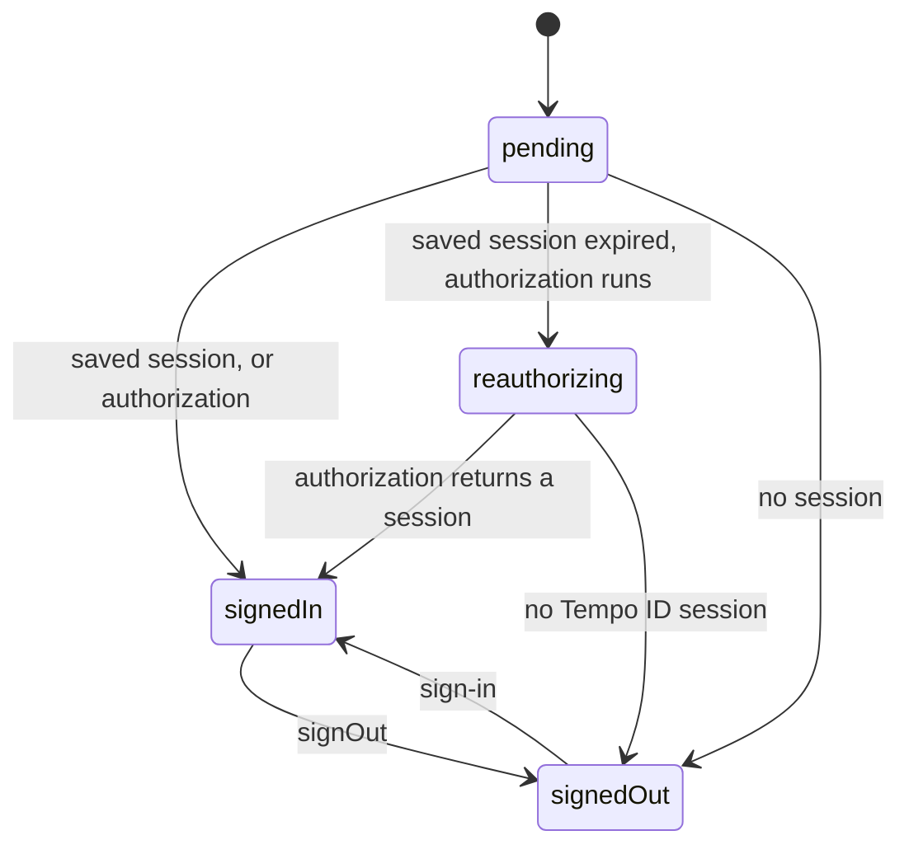

# react

## Overview

A plugin, from `accounts/react`, that adds `tempoId.useSession()` to the instance itself. React is an optional peer dependency of `accounts`, so an app with React shares its own copy. The plugin has an entry of its own, so `accounts/plugins` loads without React.

`tempoId.useSession()` returns the [status](types.md#sessionstatus) of the instance's session, the session to show, and a flag for each status. It renders again at each change of the status. The first render restores the saved session through [`tempoId.session.get()`](Id.create.md#sessionget), which also completes a redirect's callback. On a page of a first-party app, the first render also authorizes the browser's Tempo ID session when it finds no session, or an expired one, as [`reauthorizeOnMount`](#reauthorizeonmount-optional) describes. After a [`signOut`](Id.create.md#signout) without `everywhere`, it authorizes nothing until the next sign-in. Every component's first render shares one restore. A failed restore, such as a refused callback, throws to the nearest error boundary. On a server render, the status is `pending`.

The hook reads [`tempoId.session.status`](Id.create.md#sessionstatus) with `useSyncExternalStore`, so every component that calls it renders the same status.



## Usage

```tsx
import { Id } from 'accounts'
import { react } from 'accounts/react'

const tempoId = Id.create({ plugins: [react()] })

function Account() {
  const { isPending, isReauthorizing, session } = tempoId.useSession()
  if (isPending) return <p>Checking your Tempo session…</p>
  if (!session)
    return <button onClick={() => tempoId.dialog.signIn()}>Sign in</button>
  return (
    <p>
      Signed in as {session.user.email}
      {isReauthorizing ? ' (renewing the access key…)' : null}
    </p>
  )
}
```

## Return type

`tempoId.useSession()` returns a [`Session.Status`](types.md#sessionstatus), with one flag for each status. The type narrows on `status` and on each flag.

### isPending

- **Type:** `boolean`

Whether the status is `pending`: the instance restores the session, or authorizes with no saved session to show.

### isReauthorizing

- **Type:** `boolean`

Whether the status is `reauthorizing`: an authorization renews `session`, which expired.

### isSignedIn

- **Type:** `boolean`

Whether the status is `signedIn`.

### isSignedOut

- **Type:** `boolean`

Whether the status is `signedOut`.

### session

- **Type:** [`Session`](types.md#session) `| undefined`

The session to show. While `reauthorizing`, the saved session whose access key expired, which signs nothing. `undefined` while `pending` and `signedOut`.

### status

- **Type:** `'pending' | 'reauthorizing' | 'signedIn' | 'signedOut'`

The status of the session, as [`Session.Status`](types.md#sessionstatus) describes.

## Parameters

### reauthorizeOnMount (optional)

- **Type:** `boolean | AuthorizeParameters | (() => Promise<Session | undefined>)`
- **Default:** `true` on a page of a [first-party app](https://github.com/tempoxyz/id/blob/main/docs/apps.md#first-party-apps), and `false` elsewhere

Whether the first render authorizes the browser's Tempo ID session when it finds no session, or a session whose access key expired, as [`tempoId.authorize`](Id.create.md#authorize) does. `true` authorizes with the instance's `accessKey`. An object passes the parameters of `tempoId.authorize`. A function runs as the authorization, such as one that falls back to a sign-in without an access key. A third-party app has no grant to read the Tempo ID session, and a native app holds no browser session, so neither authorizes by default. `false` turns the authorization off.

A failure of the default authorization, such as an unreachable Tempo ID or a page origin without a CORS grant, leaves the status `signedOut`. A failure of an authorization that the app sets throws to the error boundary.

```ts
react({ reauthorizeOnMount: { accessKey: false } })
```

## Errors

A sign-out or a newer sign-in that overtakes the first render's restore throws nothing, since the status already shows it.

### `Id.RequestError`

Thrown to the error boundary when the restore fails, such as for a refused redirect callback, as [`redirect`](plugins.redirect.md#errors) lists, or when an authorization that the app sets with `reauthorizeOnMount` fails, as [`Actions.authorize`](Actions.authorize.md#errors) lists.
