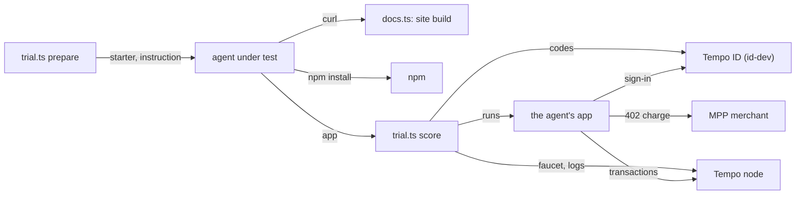

# Integration bench

The integration bench measures how well a coding agent integrates the package from the docs alone. An agent receives a starter app and the quick prompt of `README.md`. A grader then runs the app that the agent built: it signs a new user in through the app at a local Tempo ID, and checks the task's transaction on a local Tempo node.

The method follows the suites of [`tempoxyz/tempo-evals`](https://github.com/tempoxyz/tempo-evals): a task holds an instruction, a starter, an oracle solution, and an independent grader. The oracle proves that each cell is solvable, and no agent sees it. Pass rates are deterministic checks of what the app does, not a review of its code.

## Model

| Part                         | Role                                                                            |
| ---------------------------- | ------------------------------------------------------------------------------- |
| `test/bench/Tasks.ts`        | The cells, the stack's URLs, and the instruction of each trial                  |
| `test/bench/starters/<name>` | One app per platform, with no Tempo code: `react`, `backend`, `cli`, and `expo` |
| `test/bench/oracles/<cell>`  | The files that solve each cell, over its starter                                |
| `test/bench/stack.ts`        | Starts one Tempo node, the `id-dev` image of Tempo ID, and the MPP merchant     |
| `test/bench/docs.ts`         | Serves a static build of `site/`, with the Markdown of each page at `<path>.md` |
| `test/bench/trial.ts`        | Prepares a trial, grades it, and writes the table of each phase                 |
| `test/bench/grade.bench.ts`  | The grader: runs the app in Chromium or as commands, and checks the node        |



## Cells

Each task starts with a sign-in, so each cell grades the sign-in and the task apart.

| Starter   | Shape                                                             | Tasks                    |
| --------- | ----------------------------------------------------------------- | ------------------------ |
| `react`   | A Vite app with no server                                         | `transfer`, `mpp`, `pay` |
| `backend` | A Hono server on Node, which renders its pages and holds sessions | `transfer`, `sponsor`    |
| `cli`     | A Node CLI, run as `npm run cli -- <command>`                     | `transfer`, `mpp`        |
| `expo`    | An Expo app. The grader runs no device, so it checks the bundle   | `transfer`               |

| Task       | The grader passes the task when                                                                                     |
| ---------- | ------------------------------------------------------------------------------------------------------------------- |
| `transfer` | The node holds a transfer of 1 OUSD from the shown Tempo Account to `0x…dEaD`, with no prompt                       |
| `mpp`      | The node holds a payment of 0.01 OUSD to the merchant's payee, and the app shows the content                        |
| `pay`      | The node holds a transfer of 5 OUSD from the shown Tempo Account to `0x…dEaD`, after Pay on Tempo ID's payment page |
| `sponsor`  | The transfer of `transfer` lands, and its receipt names the app's fee payer as `feePayer`                           |

A starter holds no comment of this repository, since it stands for an app of a user. Lint and `tsc` skip the starters and the oracles, since each trial installs their packages.

A sign-in passes when a new user signs in at Tempo ID's pages, and the app shows the email and an address. A `pay`, `sponsor`, or `transfer` task also needs the transaction hash on the page or in the output of `send`. The transaction of `mpp`, `sponsor`, and `transfer` needs a signature of an access key of the shown Tempo Account. The transaction of `pay` needs only the shown Tempo Account as the sender: the owner signs it on the payment page, and Tempo ID's sponsor pays its fee. The grader opens the payment page in the dialog's frame or in a popup, and clicks Pay. An app whose access key sends the transfer with no page passes too. The grader funds each shown address from the node's faucet before the task. The backend's page also holds no entry in IndexedDB, and no token or private key in its storage or its script-readable cookies, since its server holds the session.

The Expo grade runs `tsc --noEmit` and `expo export --platform ios`, then reads the code: the registration's client ID and redirect URI, the scheme in `app.json`, `accounts/expo`, `redirect.signIn`, the stack's URL and chain, and a transfer to the recipient.

## Instruction

Each trial's instruction is the quick prompt with the URL of the served docs, then what the grader runs and checks, the stack's URLs, and the rules. `Tasks.instruction` writes it. The stack replaces Tempo testnet, so the instruction names Tempo ID's URL, the node's chain ID, and its RPC URL.

| Profile | The agent reads                                                                    |
| ------- | ---------------------------------------------------------------------------------- |
| `docs`  | The docs, and the output of the compiler and of the app. No file of `node_modules` |
| `types` | The same, and the type declarations of installed packages, as an editor shows them |

No agent reads this repository, GitHub, another trial, an oracle, or a kept grade. A run of subagents in this repository's orb makes `src`, `examples`, `test`, `site`, `docs`, `scripts`, `patches`, `.changeset`, `README.md`, and `CHANGELOG.md` unreadable while the agents work, and readable again before the grade. The oracles' trials in `/tmp/bench/oracles` and the kept grades in `/tmp/bench/keep` sit apart from the agents' trials, so the run makes those two folders unreadable too.

## Commands

```sh
pnpm exec playwright install chromium   # once per machine
node test/bench/stack.ts                # the stack, until the process ends. Needs Docker and ghcr.io
pnpm --filter site build && node test/bench/docs.ts site/dist/public 5180

node test/bench/trial.ts oracle oracle-react-transfer-1 react transfer
node test/bench/trial.ts score oracle-react-transfer-1

node test/bench/trial.ts prepare docs-before-react-transfer-1 react transfer http://localhost:5180 docs
# The agent reads /tmp/bench/trials/<id>/instruction.md, and works in /tmp/bench/trials/<id>/app.
node test/bench/trial.ts score docs-before-react-transfer-1
node test/bench/trial.ts report docs-before docs-after
```

A trial's ID names its phase, its cell, and its run. `report` counts the grades of each phase's prefix. Each grade, the trial's instruction, and the app's sources without `node_modules` land in `/tmp/bench/keep/<id>`, or in the folder of `BENCH_KEEP`. A failed grade holds the error, the page's text, the app's output, and a screenshot.

The graders of two trials share ports, so `score` runs one trial at a time.

## Limitations

- The agents under test are of one model. The bench holds no matrix of models.
- A phase of 3 runs per cell gives 24 trials. A difference of one or two trials is in the noise. The gaps that each agent reports in the docs show more than the pass rate.
- The grader sees no credential of a backend's session, so its check of the page's storage matches shapes: an entry of IndexedDB, a JWT or `0x` and 64 hex digits as a whole value or as a string in JSON, or JSON that names a session's credential. A credential in another form passes, and a CSRF token of exactly that form fails.
- The `docs` profile is a rule of the instruction. No sandbox stops an agent from reading `node_modules`, so each agent reports what it read.
- The runs of 2026-11-12 hid the repository's folders, but not the oracles' trials and the kept grades, which then sat beside the agents' trials and in the checkout. Each agent reported that it read only its instruction, its app, and the docs.
- The stack replaces Tempo testnet and `id.tempo.xyz`, so each trial needs `url`, a chain ID, and a transport, which a testnet app does not need.
- The Expo grade runs no device, and no sign-in. It checks the types, the bundle, and the code.
- The grader signs in a new user with an emailed code. No cell covers a passkey, a returning user, a refresh, or a sign-out.
- No cell covers a payment page of a backend, a CLI, or an app of Expo, nor Reject on the payment page.
- The oracle of `react` × `pay` pins the alpha of the other oracles, which holds no `accounts.pay`. It passes with a build of the checkout, until its pin moves to an alpha that holds `pay`.
- No cell covers the dialog of a backend, SIWE, connections, subscriptions, sessions of MPP, or a page that sends through a relay route.
- The agents install `accounts@alpha` from npm, so a trial grades the published alpha of its day, not the checkout.
