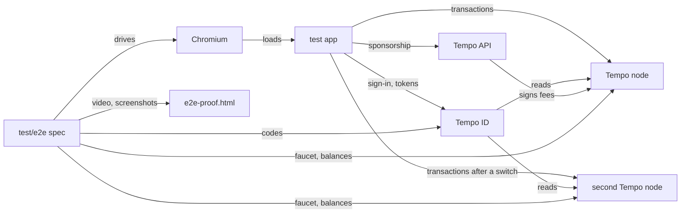
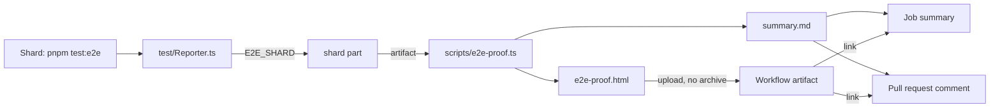

# End-to-end suite

The end-to-end suite runs the package in Chromium, in small apps that use it as an app does. Each app signs a user in at a local Tempo ID, and acts on a local Tempo node. A second node serves a second chain, which an app switches to. The suite covers what a browser alone shows: the dialog's frame, a popup window, a redirect, the storage and the renewal of a session, a transaction that the access key signs, the cookie of a session that an app's backend holds, and a transaction whose fees a relay route pays. Tempo ID's own suite, in `tempoxyz/id`, covers Tempo ID's pages and API.

## Model

| Part                     | Role                                                                         |
| ------------------------ | ---------------------------------------------------------------------------- |
| `playwright.config.ts`   | Playwright's config: Chromium, the app servers, the reporters                |
| `test/e2e/setup.ts`      | Starts the nodes and Tempo ID together, and stops them at the end            |
| `test/Chain.ts`          | The two Tempo nodes through prool, their faucets, and their balances         |
| `test/TempoId.ts`        | Tempo ID's `id-dev` container, whose inbox returns each sign-in code         |
| `test/TempoApi.ts`       | The Tempo API's `api-dev` container with its database, which sponsors fees   |
| `test/Images.ts`         | The wait for the pull of an image that a CI job started                      |
| `test/Apps.ts`           | The test apps' client IDs, URLs, registrations, and servers                  |
| `test/apps/<name>/`      | One test app per platform or backend shape, such as `web` and `backend`      |
| `test/Playwright.ts`     | Playwright's `test` with the suite's fixtures, helpers, and selectors        |
| `test/Web.ts`            | The web app's URLs, and the sign-ins that its specs share                    |
| `test/Messages.ts`       | The message shapes that a spec signs, as Tempo ID's pages name them          |
| `test/Verify.ts`         | The checks of a signature and of a proof, as an app's backend runs them      |
| `test/e2e/<flow>.e2e.ts` | One spec per flow                                                            |
| `test/Reporter.ts`       | The reporter that writes each run's [proof](#proof), or a shard's part of it |
| `test/Proof.ts`          | The proof's files, and the merge of the parts of a run in shards             |
| `scripts/e2e-proof.ts`   | Writes the proof of a run in shards from its parts                           |



One stack serves the whole run. Each test signs in a new address under `example.org`, so the tests run in parallel and share no user.

The Tempo API is the one service that starts with a test, not with the run. Its image is larger than every other image together, and two tests read it. Each one takes the `tempoApi` fixture, which starts the API for the test's worker, and carries the tag `@tempo-api`. A run without those tests starts no Tempo API, and pulls no image of it.

## Commands

```sh
pnpm exec playwright install chromium   # once per machine
pnpm test:e2e                           # the whole suite, on its own stack
pnpm test:e2e dialog                    # the specs whose path holds `dialog`
pnpm test:e2e --grep-invert @tempo-api  # every test that needs no Tempo API
pnpm test:e2e --ui                      # Playwright's UI mode
```

The suite needs Docker, and a login to `ghcr.io` for the images of Tempo ID and the Tempo API. The stack, with its two nodes, and a run hold about 6 GB of memory. With less, run with `--workers 1`.

## Targets

Each service has two variables. The image variable names another image for the container that the suite starts. The URL variable names a running service, and the suite then starts no container for it.

| Variable                     | Default                                                             | Effect                                                |
| ---------------------------- | ------------------------------------------------------------------- | ----------------------------------------------------- |
| `TEMPO_NODE_IMAGE`           | `ghcr.io/tempoxyz/tempo:latest`                                     | The image of each node that the suite starts          |
| `TEMPO_RPC_URL`              | `http://127.0.0.1:9545/1`                                           | The RPC URL of a running node of chain 1337           |
| `TEMPO_SECOND_RPC_URL`       | `http://127.0.0.1:9645/1`                                           | The RPC URL of a running node of chain 31318          |
| `TEMPO_ID_IMAGE`             | `ghcr.io/tempoxyz/id-dev:d130cf0d808bce2e3047044231923597b9510bbd`  | The image of the Tempo ID that the suite starts       |
| `TEMPO_ID_URL`               | `http://localhost:8787`                                             | The URL of a running `id-dev` instance                |
| `TEMPO_API_IMAGE`            | `ghcr.io/tempoxyz/api-dev:0dea25edcab7f3a4b55443064bc9d81bc6807383` | The image of the Tempo API that the suite starts      |
| `TEMPO_API_URL`              | `http://127.0.0.1:9546`                                             | The URL of a running Tempo API                        |
| `TEMPO_API_KEY`              | `tempo:sk:admin`                                                    | The API key of the API that `TEMPO_API_URL` names     |
| `PLAYWRIGHT_EXECUTABLE_PATH` | Playwright's Chromium                                               | A Chromium binary to use in place of Playwright's own |

```sh
# Another commit of Tempo ID, on the suite's own node.
TEMPO_ID_IMAGE=ghcr.io/tempoxyz/id-dev:<commit> pnpm test:e2e

# One commit of the node, in place of the latest build of its main branch.
TEMPO_NODE_IMAGE=ghcr.io/tempoxyz/tempo:sha-<commit> pnpm test:e2e

# A stack that already runs, such as a local checkout of each service.
TEMPO_RPC_URL=http://127.0.0.1:9545/1 \
TEMPO_SECOND_RPC_URL=http://127.0.0.1:9645/1 \
TEMPO_ID_URL=http://localhost:8787 \
TEMPO_API_URL=http://127.0.0.1:9546 \
pnpm test:e2e
```

A service that the suite does not start must meet the suite's needs itself:

- The node serves chain 1337, and its faucet drips OUSD, which the dev genesis holds.
- The second node serves chain 31318, with the same faucet. The suite's own second node starts from the dev genesis with that chain ID, since Tempo ID reads only the chains that it knows.
- Tempo ID is an `id-dev` instance, since the suite reads each sign-in code from its inbox. It reads both nodes, with one entry of `RPC_URLS` for each, and holds the apps of `Apps.registrations`.
- The Tempo API reads the same node, sponsors chain 1337 with an account that holds a fee token, and holds the API key of `TEMPO_API_KEY`.

The suite's own API takes only its development key. The suite sends `TEMPO_API_KEY` only to the API that `TEMPO_API_URL` names.

The suite replaces a loopback host with `host.docker.internal` in each URL that a container reads, so a container reaches a service on the host.

> [!WARNING]
> The suite funds accounts from a faucet, and signs in at Tempo ID with codes from its inbox. Name only local services in these variables.

## Test apps

Each app in `test/apps/` is a workspace package that depends on `accounts` as `workspace:*`. Playwright builds each app of pages once per run with the stack's URLs, and serves the build with `vite preview`. `cli`, `mcp`, and `mpp` have no build. Each command of `cli` is a Node process, and Playwright starts `mcp` and `mpp` as they are.

| App           | URL                     | Shape                                                           |
| ------------- | ----------------------- | --------------------------------------------------------------- |
| `web`         | `http://localhost:5290` | Pages without a backend. The Tempo Account pays its own fees    |
| `third-party` | `http://localhost:5291` | A second build of `web`, whose client ID is its own origin      |
| `backend`     | `http://localhost:5292` | Pages and a Worker at one origin, which `vite preview` runs     |
| `cli`         | None                    | A program without a browser, which signs in with a device grant |
| `mpp`         | `http://localhost:5293` | A merchant in Node, whose routes charge OUSD through MPP        |
| `mcp`         | `http://localhost:5294` | A paid MCP server in Node, whose tools charge OUSD through MPP  |

To add a flow, add a spec in `test/e2e/`. To add an app, add its folder, its entry in `test/Apps.ts`, and its registration.

### Registrations

`Apps.registrations` holds the apps of the suite's Tempo ID. Tempo ID holds each one as a first-party app with `tempo-id:iframe`.

| Client ID                        | Difference                                                           |
| -------------------------------- | -------------------------------------------------------------------- |
| `accounts-e2e-web`               | The build's default                                                  |
| `accounts-e2e-web-dpop`          | Each token request needs a DPoP proof                                |
| `accounts-e2e-web-passkey`       | A new user's first account is a passkey's. Holds `tempo-id:sign`     |
| `accounts-e2e-web-short-lived`   | Each refresh token lives 8 seconds, so a spec meets its expiry       |
| `accounts-e2e-web-sign`          | Holds `tempo-id:sign`                                                |
| `accounts-e2e-api`               | A confidential app, which the APIs of both resources authenticate as |
| `accounts-e2e-backend`           | A confidential app. Its redirect URIs are the backend's callbacks    |
| `accounts-e2e-backend-assertion` | Authenticates with a client assertion, and receives logout tokens    |
| `accounts-e2e-backend-headless`  | A confidential app with backend sign-in, and `tempo-id:sign`         |
| `accounts-e2e-backend-page`      | A public app, for the pages of `backend` that hold a session         |
| `accounts-e2e-backend-short`     | A confidential app, for the backend that reads short tokens          |

Each registration of the web app holds the same redirect URIs, so a page signs in to any one. A client ID holds 8 to 64 characters.

`Apps.resources` holds the registered resources of the suite's Tempo ID, as the `ID_DEV_RESOURCES` of its container. The two APIs of the backend app hold the access key policy `Apps.policy`: up to 25 OUSD, with `transfer` alone, for a day. The MCP test app holds none, since each client pays with its own access key.

| Resource                                    | Access key of a connection                                              |
| ------------------------------------------- | ----------------------------------------------------------------------- |
| `https://api.accounts-e2e.example/deferred` | The API redeems the allowance of the approval, with its own public key  |
| `https://api.accounts-e2e.example/prepared` | Tempo ID requests it from the API's access key endpoint at the approval |
| `https://mcp.accounts-e2e.example/mcp`      | None                                                                    |

An app without `tempo-id:sign` meets Tempo ID's bounds for a sign-in with no page: at most 1,000 OUSD per access key, an expiry, and scopes on tokens alone. Tempo ID also refuses its update or its revocation of an access key with no page, and its passkey registration with an access key. `accounts-e2e-web-sign` meets none of these bounds.

### Third-party app

`Apps.thirdParty` is the `web` package, built a second time with its origin as its client ID. Tempo ID holds no registration of it, and accepts a localhost origin as a client ID. `Web.url({ origin: Apps.thirdParty.url })` returns the URL of one of its pages.

- The user grants each access key on a page of Tempo ID. The sign-in form shows the grant to a new user, and the approval page shows it to a signed-in one.
- The dialog's frame holds each action until its controls show for a moment. `signIn` detects the hold from the frame's report of its visibility, and `approve` takes `held: true` for that frame.
- Tempo ID's responses to the routes of an app's own form name no third-party origin. The browser blocks each one, and logs two console errors, which the spec asserts and removes from `errors`.
- `accounts.authorize` rejects before any request, and `useSession` authorizes nothing at a mount.

### Backend app

`test/apps/backend/worker.ts` is a Worker, which the Cloudflare plugin of Vite runs in workerd. It serves the routes of the app's backend, and the pages' assets at the same origin. Only the Worker reads the client secret, the private key of the fee payer, and the API key.

| Page          | Shape                                                                                    |
| ------------- | ---------------------------------------------------------------------------------------- |
| `/`           | `dialog({ backend })`: the backend holds the session, and the page holds a cookie alone  |
| `/?short=1`   | The same, for the app whose sessions read an access token lifetime of 20 seconds         |
| `/funded/`    | A sign-in with `funding`, which the backend starts with the `backend` plugin's own calls |
| `/siwe/`      | `signIn({ method: 'siwe' })`: the account signs a message that the backend issues        |
| `/sponsored/` | A page with its own session, whose transfers name a relay route. `relay` names another   |
| `/asserted/`  | A sign-in of the app that authenticates with a client assertion                          |
| `/connected/` | `redirect()` with `resource`: the page opens a connection to an API of the Worker        |
| `/emailed/`   | The app's own form, whose code the backend redeems. `?refused=1` names another app       |

| Route              | Serves                                                                                 |
| ------------------ | -------------------------------------------------------------------------------------- |
| `/api/*`           | The handler of the confidential app: the sign-in routes, with `Sessions.durableObject` |
| `/apis/<name>/*`   | The API of the resource `deferred` or `prepared`, with `Connections.durableObject`     |
| `/app/*`           | The app's own routes, which read the session of the request's cookie                   |
| `/assertion/*`     | A sign-in with a client assertion, and the route that receives each logout token       |
| `/fund/*`          | `backend.start`, `complete`, `get`, and `end`, with a cookie of the app's own          |
| `/headless/*`      | `backend.email.sendCode` and `signIn`. `/headless/refused/*` names an app without it   |
| `/page/relay`      | The handler's relay route, whose fees the app's own fee payer pays                     |
| `/page/bearer`     | A route that reads the user from the page's access token                               |
| `/relay/api`       | A relay through the Tempo API, whose sponsor pays the fees                             |
| `/relay/denied`    | A relay whose `authorize` refuses each caller                                          |
| `/relay/guarded`   | A relay whose `validate` sponsors no transaction                                       |
| `/relay/wrong-key` | A relay through the Tempo API with an API key that the API does not hold               |
| `/short/*`         | The routes of `/api/*` and `/app/*`, for the app with short access tokens              |

- The page of a backend session holds no token. A spec reads the session through `Session` and `Me`, and asserts with `Storage` that no script reads a token.
- `Storage` reads each cookie, each value of the web storage, and each record of each IndexedDB database. On `/sponsored/`, whose page holds its own session, the same control finds a token.
- Tempo ID has no setting for the lifetime of an access token. The Worker of the `short` app rewrites `expires_in` of each token response, so each read of a session refreshes it.
- Tempo ID refuses the frame for a confidential app, since a pushed request needs a top-level page. The dialog then offers its popup.
- The handler's routes take no `funding`. The routes of `/fund/*` pass it to `backend.start`.
- The suite's setup funds the app's own fee payer once per run.
- Tempo ID posts each logout token and each access key request from inside its container. `Chain.reachable` writes the Worker's URL for it, and `vite preview` listens on each interface and allows the host `host.docker.internal`.
- The Worker keeps the `sid` of each session, each ended `sid`, and the latest access key request token of each API in the KV namespace `KEPT`, since its module scope holds only constants.

### CLI app

`test/apps/cli/index.ts` is a program with no browser. It signs in with the `device` plugin, and sends OUSD with the access key of the sign-in. Its client ID starts with `cli:`, so Tempo ID holds no registration of it, and its instance receives no `store`. The session saves to the default file of a CLI, `id/store.json` in the folder that `TEMPO_HOME` names, which the fixture sets to the folder of the test.

A spec of the program imports `test` from `test/Cli.ts`, which adds two fixtures to the suite's own.

| Fixture    | Use                                                                                          |
| ---------- | -------------------------------------------------------------------------------------------- |
| `cli`      | The program in a folder of its own. `run` awaits a command, and `start` returns its process  |
| `terminal` | Adds a screenshot of each command and its output to the report, as `capture` does for a page |

| Command              | Effect                                                                  |
| -------------------- | ----------------------------------------------------------------------- |
| `authorize`          | Starts a grant for an access key of its own, and saves the device code  |
| `login`              | Signs in with `device.signIn`, and saves the session                    |
| `logout`             | Signs out                                                               |
| `mcp <url> <tool>`   | Calls a tool of an MCP server, and pays its charge with the access key  |
| `pay <url>`          | Pays the charge of an MPP endpoint with the session's access key        |
| `poll [to amount]`   | Sends one poll of the saved device code, then a transfer with its key   |
| `proof`              | Prints the session's access token and key authorization, for a verifier |
| `refresh`            | Refreshes the session's tokens                                          |
| `send <to> <amount>` | Sends OUSD with the session's access key                                |
| `whoami`             | Prints the session                                                      |

- Each command ends its output with one line of JSON: what its action returned or threw. `result.outcome` holds it, in the shape of a page's outcome. A command that throws exits with code 1.
- The commands of one test share a session file, so a second process reads what the first one saved. Assert the session across processes, and the file's mode.
- The program prints each token as a fingerprint of its hash. `proof` prints the access token itself, so a spec runs it with `hidden: true`, and the transcript shows none of its output.
- `process.line({ pattern })` returns a line once the command prints it, such as the URL of the device page. It rejects once the command ends without the line. `process.write({ text })` writes a line to the command's input.
- A failed test attaches the transcript to the report as `terminal`, so the report shows what each command printed.
- The user approves the code on the test's page. `Playwright.device` returns the device page, and `Playwright.funding` returns the page that follows the approval of a request with `funding`.
- Tempo ID disables the approval of an app without a registration until the user checks `trust`.
- A step with no page ends with `terminal(name)`. The tab of the transcript opens after the test's page, and the proof shows the video of a test's first page.
- A sign-in with `funding` resolves at the approval. The funding page then funds the Tempo Account, or the user selects "Not now".
- `pay --max <amount>` and `mcp --max <amount>` set the most that a charge may cost. A charge above it rejects before a signature.
- `login --resource <identifier>` signs in for a registered resource, so each access token is for that API alone.

### MCP app

`test/apps/mcp/index.ts` is a paid MCP server in Node, as `examples/mcp` serves it, with the MCP SDK, Hono, and mppx's MCP SDK transport. A request to `/mcp` without an access token for `Apps.mcp.resource` receives 401, whose challenge names the server's protected resource metadata. Each paid tool answers a call without a credential with the JSON-RPC error `-32042`, and a paid call with its result and a receipt in `_meta`. The address `Apps.mcp.payee` receives each charge.

| Tool      | Effect                                                    |
| --------- | --------------------------------------------------------- |
| `whoami`  | Returns the user and the app of the access token          |
| `fortune` | Charges 0.01 OUSD                                         |
| `report`  | Charges 5 OUSD, above the limit of 1 OUSD of a spec's key |

- The resource reaches no host, so the `mcp` command of `cli` calls the server at `Apps.mcp.url`, and the challenge names the metadata at that origin.
- `Apps.mcp.amounts` holds the amount of each tool. The server reads them from `MCP_AMOUNTS`, and a spec reads them from `Apps`.
- The `mcp` command pays through `accounts.mpp().mcp(client)`, so a charge above the access key's limit rejects with `mpp.LimitError`.
- The receipt's `reference` is the transaction's hash. Assert its transfer on the node with `Chain.transfers`.

### MPP app

`test/apps/mpp/index.ts` is a merchant in Node, with Hono and `mppx/server`. Each route answers a request without a payment with a 402 challenge, and a request with a valid credential with its content and a `Payment-Receipt`. The payee of `Apps.mpp` receives each payment. The suite's setup funds it once, since it closes each session and pays the fee of each charge of a subscription.

| Route                      | Effect                                                          |
| -------------------------- | --------------------------------------------------------------- |
| `/charge`                  | Charges 0.01 OUSD for one request                               |
| `/charge/large`            | Charges 150 OUSD, above the limit of each access key            |
| `/charge/medium`           | Charges 2 OUSD, which a spent limit of 5 OUSD refuses           |
| `/proof`                   | Takes a proof of the Tempo Account, which moves nothing         |
| `/session`                 | Charges 0.01 OUSD for each request, with a voucher of a channel |
| `/subscription`            | Charges 0.01 OUSD every five seconds, after one approval        |
| `POST /subscription/renew` | Charges the current period of `subscriptionId`, as a cron does  |

- `Apps.mpp.amounts` holds the amount of each route. The merchant reads them from `MPP_AMOUNTS`, and a spec reads them from `Apps`.
- The process holds each spent transaction, each channel, and each subscription in memory. One merchant serves the run, and each test pays with a new Tempo Account.
- The `/mpp/` page of `web` and the `pay` command of `cli` pay the routes. A spec calls `/subscription/renew` itself, as the merchant's cron does.
- The receipt's `reference` is the transaction's hash for a charge and a subscription. A session's close receipt holds it as `txHash`. Assert its transfers on the node with `Chain.transfers`.
- The browser logs each 402 response as a console error. A spec of a payment removes those from the `errors` fixture.

### Pages of the web app

One build serves every page. The server answers each path with the app's entry, and `main.tsx` starts the page of the path. Each page creates its own instance with `Accounts.create`, with its own sign-in plugin, then `react` and `viem`. The wagmi page creates a config of wagmi in place.

| Path              | Sign-in                                                                                  |
| ----------------- | ---------------------------------------------------------------------------------------- |
| `/`               | `dialog()`: Tempo ID's frame in a dialog on the page                                     |
| `/chains/`        | `dialog()`, on an instance of two chains: each "Switch" control calls `switchChain`      |
| `/popup/`         | `dialog({ mode: 'popup' })`: Tempo ID's page in a popup window                           |
| `/isolated/`      | The popup, on a page that sends `Cross-Origin-Opener-Policy: same-origin` and names it   |
| `/severed/`       | The popup, on a page that sends the header and names no policy                           |
| `/redirect/`      | `redirect()`: the page leaves for Tempo ID, and returns                                  |
| `/open/`          | `redirect({ open })`: a window shows Tempo ID, as a system browser does for a native app |
| `/open/callback/` | The redirect URI of `/open/`. It sends its URL to the page that waits, then closes       |
| `/custom/`        | `email()` and `passkey()`: the app's own form signs in, with no page of Tempo ID         |
| `/mpp/`           | `dialog()`, then `mpp()`: each control pays one route of the MPP app                     |
| `/wagmi/`         | The `tempoId` connector of a wagmi config: "Connect" signs in through the dialog         |

The page's query sets the options that a spec varies. Tempo ID matches a redirect URI exactly, so a page that is its own redirect URI, such as `/redirect/`, returns without its query. Its query thus sets only the request items of "Sign in" and the options of "Deposit".

| Parameter          | Effect                                                                          |
| ------------------ | ------------------------------------------------------------------------------- |
| `accessKey`        | The permissions of each access key, as `Json.stringify` of `ox` writes them     |
| `chains`           | On `/chains/`, the IDs of the chains that the instance serves, with commas      |
| `challenge`        | A message that the page's "Sign in" and "Authorize" controls sign               |
| `clientId`         | Another app of `Apps.registrations`, in place of the build's                    |
| `default=1`        | On `/`, the instance receives the default dialog, with no sign-in plugin        |
| `deposit`          | The options of the page's "Deposit" control, as JSON                            |
| `dpop=1`           | A DPoP key binds the tokens. The page keeps the key in IndexedDB                |
| `expiry`           | The expiry of each access key, such as `15s`. Defaults to `1d`                  |
| `funding`          | The amount that a sign-in needs in the Tempo Account, as JSON                   |
| `instanceResource` | The registered resource that the instance names for each request                |
| `message`          | The message that each "Sign a message" control signs                            |
| `par=1`            | On `/`, the plugin pushes each request, so the sign-in opens a popup            |
| `plugin=1`         | On `/wagmi/`, the config is `accounts.wagmi` of the page's own instance         |
| `preload=0`        | On `/`, the page loads no frame before a sign-in                                |
| `reauthorize=0`    | `useSession` authorizes no Tempo ID session of the browser at a mount           |
| `resource`         | The registered resource that the tokens of "Sign in" are for                    |
| `retry=0`          | The Viem client shows no screen for a refused transaction, and rejects the call |
| `scope`            | The scopes beyond the instance's that the tokens of "Sign in" hold              |
| `second=1`         | On `/wagmi/`, the connector's config also holds the second node's chain         |
| `typedData`        | The typed data that "Sign typed data as the owner" signs, as `Json.stringify`   |

Without `accessKey`, each sign-in requests an access key that sends up to 100 OUSD until `expiry`. With `accessKey=false`, a sign-in requests none. `Web.url` writes each parameter.

Each page shows the same parts, which a spec reads and drives:

- `#status` shows the status of `useSession`, and `#history` shows each status that the hook returned, in order.
- `#chain` shows the ID of the instance's chain, which `switchChain` changes.
- Each control runs one action of the instance, such as `Sign in`, `Refresh`, or `Sign out everywhere`. Its `output` shows what the action returned or threw, as JSON.
- The "Send OUSD" form sends one transfer with the session's access key.
- The "Send calls" form sends the calls of its `Calls` field as one transaction, in the token of its `Fee token` field.
- A session shows each token as the first bytes of its SHA-256 hash. A spec compares tokens, and the proof holds none.
- "Proof" returns the access token and the key authorization, in an output that the page hides. A spec passes them to `test/Verify.ts`.
- `#failure` shows the error that `useSession` threw, in place of the controls.

To cover another option, add a parameter or a control to the page, not a second build.

The wagmi page shows the outcome of each hook of wagmi as the other pages show an action's. Its "Send OUSD" form sends with `Hooks.token.useTransferSync` of `wagmi/tempo`. "Sign out of the instance" calls the instance's own `signOut`, so a spec asserts that wagmi follows the session. With `second=1`, "Switch to the second chain" calls `useSwitchChain`, and `#chain` shows the chain of `useChainId`.

## Specs

- Import `test` and `expect` from `test/Playwright.ts`, and its helpers as the `Playwright` namespace, such as `Playwright.signIn`. Its `email` fixture returns a new address per test, and `code` returns the sign-in code of an address.
- Write each phase of a flow as a `test.step`, and call `capture(name)` at the end of each one. A step that returns a value returns it after the capture. The proof shows each step with its screenshots. `capture(name, target)` shows another page, such as a second tab or a popup. A test with no page captures nothing: one that sends each request through the `request` fixture, or one that acts on the node alone.
- Assert the outcome outside the page too, such as a balance on the node through `Chain.balance`, or what an access key may still send through `Chain.remaining`. `Chain.accessKey`, `Chain.balance`, and `Chain.fund` take `chainId: Chain.second.chain.id` for the second node.
- Select the package's dialog and Tempo ID's own elements only through `test/Playwright.ts`, so a change to Tempo ID's pages changes one file.
- A test fails if its page logs a console error or throws. A test that expects an error removes it from the `errors` fixture.
- Assert a request that the package sends, or does not send, with `page.on('request')`. To hold a response, use `context.route`.

| Helper                      | Use                                                                              |
| --------------------------- | -------------------------------------------------------------------------------- |
| `start`, `outcome`, `run`   | Click a control, read what its action returned or threw, or both                 |
| `send`, `submit`            | Send OUSD with the page's form, or start the transfer and wait for no outcome    |
| `calls`                     | Send the `.call` of each `viem/tempo` action as one transaction                  |
| `signIn_custom`             | Sign in with the app's own form on `/custom/`                                    |
| `call`                      | Start a control with no user gesture, as a script of the page does               |
| `abort`                     | Abort the signal of a sign-in that runs, which no control can do under a dialog  |
| `dialog`, `frame`, `prompt` | The open dialog's frame, the frame that the page holds, and the popup offer      |
| `choose`, `uncovered`       | Click a button of the popup offer, and wait until no dialog covers the page      |
| `popup`                     | The window that a click opens                                                    |
| `authenticator`             | A virtual authenticator of the page: its passkeys, and whether it verifies       |
| `signIn`, `approve`, `deny` | Tempo ID's sign-in form and approval page, in a page or in a frame               |
| `revoke`, `deposit`         | Tempo ID's revocation page, and the parts of its deposit page                    |
| `device`, `funding`         | Tempo ID's device page, and the funding page that follows its approval           |
| `grant`                     | The notes of a sign-in form or an approval page: what the user grants or signs   |
| `issue`                     | Return, or refuse, the message of a sign-in whose challenge is a function        |
| `form`                      | The email field of Tempo ID's sign-in form, which shows with no Tempo ID session |
| `failure`                   | The error that the page shows in place of its controls                           |
| `idle`                      | Wait until the page holds no user gesture                                        |

### Access keys

- The node holds an access key from its first transaction. Before that, `Chain.accessKey` and `Chain.remaining` reject.
- A transfer pays its fee in the token that it sends, and the fee counts against the limit of that token. Assert a remainder within a bound, not as an exact value.
- A call that is no transfer names a limited token in `feeToken`, since the access key pays no fee in another token.
- With `retry=0`, a refused transaction rejects with the node's error. Without it, the Viem client opens Tempo ID's page for the refusal, and the spec approves or closes it.
- Tempo ID refuses a sign-in of the app's own form with an `Accounts.RequestError`, and the browser logs the response. The spec asserts the log, and removes it from `errors`.

### Backend sessions and sponsorship

- A confidential app pushes each request, so its authorize URL holds a `request_uri` and no `redirect_uri`.
- Assert the session's cookie through `context.cookies`: its name, `httpOnly`, and that a second context holds none.
- The backend's transfer pays its fee in OUSD, as the page's does. Assert the remainder of the limit from the node's balance.
- A sponsored transfer costs the sender the amount alone. Assert the sender's balance as an exact value, and the receipt's payer with `Chain.feePayer`.
- If a relay refuses a sponsorship, the Viem transport sends the transaction with the sender's own fees. Assert the payer, not a rejection.
- Viem retries a 403 response three times, so a relay whose `authorize` refuses logs four console errors.
- A test that reads the Tempo API takes the `tempoApi` fixture, and its `describe` carries `TempoApi.tag` and the mode `default`. The API serves on one port, so its tests share one worker.

### Connections and APIs

- A sign-in with `resource` returns an access token for the API alone. `connection.get` then needs a second sign-in without `resource`, which a consented user passes with no page.
- `Playwright.grant` reads what the approval page grants to the API: its name, its limit, and its expiry.
- The API's access key pays its fee in OUSD, and the fee counts against the policy's limit. Assert `Chain.remaining` within a bound.
- Assert a revocation on the node with `Chain.accessKey`, whose `isRevoked` is then `true`.
- An access key request token lives 60 seconds, and Tempo ID sends each one once. The `replay` route posts the latest one again, which the endpoint answers with 401.
- A page of `/emailed/` sends each request to the Worker. Assert with `page.on('request')` that the browser sends none to Tempo ID.

### Passkeys

`Playwright.authenticator(page)` adds a virtual authenticator to the page through the DevTools protocol. It holds each passkey that the page registers, and answers each ceremony with no prompt.

- `Web.enroll` signs in with the app's own form and registers a passkey, as the first step of a test.
- A passkey owns a Tempo Account of its own, which differs from the account of the email's sign-in. Fund it before a transfer.
- `credentials()` returns each passkey with its `signCount`, which rises by one per ceremony. Assert it as the count of ceremonies that ran.
- `verifies(false)` makes the authenticator refuse the user verification. The sign-in then rejects with an `AbortError`, as it does with no passkey.
- `passkey.prepare` requests the options before the click. Assert with `page.on('request')` that the prepared sign-in sends the verification alone.

### Signatures and proofs

A spec verifies each signature in its own process, as an app's backend does, and not in the page that signed.

| Check              | Proves                                                                                            |
| ------------------ | ------------------------------------------------------------------------------------------------- |
| `Verify.message`   | The Tempo Account signed the message, as `personal_sign` signs it                                 |
| `Verify.siwe`      | The same, and the message's domain and nonce are the ones that the spec issued                    |
| `Verify.typedData` | The Tempo Account signed the typed data                                                           |
| `Verify.accessKey` | The signature counts for the account: the owner's, or an access key's with the app's access token |
| `Verify.challenge` | `Challenge.verify` of `accounts`: the access key's authorization binds the challenge              |
| `Verify.proof`     | `Challenge.verify` alone, for a proof that the spec signed: the outcome, and each request sent    |

- Assert a failure beside each pass: another message, another account, or another app's access token.
- `Messages.from` returns a message of a shape that Tempo ID's pages name, such as a Sign-In with Ethereum message or a share. Assert the note with `grant`.
- With an access key, the session's `challengeSignature` is the key authorization's signature, which is no `personal_sign` of the challenge. Verify it with `Verify.challenge`.
- For the proof of a root key, a spec signs with a root key of its own, and verifies with `Verify.proof`, which holds no access token of an app. `Chain.upgrade` retires the root key on the node.

### Deposits

- The faucet of Tempo ID's deposit page sends 1,000,000 OUSD. A spec that asserts the deposit starts with `fund: false`, so the account holds nothing before.
- A sign-in with `funding` shows the deposit page only if the account holds less than the amount.
- In a frame or a popup, the deposit page ends itself at the faucet. After a redirect, the page shows a link that returns to the app.
- The hidden frame of a sign-in keeps the browser's key focus. A spec that presses Escape on a later frame loads the page again first.

### User gestures and popups

Playwright starts Chromium without its popup blocker. The suite keeps the blocker, as a user's browser does, so a popup opens only within a click. The config sets `channel: 'chromium'`, since Playwright's headless shell has no popup blocker.

- `start` clicks, so the call that it starts holds a gesture.
- Playwright's `evaluate` and `dispatchEvent` hold a gesture too. `call` evaluates through the DevTools protocol, which holds none.
- A click's gesture lasts a few seconds. `idle` waits for its end, before a call that must open no window by itself.
- Tempo ID's pages send `Cross-Origin-Opener-Policy`, which severs the opener's handle to their window. A page cannot read `closed` of such a window.

### Timing

The tests run in parallel, and the first ones meet a Tempo ID that has served no request. A step that depends on a duration fails there.

- Wait for a state, not for a time. The page aborts a sign-in at an event from the spec, not after a delay.
- A sign-in that starts before the page holds its frame loads its own frame. A spec that counts frame loads waits for the frame first.
- The short-lived registration, the expiry of an access key, and the period of a limit are the only clocks. A spec that uses one asserts only what holds after the duration.
- Tempo ID refuses an expiry that passed. The page counts a short expiry from the click, so it leaves 15 seconds for the sign-in.
- An action that waits for several blocks, such as the open of a channel, takes longer than an assertion's timeout. Pass `timeout` to `outcome` or `run` for it.
- A subscription's period is five seconds of the node. A spec polls the renewal until the merchant returns a receipt, and waits for no time.

## Proof

Each run writes its proof to `test/e2e/proof/`, also a run that fails.

| File             | Content                                                                                             |
| ---------------- | --------------------------------------------------------------------------------------------------- |
| `e2e-proof.html` | Each test's result, video, steps, and screenshots. A test that did not pass adds its error and page |
| `summary.md`     | The totals, the stack, and one row per test                                                         |

`e2e-proof.html` holds each video and screenshot as a data URL, so the file opens in a browser without another file. A run that fails before its first test, such as a service that does not start, writes the error and no test.

### Shards

CI runs the suite for each pull request, and for each push to `main` beside the release, which waits for no test. CI runs the suite in shards, so a run ends in the time of its slowest shard. Each shard is one job of the `Test (e2e, <shard>/<count>)` matrix, such as `Test (e2e, 3/17)`, with its own stack. Each job runs on a runner with four CPUs, which the two workers of `playwright.config.ts` assume.

| Shard       | Tests                                                                          |
| ----------- | ------------------------------------------------------------------------------ |
| `1` to `16` | Each test whose position in the list of tests has the shard's remainder        |
| `17`        | The tests with the tag `@tempo-api`. It alone pulls the image of the Tempo API |

Each shard but the last one takes its tests from `playwright test --list`, and runs them with `--test-list`. The tests of one spec so run in several shards, and each shard holds about the same count. A new test needs no change of the workflow.

`--test-list` matches each test by its title, and skips a test that it does not match without an error. A shard so fails if its part holds another count of tests than its list. A title with a `›`, an edge space, or a line break causes that.

Each job starts the pull of its images before the install, and holds one lock file per image in the directory of `E2E_PULLS` until that pull ends. `test/Images.ts` waits for an image's file before a service starts its container. Without the wait, Docker starts a second pull of an image whose pull still runs, and extracts it again. A run without `E2E_PULLS` waits for nothing.

Each shard runs with `E2E_SHARD`, which holds the shard's name and the count of shards, such as `3/17`. The reporter then writes the shard's part of the proof, `shard-<name>.json`, in place of the proof. The job uploads the part, also after a failed test.

The `Test (e2e)` job runs after every shard, also after a failed one, and publishes the proof:

1. The job downloads each part, and `node scripts/e2e-proof.ts` merges them into `e2e-proof.html` and `summary.md`. If a shard uploaded no part, both files name the shards that the proof holds. A shard uploads no part if it fails before its tests end. A part also expires after one day, so a later attempt of the run that runs only some shards lacks the other parts.
2. The job uploads `e2e-proof.html` as an artifact without an archive, so its link opens the file in the browser.
3. The job writes `summary.md` and the link to the job summary.
4. The job fails if a shard failed.
5. The `Proof` job writes the same text to one comment on the pull request, which each run updates.

If every shard fails before its tests run, such as at the pull of an image, the summary and the comment state that the run holds no proof.



A run without `E2E_SHARD`, such as a local one, writes `e2e-proof.html` and `summary.md` itself.

To run one shard on a local machine, pass the same variable and list:

```sh
pnpm exec playwright test --list --reporter list --grep-invert @tempo-api \
  | grep '›' | awk 'NR % 16 == 3' > tests.txt
E2E_SHARD=3/17 pnpm test:e2e --test-list tests.txt
```

A failed shard also uploads Playwright's report, `test/e2e/report`, as `e2e-report-<name>`. It holds the trace of each failed test.

## Limitations

- The suite runs only Chromium.
- The node's default image is a tag that moves, so a change of the node can fail a run. The proof names the tag, not the node's commit.
- The suite holds the specs of the web app (`access-keys`, `challenges`, `custom`, `dialog`, `funding`, `popup`, `redirect`, `requests`, `session`, `signatures`, and `third-party`), of the backend app (`backend`, `connections`, `siwe`, and `sponsored`), of the CLI app (`cli`), of the wagmi page (`wagmi`), of machine payments (`mpp`), and of the paid MCP server (`mcp`). Of the deposit page, it covers the faucet, the hint of the requested amount, and the refusal of a Tempo Account that the user does not hold.
- The backend's sessions live in a Durable Object. No spec covers `Sessions.postgres` or `Sessions.redis`.
- The Tempo API runs with no indexer, so no spec covers its data routes.
- The suite's Tempo ID flags no chain in `CONFIGURABLE_ACCOUNTS`, and its image has no route that seeds a wallet.tempo passkey. A spec covers the refusal of `account.upgrade` alone.
- No spec links a passkey of another Tempo ID realm to an email (`email.link` after `link_required`), since the suite's Tempo ID holds no such passkey. No spec replays a passkey assertion.
- A transfer of exactly the remainder of a limit reverts, since its fee counts against the limit. Only a sponsored transfer spends a limit to zero.
- The node rejects a `transferFrom` of OUSD that names no fee token as an allowance that is too low. `Chain.pull` names alphaUSD.
- `session.get()` reads a damaged session file as no session, so `whoami` and `send` print "Not signed in" for one. The spec asserts the refusal of `login` and `logout` alone.
- The CLI spec polls at the interval of the suite's Tempo ID, one second. No spec covers `slow_down`, or a device code that expires.
- The window of `/open/` stands in for a system browser. No spec runs a native app.
- The comment shows the table and a link. GitHub renders no image or video from an artifact in a comment.
- An artifact expires after the repository's retention period, at most 90 days. The comment's link then opens nothing.
- A pull request from a fork receives no comment. Its proof stays in the job summary.
