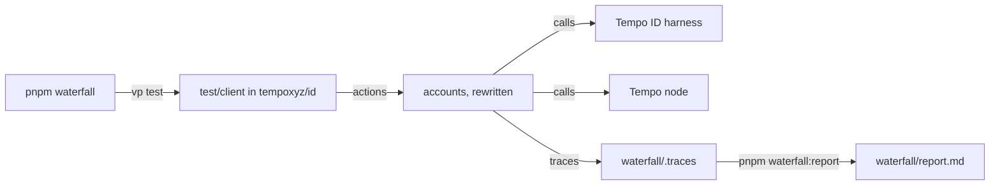
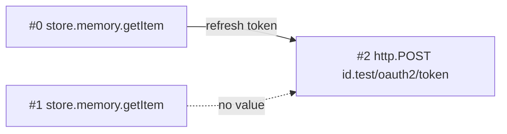

# Waterfall

The waterfall records every async call of each public action of the package, and reports the calls that a change can remove or run sooner. It covers each action of `Actions`, such as `Actions.refresh`, and each member of an instance from `Accounts.create`, such as `accounts.session.get`, with the calls of the actions inside them. Tempo ID's integration suite of the package, `test/client/` in `tempoxyz/id`, drives the actions against a real Tempo ID.

## Model

| Part                            | Role                                                                                         |
| ------------------------------- | -------------------------------------------------------------------------------------------- |
| `test/waterfall/Transform.ts`   | The Vite plugin that rewrites the package's modules as Vitest loads them                     |
| `test/waterfall/Recorder.ts`    | Records each call on the trace of its action, and writes the traces                          |
| `test/waterfall/vite.config.ts` | Tempo ID's suite config, with the plugin                                                     |
| `waterfall/.traces/`            | One JSON Lines file per test process, which `pnpm waterfall` empties first                   |
| `test/waterfall/Report.ts`      | Groups the traces, and derives the rounds and findings                                       |
| `scripts/waterfall.ts`          | Runs the suite, or writes `waterfall/report.md` and `waterfall/summary.json` with `--report` |



The published package holds no part of the waterfall. Only Vitest with the plugin rewrites the modules, and only `pnpm waterfall` adds the plugin. `vite.config.ts` adds it to this repository's own tests only when `ACCOUNTS_WATERFALL` is `true`.

## Recorded calls

The plugin rewrites each module of `src/` but its tests. Each rewrite keeps the module's lines.

| Call            | Hook                                                                                 | Label                                                          |
| --------------- | ------------------------------------------------------------------------------------ | -------------------------------------------------------------- |
| Action          | Each exported function of `src/actions/` and `src/internal/Actions.ts`               | `Actions.<namespace>.<name>`                                   |
| Instance member | The instance that `Accounts.create` returns, and its members to two levels           | `accounts.<path>`, such as `accounts.viem.signMessage`         |
| `fetch`         | Each `(auth.fetch ?? fetch)` call site, and the global `fetch` for Viem's transports | `chain.<method>` for JSON-RPC, or `http.<METHOD> <host><path>` |
| Store           | Each store of `src/stores/`, IndexedDB, and `Store.from`                             | `store.<kind>.<method>`, such as `store.memory.getItem`        |
| WebAuthn        | ox's `Authentication.sign` and `Registration.create`                                 | `webauthn.get` and `webauthn.create`                           |
| Popup           | `Popup.watchPopup`, from the watch until the callback or the close                   | `popup.callback`                                               |

A call of an action outside any trace opens a trace. A call inside another action's trace records on the outer trace, and its calls name the inner action in `within`. A call inside another recorded call records nothing more, such as a custom store over `Store.memory`, or an instance's `fetch` over the global one. A path segment that holds an identifier, such as an address, reads as `:id`.

Each call holds its start, duration, and position in the trace's sequence of opens and settles. A call that settles after its action did is a background call, such as a refresh beside a request. A call with the same label and arguments as an earlier call of the trace names that call in `same`. The arguments and results stay in the test process. A trace holds only labels, positions, and indexes.

## Dependencies

The recorder derives each call's `dependsOn` from the values that the calls pass on:

1. When a call opens, the recorder keeps the text of its arguments: the URL and its parts, the body, the headers, a store's key and value, and a ceremony's options. A JWT adds its header and payload, and a hex string the address in each ABI word.
2. When a call settles, the recorder collects the values of its result: a clone of a JSON or text response's body, its `DPoP-Nonce` and `Location` headers, a JSON-RPC result, or a store's value. The clone is taken before the caller receives the response, and read beside it.
3. A value is a string of 16 or more characters, or of 8 or more with a digit, such as an ID, an address, or a token. A status such as `pending` links nothing. A value that the call's own arguments hold is not a result.
4. A call depends on each earlier settled call whose result values its arguments hold. A transaction's submission, `chain.eth_send*`, also depends on each earlier chain call, since its fields encode them.
5. A store call depends on each earlier settled call to the same entry if either call writes it. A read after a write to its entry is no duplicate.

The write of a trace waits at most 1 second for the reads of its results, so a body that never ends does not hold it.



A call's **blocker** is the call that settled last before it opened. If the call depends on its blocker neither directly nor through another call, the report lists the pair as a sequential call without a dependency. This is the shape `await a(); await b()`, where `b` reads nothing of `a`. In the diagram, `#2` waits for `#1` without a dependency, so both can start after `#0`.

## Report

| Section                               | Lists                                                                                                                         |
| ------------------------------------- | ----------------------------------------------------------------------------------------------------------------------------- |
| Sequential calls without a dependency | Each pair of a call and the blocker that it does not depend on: reads first, cross-service first, then by count               |
| Duplicate calls                       | Each call with the same label and arguments as an earlier call of the trace, with no write between                            |
| Repeated calls                        | Each label that one trace calls three or more times with other arguments                                                      |
| Actions                               | Each action and outcome's calls, rounds, ideal rounds, duplicates, pairs without a dependency, and median duration            |
| Most frequent calls                   | Each label's calls across every trace                                                                                         |
| Waterfalls                            | Each call of the trace with the most rounds, with its round, blocker, and dependencies, for each action with 3 or more rounds |

A **round** is one step of the longest chain of calls where each call opens after the previous one settles. Calls in `Promise.all` share a round. **Ideal rounds** are the longest chain over `dependsOn` alone. Background calls count in no total. A JSON-RPC batch reads as each run of one method and its count, such as `chain.eth_call×16`.

A pair is a write if either call is a store's `setItem` or `removeItem`, a transaction, or an HTTP request other than `GET`. Writes come last, since a check often orders them by design. A pair whose calls use one service, such as one store or Tempo ID, is in the same lane.

> [!WARNING]
> A control dependency looks independent, such as a call that runs only when an earlier one found nothing, or a write after a check that refuses. A value that a call derives, such as a hash or a signature, also hides its source. Each pair is a lead, not a proof. Read the action's code before it runs in `Promise.all`.

## Commands

```sh
pnpm waterfall                                        # Tempo ID's test/client, with each action's calls recorded
pnpm waterfall test/client/Actions.test.ts            # one file of the suite
pnpm waterfall --local                                # this repository's own tests
pnpm waterfall:report                                 # waterfall/report.md and waterfall/summary.json
pnpm waterfall:report --base base.json --json head.json   # each action's change against a base summary
```

`pnpm waterfall` runs in the `accounts` submodule of `tempoxyz/id`, and finds Tempo ID's checkout in the parent folder. `TEMPO_ID_DIR` names another checkout. Tempo ID's suite needs Docker for its Postgres and Tempo node, and a login to `ghcr.io` for the Tempo API.

## Limitations

- The suite drives the actions, so an action's row holds the cases that its tests send, in their proportions.
- Durations come from the local harness. Compare rounds and calls, not milliseconds.
- The suite runs in Node, so it records no IndexedDB, popup, or browser WebAuthn call. Its passkey tests run the ceremony through `getFn`, which records as `webauthn.get`.
- The dialog's messages to its frame are not recorded.
- A fetch through a `Request` with a body records no body values.
- A server that runs in the test's process, such as an MPP endpoint's `fetch`, runs inside the action's async context, so its calls record on the action's trace.
- A dependency through a decision, such as a read whose result selects the next request's fields, links no value, so its pair lists as one without a dependency.
