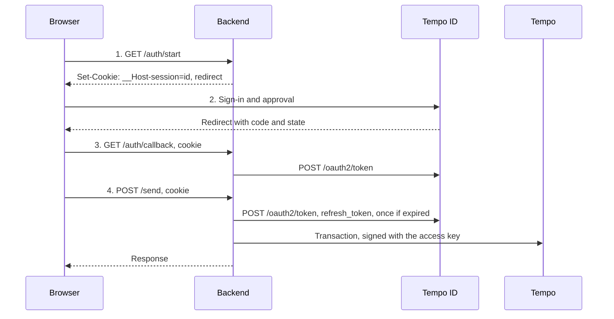

# Backends

## Overview

An app with a client secret or a [client assertion key](https://github.com/tempoxyz/id/blob/main/docs/apps.md#client-assertions) runs the sign-in on its server with the [`backend`](../api/plugins.backend.md) plugin. The plugin keeps the tokens and the access key on the server, and the browser holds only an opaque session ID in an `HttpOnly` cookie. No token reaches the browser, so an XSS on the app's pages cannot copy one.

```ts
import { Accounts, Store } from 'accounts'
import { backend, viem } from 'accounts/plugins'
import { Hono } from 'hono'
import { deleteCookie, getCookie, setCookie } from 'hono/cookie'
import { csrf } from 'hono/csrf'
import { Pool } from 'pg'
import { Expiry, Scopes } from 'viem/tempo'
import { tempo } from 'viem/tempo/chains'
import * as Tokens from 'viem/tokens'

const ousd = Tokens.ousd(tempo.id).address

// One instance for the process, so concurrent requests of a session share one refresh.
const tempoId = Accounts.create({
  // The app's access key may transfer up to 100 OUSD for 30 days.
  accessKey: () => ({
    expiry: Expiry.days(30),
    limits: [{ limit: 100_000_000n, token: ousd }],
    scopes: [Scopes.tip20(ousd).transfer()],
  }),
  clientId: process.env.CLIENT_ID!,
  clientSecret: process.env.CLIENT_SECRET!,
  plugins: [
    backend({
      store: Store.postgres(
        new Pool({ connectionString: process.env.DATABASE_URL }),
      ),
    }),
    viem(),
  ],
})
const cookie = {
  httpOnly: true,
  path: '/',
  prefix: 'host',
  sameSite: 'Lax',
  secure: true,
} as const

const app = new Hono()
  .use(csrf())
  // 1. Start: store the pending state, set the session ID, and leave for Tempo ID's pages.
  .get('/auth/start', async (c) => {
    const { id, url } = await tempoId.backend.start({
      redirectUri: new URL('/auth/callback', c.req.url).href,
    })
    setCookie(c, 'session', id, cookie)
    return c.redirect(url)
  })
  // 2. Tempo ID signs the user in, and redirects here with a code.
  // 3. Callback: redeem the code, and store the session under the same ID.
  .get('/auth/callback', async (c) => {
    const id = getCookie(c, 'session', 'host')
    if (!id) return c.redirect('/auth/start')
    await tempoId.backend.complete({ id, url: c.req.url })
    return c.redirect('/')
  })
  // 4. Later requests send with the session's access key.
  .post('/send', async (c) => {
    const id = getCookie(c, 'session', 'host')
    const session = id ? await tempoId.backend.get({ id }) : undefined
    if (!session) return c.redirect('/auth/start')
    const { receipt } = await tempoId.viem({ session }).token.transferSync({
      amount: 10_000n,
      to: '0x…',
      token: ousd,
    })
    return c.json({ hash: receipt.transactionHash })
  })
  // 5. Sign-out: revoke the refresh token, and delete the session.
  .post('/auth/logout', async (c) => {
    const id = getCookie(c, 'session', 'host')
    if (id) await tempoId.backend.end({ id })
    deleteCookie(c, 'session', cookie)
    return c.redirect('/')
  })
```

1. [`backend.start`](../api/plugins.backend.md#backendstart) builds the sign-in URL, and stores the pending state under a new session ID for 10 minutes: the new access key, the PKCE verifier, and the state.
2. Tempo ID signs the user in, shows the access key's limits for approval, and redirects to `redirectUri` with `code` and `state`.
3. [`backend.complete`](../api/plugins.backend.md#backendcomplete) checks `state`, redeems the code with the verifier and the client secret, and stores the tokens and the access key. It does not store the ID token.
4. [`backend.get`](../api/plugins.backend.md#backendget) returns the session, after a refresh if its access token expires within 30 seconds. Concurrent requests of the session share that refresh. [`tempoId.viem({ session })`](../api/plugins.viem.md#session-optional) returns a client whose account signs with that session's access key.
5. [`backend.end`](../api/plugins.backend.md#backendend) revokes the refresh token at `POST /oauth2/revoke`, then deletes the session.



> [!WARNING]
> Keep `store` on the server. Each value holds a refresh token, and an access key's private key.

> [!WARNING]
> Serve every request of a session from one instance. A reused refresh token fails with `invalid_grant`, and revokes every refresh token of the app for the user, on every device. Several processes or replicas that share a store need session affinity. On Cloudflare Workers, run sessions in a Durable Object, as [Run sessions in a Durable Object](#run-sessions-in-a-durable-object) describes.

> [!WARNING]
> Never sign with the default `tempoId.viem` client on a server. The instance holds no session, so its account throws `Accounts.SignedOutError`. Pass each request's `session` to `tempoId.viem({ session })`.

[`examples/backend`](../../examples/backend/worker.ts) runs this flow in a Worker, and [`playgrounds/backend`](../../playgrounds/backend/app.ts) runs it on Node and in a Durable Object.

> [!NOTE]
> Rate-limit `/auth/start`. Each request stores a pending sign-in for 10 minutes, so the store holds every sign-in that started in that time.

## Recipes

### Call a Tempo API

A Tempo API accepts the app's access tokens when it allowlists the app's client ID, as [API allowlists](https://github.com/tempoxyz/id/blob/main/docs/apps.md#api-allowlists) describes. The backend calls it with [`backend.fetch`](../api/plugins.backend.md#backendfetch). The API verifies each token with [`AccessToken.create`](../api/AccessToken.create.md), with no call to Tempo ID.

```ts
// In the backend, for the user of the request's session.
const response = await tempoId.backend.fetch({
  id,
  init: { body: JSON.stringify({ name: 'Rent' }), method: 'POST' },
  url: 'https://api.tempo.xyz/v1/recipients',
})

// In the API.
const verifier = AccessToken.create(Accounts.from({ clientId: 'tempo-api' }), {
  clientIds: ['tempo-cash', 'tempo-console'],
})
const token = await verifier.verify({
  accessToken: request.headers.get('authorization')!.slice('Bearer '.length),
})
// token.userId names the user, and the API decides what that user may do.
```

An access token proves the user to the API. An onchain transfer uses the access key instead. If an endpoint must refuse a revoked session at once, the API calls [`Actions.oauth.introspect`](../api/Actions.oauth.introspect.md). Otherwise a revoked session's token works until it expires, 5 minutes after its issue.

### Choose a store

`store` holds each session's refresh token and access key, and each redirect in progress. The package provides a store for Postgres, Redis, and memory, and [`Store.from`](../api/types.md#store) instantiates any other.

| Store                                        | Use                                                                 |
| -------------------------------------------- | ------------------------------------------------------------------- |
| [`Store.postgres`](../api/Store.postgres.md) | A Postgres database that the backend already uses                   |
| [`Store.redis`](../api/Store.redis.md)       | Redis 6.2 or later                                                  |
| [`Store.memory`](../api/Store.memory.md)     | One process in development or tests. A restart signs every user out |

Each one deletes an abandoned sign-in after its `expiresAt`. A store with eventual consistency, such as Workers KV, can return a refresh token that a refresh already rotated, so it does not suit sessions.

### Run sessions in a Durable Object

On Cloudflare Workers, each isolate holds its own instance, so two requests of one session can refresh at once. [`DurableObject.sessions`](../api/DurableObject.sessions.md) returns a class with one object for each session ID, which serves every request of that session. Its storage holds the session. The plugin takes the class's binding as `namespace`, so the Worker creates the instance in each request.

```ts
import { Accounts } from 'accounts'
import { DurableObject } from 'accounts/cloudflare'
import { backend } from 'accounts/plugins'

export const SESSIONS = DurableObject.sessions((env: Env) => ({
  clientSecret: env.CLIENT_SECRET,
}))

function create(env: Env) {
  return Accounts.create({
    clientId: env.CLIENT_ID,
    clientSecret: env.CLIENT_SECRET,
    plugins: [backend({ namespace: env.SESSIONS })],
  })
}
```

The Wrangler configuration binds `SESSIONS` with a `new_sqlite_classes` migration, as [`examples/backend`](../../examples/backend/wrangler.jsonc) does.

### Sign in without an access key

`accessKey: false` stores a session with the tokens and the user, without `key`.

```ts
const { id, url } = await tempoId.backend.start({
  accessKey: false,
  redirectUri: new URL('/auth/callback', c.req.url).href,
})
```

### Handle a denied request

`complete` throws an [`Accounts.RequestError`](../api/Accounts.RequestError.md) when the state does not match, or the user denied the request. It throws [`Accounts.PendingNotFoundError`](../api/errors.md#accountspendingnotfounderror) without a sign-in in progress for the session ID.

```ts
const session = await tempoId.backend
  .complete({ id, url: c.req.url })
  .catch((error: unknown) => error)
if (session instanceof Accounts.PendingNotFoundError)
  return c.redirect('/auth/start')
if (session instanceof Accounts.RequestError)
  return c.text(session.message, 400)
```

### Sign in from the app's own UI

An app with [backend sign-in](https://github.com/tempoxyz/id/blob/main/docs/backend-sign-in.md) skips Tempo ID's pages. Its UI, such as a native app's screen, sends the email and the code to the backend. The backend's instance with the [`email`](../api/plugins.email.md) plugin redeems the code with its client secret, and [`backend.save`](../api/plugins.backend.md#backendsave) stores the session.

```ts
import { backend, email } from 'accounts/plugins'

const tempoId = Accounts.create({
  accessKey: () => ({
    expiry: Expiry.days(30),
    limits: [{ limit: 100_000_000n, token: ousd }],
    scopes: [Scopes.tip20(ousd).transfer()],
  }),
  clientId: process.env.CLIENT_ID!,
  clientSecret: process.env.CLIENT_SECRET!,
  plugins: [email(), backend({ store })],
})

const app = new Hono()
  .post('/auth/code', async (c) => {
    const body = await c.req.json<{ email: string }>()
    const userIp = c.req.header('cf-connecting-ip')
    await tempoId.email.sendCode({ email: body.email, userIp })
    return c.json({ sent: true })
  })
  .post('/auth/verify', async (c) => {
    const body = await c.req.json<{ code: string; email: string }>()
    const userIp = c.req.header('cf-connecting-ip')
    const session = await tempoId.email.signIn({
      code: body.code,
      email: body.email,
      userIp,
    })
    const { id } = await tempoId.backend.save({ session })
    return c.json({ id, user: session.user })
  })
```

Forward the user's IP address as `userIp`, so rate limits count each user, not the backend. Protect the backend's own routes, such as with App Attest or Play Integrity, since Tempo ID trusts every request with the secret.

### Authenticate with a private key

An app that registers [public keys](https://github.com/tempoxyz/id/blob/main/docs/apps.md#client-assertions) holds a private key in place of a client secret. The instance signs a new client assertion for each request, so no value that the backend sends authenticates a second request.

```ts
import { Accounts } from 'accounts'
import { ClientAssertion } from 'accounts/internal'

const tempoId = Accounts.create({
  clientAssertion: ClientAssertion.fromPrivateKey({
    privateKey: JSON.parse(process.env.TEMPO_ID_PRIVATE_KEY!),
  }),
  clientId: process.env.CLIENT_ID!,
  plugins: [backend({ store })],
})
```

Every request that sends the client secret sends the assertion instead, such as the code's redemption and each refresh. [`ClientAssertion.sign`](../api/ClientAssertion.sign.md) signs one assertion for a request that no action sends.

### Keep the session in a sealed cookie

An app without server storage can seal the session into an encrypted `HttpOnly` cookie instead, with the low-level [`Actions.redirect.createUrl`](../api/Actions.redirect.createUrl.md) and [`Actions.redirect.handleCallback`](../api/Actions.redirect.handleCallback.md) and the instance's `config`. The library does not include `seal` and `unseal`. They encrypt a value into an `HttpOnly` cookie, such as with ox's `AesGcm`, and read it back, or return `undefined` when it is missing or altered.

The start seals `pending` for 10 minutes. The callback deletes it before it redeems the code, since a second redemption of one code revokes the tokens that the first one issued. It then seals the authorization without `accessKey` and `idToken`. [`AccessKey.toAccount`](../api/AccessKey.toAccount.md) rebuilds the access key from `key`.

```ts
import { Actions } from 'accounts/internal'
import type { Pending } from 'accounts/internal'

const { pending, url } = await Actions.redirect.createUrl(tempoId.config, {
  accessKey: {
    expiry: '30d',
    limits: [{ limit: '100', token: 'ousd' }],
  },
  redirectUri: new URL('/auth/callback', c.req.url).href,
})
await seal(c, 'oauth', pending, 10 * 60)

// In the callback.
const sealed = await unseal<Pending.Pending>(c, 'oauth')
deleteCookie(c, 'oauth', cookie)
if (!sealed) return c.redirect('/auth/start')
const authorization = await Actions.redirect
  .handleCallback(tempoId.config, { pending: sealed, url: c.req.url })
  .catch((error: unknown) => error)
if (authorization instanceof Accounts.RequestError)
  return c.redirect('/auth/start')
if (authorization instanceof Error) throw authorization
const { accessKey, idToken, ...session } = authorization
await seal(c, 'session', session)
```

> [!WARNING]
> Do not refresh a sealed session from concurrent requests. Two requests that carry the same cookie each send its refresh token, and the second revokes every refresh token of the app for the user.

### Receive a logout token

An app with a [back-channel logout URI](https://github.com/tempoxyz/id/blob/main/docs/authentication.md#back-channel-logout) receives a logout token when a session that signed the user in to it ends, such as a sign-out on another app. The backend verifies the token, ends its own sessions that the token names, and responds with 204.

```ts
import { Accounts } from 'accounts'
import { LogoutToken } from 'accounts/internal'
import { Hono } from 'hono'

const verifier = LogoutToken.create(
  Accounts.from({ clientId: process.env.CLIENT_ID! }),
)

const app = new Hono().post('/logout', async (c) => {
  const form = await c.req.formData()
  const token = await verifier
    .verify({ logoutToken: String(form.get('logout_token')) })
    .catch((error: unknown) => error)
  // An invalid token is refused. Unavailable keys respond with 503, so Tempo ID retries once.
  if (token instanceof LogoutToken.InvalidError) return c.body(null, 400)
  if (token instanceof Error) return c.body(null, 503)

  // The ID tokens of the session named it as `sid`.
  for (const id of await appSessions.idsByTempoIdSession(token.sessionId))
    await tempoId.backend.end({ id })
  return c.body(null, 204)
})
```

The sign-in requests `offline_access`, since only a session that issued the app a refresh token notifies it. For an app with a back-channel logout URI, each backend session holds `sid`, the Tempo ID session that the logout token names as `sessionId`. The plugin keeps no index by `sid`, so the app maps each `sid` to its own session IDs after `complete`, as `appSessions` does here, and calls `end` for each. [`LogoutToken.create`](../api/LogoutToken.create.md) lists the checks and errors.

## Learn more

- [Backend sign-in](https://github.com/tempoxyz/id/blob/main/docs/backend-sign-in.md)
- [`backend`](../api/plugins.backend.md)
- [`DurableObject.sessions`](../api/DurableObject.sessions.md)
- [Redirect sign-in](redirect.md)
- [Access tokens](https://github.com/tempoxyz/id/blob/main/docs/access-tokens.md)
