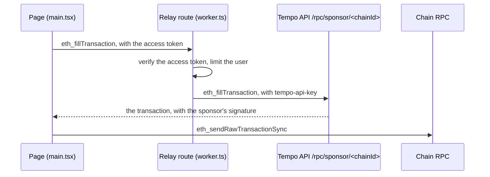

# sponsored-tempo-api

A page that signs in with Tempo ID in a dialog, and sends OUSD on Tempo testnet with the access key of the sign-in. The sponsor of the app's Tempo API key pays the fees, so the Tempo Account pays none. The app runs no fee payer account.

1. The page's `viem({ relay: '/api/relay' })` sends each fill to the route, with the session's access token. Every other request goes to the chain's RPC.
2. The `relay` plugin accepts only a valid access token of this app. Its `authorize` allows at most 10 requests a minute for each user.
3. The plugin, in the Tempo API mode, relays the request with the API key. The API key's own limits are a backstop, not the guard.
4. The page sends the signed transaction, and shows the receipt's `feePayer`.

## Run

1. Copy `.dev.vars.example` to `.dev.vars`, and set `TEMPO_API_KEY` to a Tempo API key with the `rpc-relay:sponsor` scope. Git ignores `.dev.vars`.
2. Run `pnpm dev`, and open `http://localhost:5193`.

To deploy, set the secret with `wrangler secret put TEMPO_API_KEY`, set `APP_URL` to the page's origin, and run `pnpm deploy`.

## Comparison with the self-hosted mode

| Mode                              | Fee payer                              | The app holds                          |
| --------------------------------- | -------------------------------------- | -------------------------------------- |
| Tempo API, `relay({ apiKey })`    | The sponsor of the app's Tempo API key | A Tempo API key                        |
| Self-hosted, `relay({ account })` | The app's own account                  | A private key, and the account's funds |

In both modes, the route verifies the access token of each request, and `authorize` limits each user. The Tempo API mode needs no funded account and no private key on the server.

## Limitations

- The route does not check that a fill's sender is a Tempo Account of the token's user. Any signed-in user of the app can request a sponsored fill for any sender, within the rate limit.
- The rate limit counts in each Cloudflare location, so it is approximate.
