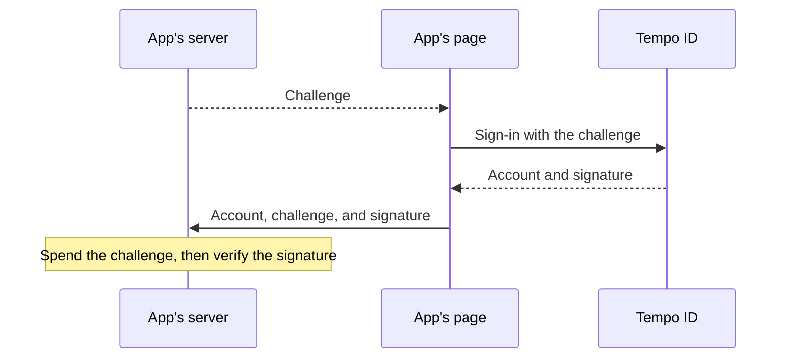

import { Cards } from 'vocs'
import { Demo } from '../../../../components/Demo.tsx'
import { PageCard } from '../../../../components/PageCard.tsx'
import { SourceLink } from '../../../../components/SourceLink.tsx'
import { StepTag } from '../../../../components/StepTag.tsx'

# Sign challenges [A Tempo Account signs a challenge of a server at sign-in, and the server verifies it.]

## Overview

A server that acts for an address, such as a credit to it, needs proof that the user controls it. The server issues a one-time challenge, the Tempo Account signs it at sign-in, and the server spends it and verifies the signature.

The demo signs a challenge of the site's server in Tempo ID's dialog. The server returns the proven address, then refuses the same proof.

<Demo name="SignChallenges" title="Sign a challenge" />

## Walkthrough

The steps build a React page and a Hono server.



::::steps

### Install the packages

:::code-group

```sh [npm]
npm install accounts hono react react-dom viem
```

```sh [pnpm]
pnpm add accounts hono react react-dom viem
```

```sh [bun]
bun add accounts hono react react-dom viem
```

:::

### Issue the challenge<StepTag kind="server" />

Issue a message, and keep it in a store until it expires. Tempo ID's dialog shows the message to the user before the signature.

- Name the app's host, so the signature serves no other server.
- Add a random value, so no two challenges are equal.
- Use plain text, with newlines. Tempo ID refuses control and format characters, such as a bidi override.

```ts [api.ts]
import { Store } from 'accounts'
import { Hono } from 'hono'

const app = new Hono()
const challenges = Store.memory()

app.post('/api/challenge', async (c) => {
  const { host } = new URL(c.req.url)
  const challenge = [
    `${host} asks for a proof of your Tempo Account.`,
    `Nonce: ${crypto.randomUUID()}`,
  ].join('\n')

  // The challenge lasts 5 minutes.
  const expiresAt = Date.now() + 5 * 60 * 1000
  await challenges.setItem(challenge, true, { expiresAt })
  return c.json({ challenge })
})

export default app
```

:::note

<SourceLink name="create" path="src/stores/Memory.ts">`Store.memory`</SourceLink> keeps the challenges in the process, so a restart loses them. In production, use a store that each replica shares, such as <SourceLink name="create" path="src/stores/Postgres.ts">`Store.postgres`</SourceLink> or <SourceLink name="create" path="src/stores/Redis.ts">`Store.redis`</SourceLink>. Both take a challenge in one atomic step, so servers that share one spend each challenge once.
:::

### Create the instance<StepTag kind="client" />

The page's origin is its client ID, so the app needs no registration.

```ts [tempo.config.ts]
import { Accounts } from 'accounts'

export const accounts = Accounts.create({ chain: 'testnet' })
```

### Sign in with the challenge<StepTag kind="client" />

Pass the challenge as <SourceLink name="signIn.method.challenge" path="src/plugins/dialog.ts">`challenge`</SourceLink> of <SourceLink name="signIn" path="src/plugins/dialog.ts">`dialog.signIn`</SourceLink>, with <SourceLink name="signIn.method.accessKey" path="src/plugins/dialog.ts">`accessKey`</SourceLink> set to false. Tempo ID's dialog shows it, and the account's owner signs its EIP-191 hash, as `personal_sign` does. With an access key, the key authorization signs it instead, as [Bind challenges](/docs/guides/access-keys/bind-challenges) describes.

The sign-ins of other plugins take a challenge too, such as <SourceLink name="signIn" path="src/plugins/redirect.ts">`redirect.signIn`</SourceLink> and <SourceLink name="signIn" path="src/plugins/device.ts">`device.signIn`</SourceLink>.

:::code-group

```tsx [App.tsx]
import { accounts } from './tempo.config.js'

export function App() {
  return (
    <button
      onClick={async () => {
        const issued = await fetch('/api/challenge', { method: 'POST' })
        const { challenge } = await issued.json()

        // [!code hl:start]
        const session = await accounts.dialog.signIn({
          accessKey: false,
          challenge,
        })
        // [!code hl:end]
      }}
      type="button"
    >
      Sign in with Tempo
    </button>
  )
}
```

```ts [tempo.config.ts]
import { Accounts } from 'accounts'

export const accounts = Accounts.create({ chain: 'testnet' })
```

:::

The session holds the account as <SourceLink name="Session.address" path="src/Session.ts">`address`</SourceLink>, and the signature as <SourceLink name="Session.challengeSignature" path="src/Session.ts">`challengeSignature`</SourceLink>.

### Send the proof<StepTag kind="client" />

Send the account, the challenge, and the signature to the server, with no token.

:::code-group

```tsx [App.tsx]
import { useState } from 'react' // [!code ++]
import { accounts } from './tempo.config.js'

export function App() {
  const [proven, setProven] = useState<string>() // [!code ++]

  if (proven) return <p>The server verified {proven}.</p> // [!code ++]

  return (
    <button
      onClick={async () => {
        const issued = await fetch('/api/challenge', { method: 'POST' })
        const { challenge } = await issued.json()

        const session = await accounts.dialog.signIn({
          accessKey: false,
          challenge,
        })
        const response = await fetch('/api/verify', { // [!code ++]
          body: JSON.stringify({ // [!code ++]
            address: session.address, // [!code ++]
            challenge, // [!code ++]
            signature: session.challengeSignature, // [!code ++]
          }), // [!code ++]
          headers: { 'content-type': 'application/json' }, // [!code ++]
          method: 'POST', // [!code ++]
        }) // [!code ++]
        const { address } = await response.json() // [!code ++]
        setProven(address) // [!code ++]
      }}
      type="button"
    >
      Sign in with Tempo
    </button>
  )
}
```

```ts [tempo.config.ts]
import { Accounts } from 'accounts'

export const accounts = Accounts.create({ chain: 'testnet' })
```

:::

### Spend the challenge<StepTag kind="server" />

The chain does not spend a challenge, so a copied signature verifies again. Take the challenge from the store with <SourceLink name="takeItem" path="src/Store.ts">`takeItem`</SourceLink> before the signature check, so the server refuses an unknown or spent challenge.

```ts [api.ts]
import { Store } from 'accounts'
import { Hono } from 'hono'
import { isAddress, isHex } from 'viem'

const app = new Hono()
const challenges = Store.memory()

app.post('/api/challenge', async (c) => {
  const { host } = new URL(c.req.url)
  const challenge = [
    `${host} asks for a proof of your Tempo Account.`,
    `Nonce: ${crypto.randomUUID()}`,
  ].join('\n')

  // The challenge lasts 5 minutes.
  const expiresAt = Date.now() + 5 * 60 * 1000
  await challenges.setItem(challenge, true, { expiresAt })
  return c.json({ challenge })
})

app.post('/api/verify', async (c) => {
  const { address, challenge, signature } = await c.req.json()
  if (
    !isAddress(address) ||
    typeof challenge !== 'string' ||
    !isHex(signature)
  )
    return c.json({ error: 'invalid_request' }, 400)

  // `takeItem` reads and deletes in one step, so one request spends it.
  // [!code hl:start]
  if (!(await challenges.takeItem?.(challenge)))
    return c.json({ error: 'invalid_challenge' }, 400)
  // [!code hl:end]

  return c.json({})
})

export default app
```

### Verify the signature<StepTag kind="server" />

Viem's `verifyMessage` counts the account owner's signature on the instance's chain, and refuses an access key's.

```ts [api.ts]
import { Store } from 'accounts'
import { Hono } from 'hono'
import { isAddress, isHex } from 'viem' // [!code --]
import { createClient, http, isAddress, isHex } from 'viem' // [!code ++]
import { verifyMessage } from 'viem/actions' // [!code ++]
import { tempoTestnet } from 'viem/chains' // [!code ++]

const app = new Hono()
const challenges = Store.memory()
const client = createClient({ chain: tempoTestnet, transport: http() }) // [!code ++]

app.post('/api/challenge', async (c) => {
  const { host } = new URL(c.req.url)
  const challenge = [
    `${host} asks for a proof of your Tempo Account.`,
    `Nonce: ${crypto.randomUUID()}`,
  ].join('\n')

  // The challenge lasts 5 minutes.
  const expiresAt = Date.now() + 5 * 60 * 1000
  await challenges.setItem(challenge, true, { expiresAt })
  return c.json({ challenge })
})


app.post('/api/verify', async (c) => {
  const { address, challenge, signature } = await c.req.json()
  if (
    !isAddress(address) ||
    typeof challenge !== 'string' ||
    !isHex(signature)
  )
    return c.json({ error: 'invalid_request' }, 400)

  // `takeItem` reads and deletes in one step, so one request spends it.
  if (!(await challenges.takeItem?.(challenge)))
    return c.json({ error: 'invalid_challenge' }, 400)

  const valid = await verifyMessage(client, { // [!code ++]
    address, // [!code ++]
    message: challenge, // [!code ++]
    signature, // [!code ++]
  }) // [!code ++]
  if (!valid) return c.json({ error: 'invalid_signature' }, 400) // [!code ++]

  // The user controls `address`. // [!code ++]
  return c.json({ address }) // [!code ++]
})

export default app
```

::::

## Use cases

Each use case sets the <SourceLink name="signIn.method.challenge" path="src/plugins/dialog.ts">`challenge`</SourceLink> of <SourceLink name="signIn" path="src/plugins/dialog.ts">`dialog.signIn`</SourceLink> in another form, or beside another option.

### Fetch the challenge in the dialog

A function as <SourceLink name="signIn.method.challenge" path="src/plugins/dialog.ts">`challenge`</SourceLink> returns the challenge after the dialog opens. The call then comes before any `await` of the click handler, as the dialog's popup fallback needs. Its signal aborts once the call ends.

:::code-group

```tsx [App.tsx]
import { accounts } from './tempo.config.js'

export function App() {
  async function signIn() {
    let challenge = ''
    const session = await accounts.dialog.signIn({
      accessKey: false,
      // [!code hl:start]
      challenge: async (signal) => {
        const issued = await fetch('/api/challenge', { method: 'POST', signal })
        challenge = ((await issued.json()) as { challenge: string }).challenge
        return challenge
      },
      // [!code hl:end]
    })
    await fetch('/api/verify', {
      body: JSON.stringify({
        address: session.address,
        challenge,
        signature: session.challengeSignature,
      }),
      headers: { 'content-type': 'application/json' },
      method: 'POST',
    })
  }

  return (
    <button onClick={() => void signIn()} type="button">
      Sign in with Tempo
    </button>
  )
}
```

```ts [tempo.config.ts]
import { Accounts } from 'accounts'

export const accounts = Accounts.create({ chain: 'testnet' })
```

:::

### Bind the challenge to an access key

With an <SourceLink name="signIn.method.accessKey" path="src/plugins/dialog.ts">`accessKey`</SourceLink> request, the key authorization of the access key binds the challenge, and <SourceLink name="Session.challengeSignature" path="src/Session.ts">`challengeSignature`</SourceLink> is its signature. Viem's `verifyMessage` refuses such a signature, so the server verifies it as [Bind challenges](/docs/guides/access-keys/bind-challenges) shows.

:::code-group

```tsx [App.tsx]
import { accounts } from './tempo.config.js'

export function App() {
  return (
    <button
      onClick={() =>
        accounts.dialog.signIn({
          // [!code hl:start]
          accessKey: {
            expiry: '1d',
            limits: [{ limit: '100', token: 'ousd' }],
          },
          // [!code hl:end]
          challenge: async (signal) => {
            const issued = await fetch('/api/challenge', {
              method: 'POST',
              signal,
            })
            return ((await issued.json()) as { challenge: string }).challenge
          },
        })
      }
      type="button"
    >
      Sign in with Tempo
    </button>
  )
}
```

```ts [tempo.config.ts]
import { Accounts } from 'accounts'

export const accounts = Accounts.create({ chain: 'testnet' })
```

:::

## Next steps

<Cards>
  <PageCard
    description="Verify a message that the access key signs, with no prompt."
    icon="signed-file"
    title="Verify signed messages"
    to="/docs/guides/account-proof/verify-signed-messages"
  />
  <PageCard
    description="Bind a challenge to the access key of a sign-in."
    icon="key"
    title="Bind challenges"
    to="/docs/guides/access-keys/bind-challenges"
  />
  <PageCard
    description="Sign in to a backend with a signed message."
    icon="ethereum"
    title="Sign-In With Ethereum"
    to="/docs/guides/siwe"
  />
  <PageCard
    description="Verify the access token of each request to an API."
    icon="shield-check"
    title="Authenticate requests"
    to="/docs/guides/api-authentication/authenticate-requests"
  />
</Cards>
