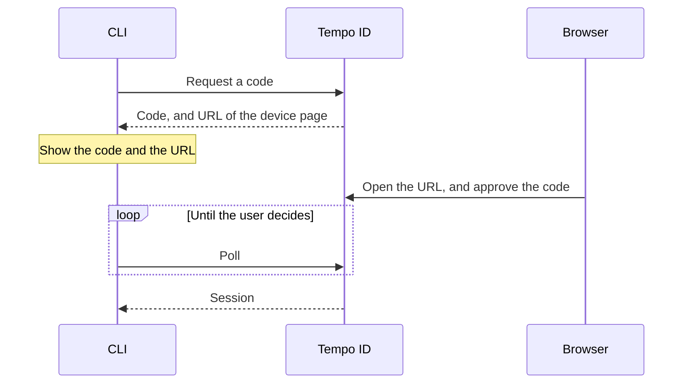

import { Cards } from 'vocs'
import { PageCard } from '../../../components/PageCard.tsx'
import { SourceLink } from '../../../components/SourceLink.tsx'

# CLI [A CLI signs a user in with a code that the user approves in a browser.]

## Overview

A CLI has no page for Tempo ID to redirect back to, and the package supports no loopback redirect.

A CLI thus signs in with the [device grant](https://github.com/tempoxyz/id/blob/main/docs/device-grant.md) (RFC 8628): the user approves the CLI's code on Tempo ID's device page, in a browser on any device, and the CLI receives the [session](/docs/guides/user-session).

Choose this flow over the other sign-in flows for a terminal program, or another client without a browser. It is the only flow of a `cli:` client ID, which needs no registration.



No demo runs in this page, since the client is a terminal program. The program below signs a user in and saves the session. The output is of one run against `id.tempo.xyz`.

:::code-group

```console [Terminal]
$ node --import tsx index.ts whoami
Not signed in. Run `login`.
$ node --import tsx index.ts login
Open https://id.tempo.xyz/device?code=ZZVF-JWQT and confirm the code ZZVF-JWQT.
Signed in as alice@example.com.
$ node --import tsx index.ts whoami
alice@example.com 0xB93163e0dbC07Ee5744Fb519907ed922d0F1Cc1C
```

```ts [index.ts]
import { accounts } from './tempo.config.js'

const [command] = process.argv.slice(2)
const session = await accounts.session.get()

if (command === 'login') {
  const { user } = await accounts.device.signIn()
  console.log(`Signed in as ${user.email}.`)
} else if (!session?.accessKey) {
  console.log('Not signed in. Run `login`.')
} else if (command === 'whoami') {
  console.log(`${session.user.email} ${session.accessKey.account}`)
}
```

```ts [tempo.config.ts]
import { Accounts } from 'accounts'
import { device } from 'accounts/plugins'

export const accounts = Accounts.create({
  // Each sign-in requests an access key that sends up to 100 OUSD for 7 days.
  accessKey: () => ({
    expiry: '7d',
    limits: [{ limit: '100', token: 'ousd' }],
  }),
  chain: 'testnet',
  clientId: 'cli:acme-example',
  plugins: [
    device({
      onCode: (code) =>
        console.log(
          `Open ${code.verificationUriComplete} and confirm the code ${code.userCode}.`,
        ),
    }),
  ],
})
```

:::

The [`cli`](https://github.com/tempoxyz/accounts/tree/main/examples/cli) example is this program, with `send` and `logout` commands.

## Walkthrough

The CLI tab of [Getting started](/#walkthrough) installs the packages. These steps build the [`cli`](https://github.com/tempoxyz/accounts/tree/main/examples/cli) example's sign-in.

::::steps

### Create the instance

The <SourceLink name="device" path="src/plugins/device.ts">`device`</SourceLink> plugin adds the device grant.

```ts [tempo.config.ts]
import { Accounts } from 'accounts'
import { device } from 'accounts/plugins'

export const accounts = Accounts.create({
  // Each sign-in requests an access key that sends up to 100 OUSD for 7 days.
  accessKey: () => ({
    expiry: '7d',
    limits: [{ limit: '100', token: 'ousd' }],
  }),
  chain: 'testnet',
  clientId: 'cli:acme-example',
  plugins: [device()],
})
```

For a local Tempo ID or another chain, [Use another Tempo ID or chain](/docs/guides/viem#use-another-tempo-id-or-chain) sets the instance.

The client ID is `cli:` and the CLI's name: 3 to 32 lowercase letters, digits, or `-`, which start with a letter and hold no `tempo`. Tempo ID's device page marks such an [unregistered CLI](https://github.com/tempoxyz/id/blob/main/docs/apps.md#unregistered-clis) as unverified. If its [access key](/docs/guides/access-keys) names no <SourceLink name="limits" path="src/Permissions.ts">`limits`</SourceLink>, Tempo ID refuses the code request with `missing_permissions`.

### Request a code

<SourceLink name="signIn" path="src/plugins/device.ts">`device.signIn`</SourceLink> passes the code to <SourceLink name="onCode" path="src/plugins/device.ts">`onCode`</SourceLink> before it waits. Print the code and the device page's URL. Without <SourceLink name="onCode" path="src/plugins/device.ts">`onCode`</SourceLink>, <SourceLink name="signIn" path="src/plugins/device.ts">`device.signIn`</SourceLink> throws.

```ts [tempo.config.ts]
import { Accounts } from 'accounts'
import { device } from 'accounts/plugins'

export const accounts = Accounts.create({
  // Each sign-in requests an access key that sends up to 100 OUSD for 7 days.
  accessKey: () => ({
    expiry: '7d',
    limits: [{ limit: '100', token: 'ousd' }],
  }),
  chain: 'testnet',
  clientId: 'cli:acme-example',
  plugins: [device()], // [!code --]
  plugins: [ // [!code ++]
    device({ // [!code ++]
      onCode: (code) => // [!code ++]
        console.log( // [!code ++]
          `Open ${code.verificationUriComplete} and confirm the code ${code.userCode}.`, // [!code ++]
        ), // [!code ++]
    }), // [!code ++]
  ], // [!code ++]
})
```

| Property                                                                                                       | Value                                                |
| -------------------------------------------------------------------------------------------------------------- | ---------------------------------------------------- |
| <SourceLink name="expiresIn" path="src/plugins/device.ts">`expiresIn`</SourceLink>                             | Seconds until the code expires, such as `600`        |
| <SourceLink name="userCode" path="src/plugins/device.ts">`userCode`</SourceLink>                               | Code that the user confirms, such as `ZZVF-JWQT`     |
| <SourceLink name="verificationUri" path="src/plugins/device.ts">`verificationUri`</SourceLink>                 | URL of the device page, where the user enters a code |
| <SourceLink name="verificationUriComplete" path="src/plugins/device.ts">`verificationUriComplete`</SourceLink> | URL of the device page, with the code filled in      |

The device page shows the code, the CLI's name, the access key's limits, and the request's device, place, and age. The user thus recognizes a code that another person started.

### Wait for the approval

<SourceLink name="signIn" path="src/plugins/device.ts">`device.signIn`</SourceLink> polls until the user decides, and returns the session.

:::code-group

```ts [index.ts]
import { accounts } from './tempo.config.js'

const { user } = await accounts.device.signIn() // [!code hl]
console.log(`Signed in as ${user.email}.`)
```

```ts [tempo.config.ts]
import { Accounts } from 'accounts'
import { device } from 'accounts/plugins'

export const accounts = Accounts.create({
  // Each sign-in requests an access key that sends up to 100 OUSD for 7 days.
  accessKey: () => ({
    expiry: '7d',
    limits: [{ limit: '100', token: 'ousd' }],
  }),
  chain: 'testnet',
  clientId: 'cli:acme-example',
  plugins: [
    device({
      onCode: (code) =>
        console.log(
          `Open ${code.verificationUriComplete} and confirm the code ${code.userCode}.`,
        ),
    }),
  ],
})
```

:::

If the user denies the code, or the code expires, <SourceLink name="signIn" path="src/plugins/device.ts">`device.signIn`</SourceLink> throws <SourceLink name="RequestError" path="src/Accounts.ts">`Accounts.RequestError`</SourceLink>. Its <SourceLink name="RequestError.code" path="src/Accounts.ts">`code`</SourceLink> names the fault, and [Errors](/docs/guides/errors) lists the others.

| <SourceLink name="RequestError.code" path="src/Accounts.ts">`code`</SourceLink> | <SourceLink name="RequestError.message" path="src/Accounts.ts">`message`</SourceLink> |
| ------------------------------------------------------------------------------- | ------------------------------------------------------------------------------------- |
| `access_denied`                                                                 | The user denied the request.                                                          |
| `expired_token`                                                                 | Device code expired. Request a new code.                                              |

### Read the saved session

With a `cli:` client ID and no <SourceLink name="create.store" path="src/Accounts.ts">`store`</SourceLink> option, the instance saves its session to `~/.tempo/id/store.json`. Every CLI of the user shares the file, with one session for each client ID and chain.

Only the user can read the file and its folder, since the file holds a refresh token and the access key's private key.

A command that sends with the access key, such as the example's `send`, awaits <SourceLink name="session.get" path="src/Accounts.ts">`session.get()`</SourceLink> first. A transfer before the read throws <SourceLink name="SignedOutError" path="src/Accounts.ts">`Accounts.SignedOutError`</SourceLink>. The <SourceLink name="viem" path="src/plugins/viem.ts">`viem`</SourceLink> plugin adds the token actions, as [Send with Viem's token actions](/docs/guides/payments/self-managed#send-with-viems-token-actions) shows.

:::code-group

```ts [index.ts]
import { accounts } from './tempo.config.js'

const session = await accounts.session.get() // [!code hl]

if (session?.accessKey)
  console.log(`${session.user.email} ${session.accessKey.account}`)
else console.log('Not signed in. Run `login`.')
```

```ts [tempo.config.ts]
import { Accounts } from 'accounts'
import { device } from 'accounts/plugins'

export const accounts = Accounts.create({
  // Each sign-in requests an access key that sends up to 100 OUSD for 7 days.
  accessKey: () => ({
    expiry: '7d',
    limits: [{ limit: '100', token: 'ousd' }],
  }),
  chain: 'testnet',
  clientId: 'cli:acme-example',
  plugins: [
    device({
      onCode: (code) =>
        console.log(
          `Open ${code.verificationUriComplete} and confirm the code ${code.userCode}.`,
        ),
    }),
  ],
})
```

:::

:::tip
To keep the session in another file, set <SourceLink name="create.store" path="src/Accounts.ts">`store`</SourceLink> to <SourceLink name="create" path="src/stores/File.ts">`Store.file`</SourceLink> with its path. If `TEMPO_HOME` is set, the default file is `id/store.json` in that folder. A service that signs in many users with a `cli:` client ID sets <SourceLink name="create.store" path="src/Accounts.ts">`store`</SourceLink> to `false`, so it keeps no session and writes no file.
:::

::::

## Use cases

Each use case sets one option of <SourceLink name="signIn" path="src/plugins/device.ts">`device.signIn`</SourceLink>, or uses an action of the <SourceLink name="device" path="src/plugins/device.ts">`device`</SourceLink> plugin.

### Request another access key

<SourceLink name="signIn.accessKey" path="src/plugins/device.ts">`accessKey`</SourceLink> names the [access key](/docs/guides/access-keys) of one sign-in, in place of the instance's <SourceLink name="create.accessKey" path="src/Accounts.ts">`accessKey`</SourceLink>. The device page shows its limits for approval.

:::code-group

```ts [index.ts]
import { accounts } from './tempo.config.js'

const { user } = await accounts.device.signIn({
  // [!code hl:start]
  // The access key sends up to 500 OUSD for a day.
  accessKey: {
    expiry: '1d',
    limits: [{ limit: '500', token: 'ousd' }],
  },
  // [!code hl:end]
})
console.log(`Signed in as ${user.email}.`)
```

```ts [tempo.config.ts]
import { Accounts } from 'accounts'
import { device } from 'accounts/plugins'

export const accounts = Accounts.create({
  // Each sign-in requests an access key that sends up to 100 OUSD for 7 days.
  accessKey: () => ({
    expiry: '7d',
    limits: [{ limit: '100', token: 'ousd' }],
  }),
  chain: 'testnet',
  clientId: 'cli:acme-example',
  plugins: [
    device({
      onCode: (code) =>
        console.log(
          `Open ${code.verificationUriComplete} and confirm the code ${code.userCode}.`,
        ),
    }),
  ],
})
```

:::

### Stop waiting for the approval

<SourceLink name="signIn.signal" path="src/plugins/device.ts">`signal`</SourceLink> stops the polls, such as at a timeout or at Ctrl+C. The sign-in then rejects with the signal's reason. If a poll in flight returns an approval, the sign-in still signs the user in.

:::code-group

```ts [index.ts]
import { accounts } from './tempo.config.js'

const controller = new AbortController()
const cancel = () => controller.abort(new Error('Cancelled.'))
process.once('SIGINT', cancel)

try {
  const { user } = await accounts.device.signIn({
    // [!code hl:start]
    // Stops the polls after 2 minutes, or at Ctrl+C.
    signal: AbortSignal.any([controller.signal, AbortSignal.timeout(120_000)]),
    // [!code hl:end]
  })
  console.log(`Signed in as ${user.email}.`)
} finally {
  // Ctrl+C ends the process again once the sign-in settles.
  process.off('SIGINT', cancel)
}
```

```ts [tempo.config.ts]
import { Accounts } from 'accounts'
import { device } from 'accounts/plugins'

export const accounts = Accounts.create({
  // Each sign-in requests an access key that sends up to 100 OUSD for 7 days.
  accessKey: () => ({
    expiry: '7d',
    limits: [{ limit: '100', token: 'ousd' }],
  }),
  chain: 'testnet',
  clientId: 'cli:acme-example',
  plugins: [
    device({
      onCode: (code) =>
        console.log(
          `Open ${code.verificationUriComplete} and confirm the code ${code.userCode}.`,
        ),
    }),
  ],
})
```

:::

### Bind a challenge

<SourceLink name="signIn.challenge" path="src/plugins/device.ts">`challenge`</SourceLink> has the user sign a server's message on the device page. The session's <SourceLink name="challengeSignature" path="src/Session.ts">`challengeSignature`</SourceLink> holds the signature, which the server checks, as [Sign challenges](/docs/guides/account-proof/sign-challenges) shows.

:::code-group

```ts [index.ts]
import { accounts } from './tempo.config.js'

// The server issues the message to sign.
const response = await fetch('https://api.example.com/challenge', {
  method: 'POST',
})
const session = await accounts.device.signIn({
  challenge: await response.text(), // [!code hl]
})
await fetch('https://api.example.com/verify', {
  body: JSON.stringify({
    address: session.address,
    signature: session.challengeSignature,
  }),
  headers: { 'content-type': 'application/json' },
  method: 'POST',
})
```

```ts [tempo.config.ts]
import { Accounts } from 'accounts'
import { device } from 'accounts/plugins'

export const accounts = Accounts.create({
  // Each sign-in requests an access key that sends up to 100 OUSD for 7 days.
  accessKey: () => ({
    expiry: '7d',
    limits: [{ limit: '100', token: 'ousd' }],
  }),
  chain: 'testnet',
  clientId: 'cli:acme-example',
  plugins: [
    device({
      onCode: (code) =>
        console.log(
          `Open ${code.verificationUriComplete} and confirm the code ${code.userCode}.`,
        ),
    }),
  ],
})
```

:::

### Ask for funds

<SourceLink name="signIn.funding" path="src/plugins/device.ts">`funding`</SourceLink> names the amount that the CLI needs in the user's Tempo Account. If the account holds less, the device page opens Tempo ID's deposit page after the approval.

:::code-group

```ts [index.ts]
import { accounts } from './tempo.config.js'

const { user } = await accounts.device.signIn({
  funding: { amount: '10', currency: 'USD' }, // [!code hl]
})
console.log(`Signed in as ${user.email}.`)
```

```ts [tempo.config.ts]
import { Accounts } from 'accounts'
import { device } from 'accounts/plugins'

export const accounts = Accounts.create({
  // Each sign-in requests an access key that sends up to 100 OUSD for 7 days.
  accessKey: () => ({
    expiry: '7d',
    limits: [{ limit: '100', token: 'ousd' }],
  }),
  chain: 'testnet',
  clientId: 'cli:acme-example',
  plugins: [
    device({
      onCode: (code) =>
        console.log(
          `Open ${code.verificationUriComplete} and confirm the code ${code.userCode}.`,
        ),
    }),
  ],
})
```

:::

### Continue as a guest

With <SourceLink name="Config.guest" path="src/Accounts.ts">`guest: 'offer'`</SourceLink>, the device page offers Continue as guest. If the user selects it, `device.signIn` resolves with a guest session, whose key pair the instance keeps in its store, such as <SourceLink name="create" path="src/stores/File.ts">`Store.file`</SourceLink>. The guest session pays with `pay`, sends with Viem, and pays MPP charges, with no page. A short guest account receives the faucet's funds on a test chain, and a funding code through `onCode` on another chain. See [Guest checkout](/docs/guides/guest-checkout#pay-from-a-cli).

```ts [index.ts]
import { Session } from 'accounts'
import { accounts } from './tempo.config.js'

const session = await accounts.device.signIn()
// [!code hl:start]
if (Session.guest(session)) console.log(`Signed in as guest ${session.address}.`)
else console.log(`Signed in as ${session.user.email}.`)
// [!code hl:end]
```

### Sign in for an API

<SourceLink name="signIn.resource" path="src/plugins/device.ts">`resource`</SourceLink> names a [registered resource](https://github.com/tempoxyz/id/blob/main/docs/resources.md), such as an MCP server. Each access token then names it as its audience, so only that API accepts the token.

:::code-group

```ts [index.ts]
import { accounts } from './tempo.config.js'

const { user } = await accounts.device.signIn({
  resource: 'https://mcp.example.com/mcp', // [!code hl]
})
console.log(`Signed in as ${user.email}.`)
```

```ts [tempo.config.ts]
import { Accounts } from 'accounts'
import { device } from 'accounts/plugins'

export const accounts = Accounts.create({
  // Each sign-in requests an access key that sends up to 100 OUSD for 7 days.
  accessKey: () => ({
    expiry: '7d',
    limits: [{ limit: '100', token: 'ousd' }],
  }),
  chain: 'testnet',
  clientId: 'cli:acme-example',
  plugins: [
    device({
      onCode: (code) =>
        console.log(
          `Open ${code.verificationUriComplete} and confirm the code ${code.userCode}.`,
        ),
    }),
  ],
})
```

:::

### Request an API's scopes

An API can define [scopes of its own](https://github.com/tempoxyz/id/blob/main/docs/resources.md#resource-scopes), such as the Tempo API's `data:read`. <SourceLink name="signIn.scope" path="src/plugins/device.ts">`scope`</SourceLink> requests them beside `resource`, in addition to the instance's `scope`, for an app that an admin linked to the API's scopes. The device page lists them, the user can uncheck any, and the tokens carry those the user kept. A scope that the API does not define, or that the app may not request, fails with `invalid_scope`.

:::code-group

```ts [index.ts]
import { accounts } from './tempo.config.js'

const { user } = await accounts.device.signIn({
  resource: 'https://api.tempo.xyz',
  scope: 'data:read routes:read', // [!code hl]
})
console.log(`Signed in as ${user.email}.`)
```

```ts [tempo.config.ts]
import { Accounts } from 'accounts'
import { device } from 'accounts/plugins'

export const accounts = Accounts.create({
  chain: 'testnet',
  // A registered app that a Tempo ID admin linked to the API's scopes.
  clientId: 'acme-cli',
  plugins: [
    device({
      onCode: (code) =>
        console.log(
          `Open ${code.verificationUriComplete} and confirm the code ${code.userCode}.`,
        ),
    }),
  ],
})
```

:::

### Sign in without a wallet

With <SourceLink name="Config.account" path="src/Accounts.ts">`account: false`</SourceLink>, the device grant requests no access key, and the session holds only the user and the tokens. Tempo ID creates no Tempo Account for an app whose [first account](https://github.com/tempoxyz/id/blob/main/docs/realms.md#apps-without-a-first-account) is `none`. With `accessKey: false`, the user receives a Tempo Account, and no access key.

:::code-group

```ts [index.ts]
import { accounts } from './tempo.config.js'

const { user } = await accounts.device.signIn()
console.log(`Signed in as ${user.email}.`)
```

```ts [tempo.config.ts]
import { Accounts } from 'accounts'
import { device } from 'accounts/plugins'

export const accounts = Accounts.create({
  account: false, // [!code hl]
  chain: 'testnet',
  clientId: 'cli:acme-example',
  plugins: [
    device({
      onCode: (code) =>
        console.log(
          `Open ${code.verificationUriComplete} and confirm the code ${code.userCode}.`,
        ),
    }),
  ],
})
```

:::

### Send above the limit or the balance

With the <SourceLink name="viem" path="src/plugins/viem.ts">`viem`</SourceLink> plugin, a transfer above the limit of the access key, or above the balance, starts a new device grant. <SourceLink name="onCode" path="src/plugins/device.ts">`onCode`</SourceLink> shows its code. After the approval, the transfer sends again.

| Refusal     | The grant requests                                                                         |
| ----------- | ------------------------------------------------------------------------------------------ |
| Spent limit | A new access key with a higher limit of the token                                          |
| Low balance | A new access key with the same limits, and a deposit on Tempo ID's page after the approval |

After a deposit grant, the transfer waits up to 10 minutes for the deposit. If the user denies the code, or no deposit arrives, the transfer rejects with <SourceLink name="RetryClosedError" path="src/plugins/viem.ts">`Plugins.viem.RetryClosedError`</SourceLink>. If the session holds another user or Tempo Account after the approval, the transfer rejects with <SourceLink name="RetryAccountError" path="src/plugins/viem.ts">`Plugins.viem.RetryAccountError`</SourceLink>.

:::code-group

```ts [index.ts]
import { parseUnits } from 'viem'
import { Addresses } from 'viem/tempo'
import { accounts } from './tempo.config.js'

// A transfer before the read of the session throws `Accounts.SignedOutError`.
await accounts.session.get()

try {
  await accounts.token.transferSync({
    amount: parseUnits('150', 6),
    to: '0x000000000000000000000000000000000000dEaD',
    token: Addresses.ousd,
  })
} catch (error) {
  if ((error as Error).name !== 'Plugins.viem.RetryClosedError') throw error // [!code hl]
  console.error('Approve the code to send the transfer.')
  process.exitCode = 1
}
```

```ts [tempo.config.ts]
import { Accounts } from 'accounts'
import { device, viem } from 'accounts/plugins'

export const accounts = Accounts.create({
  // Each sign-in requests an access key that sends up to 100 OUSD for 7 days.
  accessKey: () => ({
    expiry: '7d',
    limits: [{ limit: '100', token: 'ousd' }],
  }),
  chain: 'testnet',
  clientId: 'cli:acme-example',
  plugins: [
    device({
      onCode: (code) =>
        console.log(
          `Open ${code.verificationUriComplete} and confirm the code ${code.userCode}.`,
        ),
    }),
    viem(),
  ],
})
```

:::

### Poll across requests

A server cannot hold one request open until the user approves. <SourceLink name="authorize" path="src/plugins/device.ts">`device.authorize`</SourceLink> starts the grant in one request, and <SourceLink name="poll" path="src/plugins/device.ts">`device.poll`</SourceLink> sends one poll in each later request.

Neither call sets a session. <SourceLink name="poll" path="src/plugins/device.ts">`poll`</SourceLink> names the access key of <SourceLink name="authorize" path="src/plugins/device.ts">`authorize`</SourceLink> again, so the server generates the access key, and keeps its private key with the device code until the code expires.

:::note

<SourceLink name="create" path="src/stores/Memory.ts">`Store.memory`</SourceLink> keeps the grants in the process, so a restart loses them. In production, use a store that each replica shares, such as <SourceLink name="create" path="src/stores/Postgres.ts">`Store.postgres`</SourceLink> or <SourceLink name="create" path="src/stores/Redis.ts">`Store.redis`</SourceLink>.
:::

:::code-group

```ts [server.ts]
import { Store } from 'accounts'
import { Hono } from 'hono'
import { generatePrivateKey } from 'viem/accounts'
import { Account } from 'viem/tempo'
import { accounts } from './tempo.config.js'

/** What the server keeps of a grant until a poll redeems it. */
type Grant = { deviceCode: string; privateKey: `0x${string}` }

const grants = Store.memory()

export default new Hono()
  // The first request starts the grant, with an access key that the server holds.
  .post('/login', async (c) => {
    const privateKey = generatePrivateKey()
    const grant = await accounts.device.authorize({ // [!code hl]
      accessKey: {
        account: Account.fromSecp256k1(privateKey),
        expiry: '1d',
        limits: [{ limit: '10', token: 'ousd' }],
      },
    })
    const id = crypto.randomUUID()
    await grants.setItem(
      id,
      { deviceCode: grant.deviceCode, privateKey },
      { expiresAt: Date.now() + grant.expiresIn * 1000 },
    )

    return c.json({
      id,
      interval: grant.interval,
      userCode: grant.userCode,
      verificationUriComplete: grant.verificationUriComplete,
    })
  })
  // Each later request sends one poll.
  .get('/login/:id', async (c) => {
    const id = c.req.param('id')
    const grant = (await grants.getItem(id)) as Grant | undefined
    if (!grant) return c.json({ error: 'not_found' }, 404)

    const result = await accounts.device.poll({ // [!code hl]
      accessKey: { account: Account.fromSecp256k1(grant.privateKey) },
      deviceCode: grant.deviceCode,
    })
    if (result.status === 'pending') return c.json(result)

    await grants.removeItem(id)
    const { accessKey, user } = result.authorization
    return c.json({
      account: accessKey.account,
      email: user.email,
      status: result.status,
    })
  })
```

```ts [tempo.config.ts]
import { Accounts } from 'accounts'
import { device } from 'accounts/plugins'

export const accounts = Accounts.create({
  chain: 'testnet',
  clientId: 'cli:acme-example',
  plugins: [device()],
})
```

:::

- The client waits <SourceLink name="interval" path="src/actions/device.ts">`interval`</SourceLink> seconds between requests. An earlier poll returns <SourceLink name="slowDown" path="src/actions/device.ts">`slowDown`</SourceLink>.
- <SourceLink name="signer" path="src/internal/Authorization.ts">`authorization.signer`</SourceLink> is a Viem account that signs with the access key.
- A poll of a denied or an expired code throws, as [Wait for the approval](#wait-for-the-approval) lists.

:::warning
Keep the device code and the private key as secret as a session. Whoever polls with them receives the approved access key.
:::

## Next steps

<Cards>
  <PageCard
    description="Name what an access key may spend, and request it at sign-in or later."
    icon="key"
    title="Authorize access keys"
    to="/docs/guides/access-keys/authorize-access-keys"
  />
  <PageCard
    description="Choose a store for each platform, or write one."
    icon="id-card"
    title="User session"
    to="/docs/guides/user-session/store-sessions"
  />
  <PageCard
    description="Send a payment with the access key of the sign-in."
    icon="arrow-up-right"
    title="Payments"
    to="/docs/guides/payments/self-managed"
  />
  <PageCard
    description="Read the reason of each refusal of Tempo ID."
    icon="alert-circle"
    title="Errors"
    to="/docs/guides/errors"
  />
</Cards>
