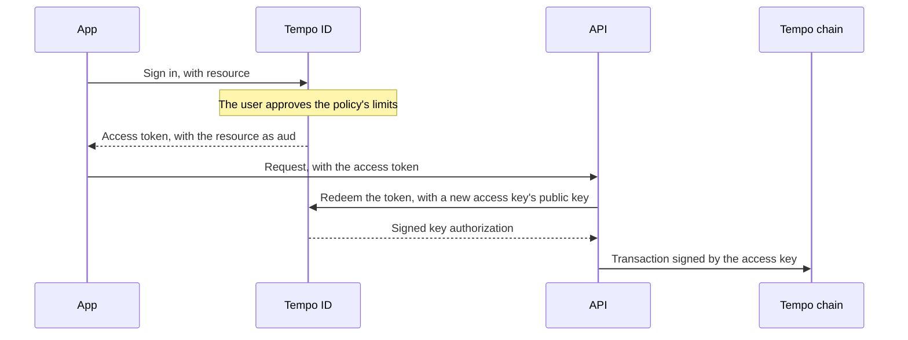

import { Cards } from 'vocs'
import { Demo } from '../../../../components/Demo.tsx'
import { PageCard } from '../../../../components/PageCard.tsx'
import { SourceLink } from '../../../../components/SourceLink.tsx'
import { StepTag } from '../../../../components/StepTag.tsx'

# Pay for users [An API pays for a user with an access key that it holds for one connection.]

## Overview

A connection is an OAuth grant of one user, through one app, to one API, such as a paid MCP server. The API, not the app, holds the [access key](/docs/guides/access-keys), and pays from the user's Tempo Account within the limits that the user approved. The app holds only an [access token](/docs/guides/api-authentication/authenticate-requests) for the API.

Tempo ID discovers the API from metadata that the API publishes, with no registration. These terms name its parts:

| Term                                                                                                    | Meaning                                                                                  |
| ------------------------------------------------------------------------------------------------------- | ---------------------------------------------------------------------------------------- |
| [Discovered resource](https://github.com/tempoxyz/id/blob/main/docs/resources.md#discovered-resources)  | An API that Tempo ID knows by its RFC 8707 identifier, such as `https://api.example/pay` |
| [Access key policy](https://github.com/tempoxyz/id/blob/main/docs/api-access-keys.md#access-key-policy) | The API's OAuth app, and the limits of each access key that the API holds                |
| Connection                                                                                              | One user's approval of one app for the resource                                          |

The approval reaches the API inside the access token. The API redeems the token at Tempo ID with its own client authentication, as in a token exchange, for the key authorization of an access key that it generated:



The demo signs a user in for this site's API, which then pays 1 OUSD on Tempo testnet with the access key that it holds for the connection.

<Demo name="PayForUsers" title="Pay for a user" />

## Walkthrough

The steps build the app that opens a connection, then the API with Hono.

::::steps

### Install the packages

:::code-group

```sh [npm]
npm install accounts hono react react-dom viem
```

```sh [pnpm]
pnpm add accounts hono react react-dom viem
```

```sh [bun]
bun add accounts hono react react-dom viem
```

:::

### Sign the user in for the API<StepTag kind="client" />

In the app, name the resource in the sign-in. The user's approval of the policy's limits authorizes the API's access key.

:::code-group

```tsx [App.tsx]
import { accounts } from './tempo.config.js'

export function App() {
  const { session } = accounts.useSession()

  if (!session)
    return (
      <button
        onClick={() =>
          accounts.dialog.signIn({
            mode: 'popup',
            resource: 'https://api.example/pay', // [!code hl]
          })
        }
        type="button"
      >
        Sign in with Tempo
      </button>
    )

  return <p>Signed in as {session.user.email}</p>
}
```

```ts [tempo.config.ts]
import { Accounts } from 'accounts'
import { react } from 'accounts/react'

export const accounts = Accounts.create({
  accessKey: false,
  chain: 'testnet',
  plugins: [react()],
})
```

:::

Tempo ID approves a connection only on its own page, so the sign-in sets <SourceLink name="signIn.challenge.mode" path="src/plugins/dialog.ts">`mode`</SourceLink> to `'popup'`, which opens it in a window. Each access token of the [session](/docs/guides/user-session) names the API as its audience. With <SourceLink name="create.accessKey" path="src/Accounts.ts">`accessKey`</SourceLink> set to `false`, the app requests no access key of its own.

### Call the API<StepTag kind="client" />

<SourceLink name="session.fetch" path="src/Accounts.ts">`session.fetch`</SourceLink> sends the request with the session's access token.

:::code-group

```tsx [Pay.tsx]
import { accounts } from './tempo.config.js'

export function Pay() {
  return (
    <button
      onClick={async () => {
        // [!code hl:start]
        const response = await accounts.session.fetch({
          init: { method: 'POST' },
          url: 'https://api.example/pay',
        })
        // [!code hl:end]
        console.log(await response.json())
      }}
      type="button"
    >
      Pay 1 OUSD
    </button>
  )
}
```

```ts [tempo.config.ts]
import { Accounts } from 'accounts'
import { react } from 'accounts/react'

export const accounts = Accounts.create({
  accessKey: false,
  chain: 'testnet',
  plugins: [react()],
})
```

:::

### Store the connections<StepTag kind="server" />

<SourceLink name="create.connections" path="src/Accounts.ts">`connections`</SourceLink> names the resource and the store of the connections. Its <SourceLink name="Options.metadata" path="src/internal/Connections.ts">`metadata`</SourceLink> names the access key policy and the private key of the API's app, an ES256 JWK with a `kid` that only the API's server holds.

The private key is a long-lived secret, like a client secret. Generate it once, and store `privateKey` as the API's `API_PRIVATE_KEY` secret. The app's document publishes only its public half. Keep `publicKey` for a later rotation.

```ts [generate-key.ts]
import { Base64, Bytes, P256 } from 'ox'

const privateKey = P256.randomPrivateKey()
const { x, y } = P256.getPublicKey({ privateKey })
const base64 = (value: bigint) =>
  Base64.fromBytes(Bytes.fromNumber(value, { size: 32 }), {
    pad: false,
    url: true,
  })
const publicKey = {
  alg: 'ES256',
  crv: 'P-256',
  kid: crypto.randomUUID(),
  kty: 'EC',
  x: base64(x),
  y: base64(y),
}

console.log({
  privateKey: JSON.stringify({
    ...publicKey,
    d: Base64.fromHex(privateKey, { pad: false, url: true }),
  }),
  publicKey: JSON.stringify(publicKey),
})
```

```sh
npm install ox
node generate-key.ts
```

<SourceLink name="handler" path="src/Accounts.ts">`accounts.handler`</SourceLink> serves the API's [protected resource metadata](https://www.rfc-editor.org/rfc/rfc9728) with the policy, and the [metadata document](https://github.com/tempoxyz/id/blob/main/docs/apps.md#api-apps) of its app. The instance authenticates as that app, with client assertions that the private key signs.

:::note

<SourceLink name="create" path="src/stores/Memory.ts">`Store.memory`</SourceLink> keeps the connections and their access keys in the process, so a restart loses them. In production, use a store that each replica shares, such as <SourceLink name="create" path="src/stores/Postgres.ts">`Store.postgres`</SourceLink> or <SourceLink name="create" path="src/stores/Redis.ts">`Store.redis`</SourceLink>.
:::

```ts [api.ts]
import { Accounts, Store } from 'accounts'
import { viem } from 'accounts/plugins'
import { Hono } from 'hono'

const accounts = Accounts.create({
  chain: 'testnet',
  connections: {
    metadata: {
      accessKey: { limits: [{ limit: '25', token: 'ousd' }] },
      privateKey: JSON.parse(process.env.API_PRIVATE_KEY!),
    },
    resource: 'https://api.example/pay',
    store: Store.memory(),
  },
  plugins: [viem()],
})

const app = new Hono()

app.all('/api/*', (c) => accounts.handler.fetch(c.req.raw))
app.get('/.well-known/oauth-protected-resource/*', (c) =>
  accounts.handler.fetch(c.req.raw),
)

export default app
```

At the first sign-in that names the resource, Tempo ID reads the metadata and stores the policy, with no registration. It reads the metadata again after 5 minutes, at the next sign-in. The approval page names the API by its host.

The store holds each access key's private key, so it stays on the server. Route every request of a connection to one process, since the instance serializes them in memory.

### Read the access token<StepTag kind="server" />

The route reads the Bearer token that <SourceLink name="session.fetch" path="src/Accounts.ts">`session.fetch`</SourceLink> sends.

```ts [api.ts]
import { Accounts, Store } from 'accounts'
import { viem } from 'accounts/plugins'
import { Hono } from 'hono'

const accounts = Accounts.create({
  chain: 'testnet',
  connections: {
    metadata: {
      accessKey: { limits: [{ limit: '25', token: 'ousd' }] },
      privateKey: JSON.parse(process.env.API_PRIVATE_KEY!),
    },
    resource: 'https://api.example/pay',
    store: Store.memory(),
  },
  plugins: [viem()],
})

const app = new Hono()

app.all('/api/*', (c) => accounts.handler.fetch(c.req.raw))
app.get('/.well-known/oauth-protected-resource/*', (c) =>
  accounts.handler.fetch(c.req.raw),
)

app.post('/pay', async (c) => {
  const accessToken = c.req.header('authorization')?.replace(/^Bearer /, '') // [!code hl]
  if (!accessToken) return c.json({ error: 'invalid_token' }, 401) // [!code hl]

  return c.json({})
})

export default app
```

### Redeem the connection<StepTag kind="server" />

<SourceLink name="connections.connect" path="src/Accounts.ts">`connections.connect`</SourceLink> verifies the access token, and returns the connection. The first request generates an access key, and redeems the approval for its key authorization. Later requests read the store, with no call to Tempo ID.

```ts [api.ts]
import { Accounts, Store } from 'accounts'
import { viem } from 'accounts/plugins'
import { Hono } from 'hono'

const accounts = Accounts.create({
  chain: 'testnet',
  connections: {
    metadata: {
      accessKey: { limits: [{ limit: '25', token: 'ousd' }] },
      privateKey: JSON.parse(process.env.API_PRIVATE_KEY!),
    },
    resource: 'https://api.example/pay',
    store: Store.memory(),
  },
  plugins: [viem()],
})

const app = new Hono()

app.all('/api/*', (c) => accounts.handler.fetch(c.req.raw))
app.get('/.well-known/oauth-protected-resource/*', (c) =>
  accounts.handler.fetch(c.req.raw),
)

app.post('/pay', async (c) => {
  const accessToken = c.req.header('authorization')?.replace(/^Bearer /, '')
  if (!accessToken) return c.json({ error: 'invalid_token' }, 401)

  const { connection } = await accounts.connections.connect({ accessToken }) // [!code ++]
  return c.json({ userId: connection.userId }) // [!code ++]
})

export default app
```

Tempo ID signs the key authorization at redemption, with the Tempo Account's owner key. A passkey signs only with the user present, so Tempo ID refuses a Tempo Account that only a passkey owns with `webauthn_required`. With an [access key endpoint](/docs/guides/connections/serve-access-keys), the owner signs at the approval instead.

### Pay with the access key<StepTag kind="server" />

<SourceLink name="pay" path="src/Accounts.ts">`accounts.pay`</SourceLink> takes the connection as <SourceLink name="pay" path="src/Accounts.ts">`session`</SourceLink>, and the connection's access key sends the transfer. The first transfer carries the key authorization, which registers the access key on the chain.

```ts [api.ts]
import { Accounts, Store } from 'accounts'
import { viem } from 'accounts/plugins'
import { Hono } from 'hono'

const accounts = Accounts.create({
  chain: 'testnet',
  connections: {
    metadata: {
      accessKey: { limits: [{ limit: '25', token: 'ousd' }] },
      privateKey: JSON.parse(process.env.API_PRIVATE_KEY!),
    },
    resource: 'https://api.example/pay',
    store: Store.memory(),
  },
  plugins: [viem()],
})

const app = new Hono()

app.all('/api/*', (c) => accounts.handler.fetch(c.req.raw))
app.get('/.well-known/oauth-protected-resource/*', (c) =>
  accounts.handler.fetch(c.req.raw),
)

app.post('/pay', async (c) => {
  const accessToken = c.req.header('authorization')?.replace(/^Bearer /, '')
  if (!accessToken) return c.json({ error: 'invalid_token' }, 401)

  const { connection } = await accounts.connections.connect({ accessToken })

  const { transaction } = await accounts.pay({ // [!code ++]
    amount: '1', // [!code ++]
    session: connection, // [!code ++]
    to: '0x000000000000000000000000000000000000dEaD', // [!code ++]
    token: 'ousd', // [!code ++]
  }) // [!code ++]
  return c.json({ transaction }) // [!code ++]
})

export default app
```

An API shows no payment page, so a payment above the approved limits rejects with <SourceLink name="PageRequiredError" path="src/actions/account.ts">`Actions.account.PageRequiredError`</SourceLink>. On testnet, Viem's `faucet.fundSync` funds the Tempo Account first.

::::

## Use cases

Each use case passes the connection that <SourceLink name="connections.connect" path="src/Accounts.ts">`connections.connect`</SourceLink> returns to another API, or sets one property of the <SourceLink name="create.connections" path="src/Accounts.ts">`connections`</SourceLink> option.

### Pay an MPP endpoint

<SourceLink name="mpp" path="src/mpp/index.ts">`accounts.mpp`</SourceLink> takes the connection as <SourceLink name="mpp.session" path="src/mpp/index.ts">`session`</SourceLink>, and pays an upstream endpoint's 402 charge with the access key.

```ts [api.ts]
import { Accounts, Store } from 'accounts'
import { mpp } from 'accounts/mpp'
import { Hono } from 'hono'

const accounts = Accounts.create({
  chain: 'testnet',
  connections: {
    metadata: {
      accessKey: { limits: [{ limit: '25', token: 'ousd' }] },
      privateKey: JSON.parse(process.env.API_PRIVATE_KEY!),
    },
    resource: 'https://api.example/pay',
    store: Store.memory(),
  },
  plugins: [mpp({ maxAmount: '1' })], // [!code hl]
})

const app = new Hono()

app.all('/api/*', (c) => accounts.handler.fetch(c.req.raw))
app.get('/.well-known/oauth-protected-resource/*', (c) =>
  accounts.handler.fetch(c.req.raw),
)

app.post('/tool', async (c) => {
  const accessToken = c.req.header('authorization')?.replace(/^Bearer /, '')
  if (!accessToken) return c.json({ error: 'invalid_token' }, 401)

  const { connection } = await accounts.connections.connect({ accessToken })

  // [!code hl:start]
  const response = await accounts
    .mpp({ session: connection })
    .fetch('https://upstream.example/tool')
  // [!code hl:end]
  return c.json(await response.json())
})

export default app
```

### Pay outside a request

<SourceLink name="connections.get" path="src/Accounts.ts">`connections.get`</SourceLink> reads the stored connection without an access token, such as in a scheduled job. It returns `undefined` without a live access key. The client ID and the user ID are those of the token that <SourceLink name="connections.connect" path="src/Accounts.ts">`connections.connect`</SourceLink> returns.

```ts [api.ts]
import { Accounts, Store } from 'accounts'
import { viem } from 'accounts/plugins'

const accounts = Accounts.create({
  chain: 'testnet',
  connections: {
    metadata: {
      accessKey: { limits: [{ limit: '25', token: 'ousd' }] },
      privateKey: JSON.parse(process.env.API_PRIVATE_KEY!),
    },
    resource: 'https://api.example/pay',
    store: Store.memory(),
  },
  plugins: [viem()],
})

export async function pay(clientId: string, userId: string) {
  const connection = await accounts.connections.get({ clientId, userId }) // [!code hl]
  if (connection)
    await accounts.pay({
      amount: '1',
      session: connection,
      to: '0x000000000000000000000000000000000000dEaD',
      token: 'ousd',
    })
}
```

### Accept only named apps

<SourceLink name="Options.clientIds" path="src/internal/Connections.ts">`clientIds`</SourceLink> names the apps whose access tokens the API accepts. It defaults to `'any'`, since any app may open a connection to the resource. Another app's token then fails <SourceLink name="connections.connect" path="src/Accounts.ts">`connections.connect`</SourceLink> with <SourceLink name="InvalidError" path="src/AccessToken.ts">`AccessToken.InvalidError`</SourceLink>.

```ts [api.ts]
import { Accounts, Store } from 'accounts'
import { viem } from 'accounts/plugins'

export const accounts = Accounts.create({
  chain: 'testnet',
  connections: {
    clientIds: ['https://app.example'], // [!code hl]
    metadata: {
      accessKey: { limits: [{ limit: '25', token: 'ousd' }] },
      privateKey: JSON.parse(process.env.API_PRIVATE_KEY!),
    },
    resource: 'https://api.example/pay',
    store: Store.memory(),
  },
  plugins: [viem()],
})
```

### Rotate the app's private key

Tempo ID keeps the keys of the app's document for 5 minutes, so an assertion of a new key fails until it reads the document again. <SourceLink name="Metadata.publicKeys" path="src/internal/Connections.ts">`publicKeys`</SourceLink> publishes the next key first:

1. Generate the next key with its own `kid`, and deploy only its `publicKey` in `publicKeys`. The API still signs with the current key, and holds no second private key.
2. After 5 minutes, deploy the next `privateKey`, with the earlier key's `publicKey` in `publicKeys`, so that replicas of the earlier deploy still authenticate.
3. After every replica runs the second deploy, remove the earlier key from `publicKeys`.

```ts [api.ts]
import { Accounts, Store } from 'accounts'
import { viem } from 'accounts/plugins'

export const accounts = Accounts.create({
  chain: 'testnet',
  connections: {
    metadata: {
      accessKey: { limits: [{ limit: '25', token: 'ousd' }] },
      privateKey: JSON.parse(process.env.API_PRIVATE_KEY!),
      publicKeys: [JSON.parse(process.env.API_NEXT_PUBLIC_KEY!)], // [!code hl]
    },
    resource: 'https://api.example/pay',
    store: Store.memory(),
  },
  plugins: [viem()],
})
```

## Next steps

<Cards>
  <PageCard
    description="Serve the access key endpoint, so a passkey owner can approve the API."
    icon="server"
    title="Serve access keys"
    to="/docs/guides/connections/serve-access-keys"
  />
  <PageCard
    description="Revoke the access keys of a connection, and handle a refused connection."
    icon="shield-check"
    title="Revoke connections"
    to="/docs/guides/connections/revoke-connections"
  />
  <PageCard
    description="Pay the 402 charge of a route with an access key."
    icon="payment-flow"
    title="Pay MPP charges"
    to="/docs/guides/payments/mpp"
  />
  <PageCard
    description="Verify an access token in an API, and read its user."
    icon="id-card"
    title="Authenticate requests"
    to="/docs/guides/api-authentication/authenticate-requests"
  />
</Cards>
