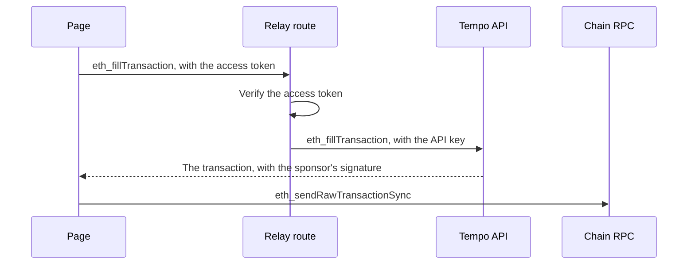

import { Cards } from 'vocs'
import { Demo } from '../../../../components/Demo.tsx'
import { PageCard } from '../../../../components/PageCard.tsx'
import { SourceLink } from '../../../../components/SourceLink.tsx'
import { StepTag } from '../../../../components/StepTag.tsx'

# Use Tempo API [The sponsor of a Tempo API key pays the fees of the transactions of users.]

## Overview

Tempo has no native gas token, so the sender of a transaction pays its fee in a stablecoin. A Tempo transaction can also name a fee payer: a second account that co-signs the transaction and pays its fee, so the sender's Tempo Account pays none. An app sponsors fees in one of two ways:

| Guide                                                           | Fee payer                              | Sent by                               | The app holds                          |
| --------------------------------------------------------------- | -------------------------------------- | ------------------------------------- | -------------------------------------- |
| Use Tempo API                                                   | The sponsor of the app's Tempo API key | A page, through the app's relay route | A Tempo API key                        |
| [Host fee payers](/docs/guides/fee-sponsorship/host-fee-payers) | An account of the app's server         | A page, through the app's relay route | A private key, and the account's funds |

The Tempo API, at `https://api.tempo.xyz`, is Tempo's hosted API. Its sponsor endpoint fills a transaction and co-signs it as the fee payer, and charges the fee to the sponsor of the request's Tempo API key.

A page must not hold the API key, so it sends each fill through a relay route on the app's server: a JSON-RPC proxy that verifies the caller and adds the API key. The <SourceLink name="relay" path="src/plugins/relay.ts">`relay`</SourceLink> plugin serves this route.

The demo sends 1 OUSD through the site's relay route, which sponsors 3 payments a minute for each user, and shows the account that paid the fee.

<Demo
  name="UseTempoApi"
  source="examples/sponsored-tempo-api"
  title="Send with no fee"
/>

## Walkthrough

The [`sponsored-tempo-api`](https://github.com/tempoxyz/accounts/tree/main/examples/sponsored-tempo-api) example runs this flow.



::::steps

### Create a Tempo API key

In the [Tempo Console](https://console.tempo.xyz), select **API Keys**, and create an API key with the `rpc-relay:sponsor` scope. The console shows the API key once. Set it as `TEMPO_API_KEY` in the server's environment.

:::warning
Keep the API key on the server. Each request with it spends the sponsor's balance, and a browser or mobile bundle shows it to anyone.
:::

### Install the packages

:::code-group

```sh [npm]
npm install accounts@alpha hono react react-dom viem
```

```sh [pnpm]
pnpm add accounts@alpha hono react react-dom viem
```

```sh [bun]
bun add accounts@alpha hono react react-dom viem
```

:::

### Add the relay route to the page<StepTag kind="client" />

Pass the route's path to the <SourceLink name="viem" path="src/plugins/viem.ts">`viem`</SourceLink> plugin as <SourceLink name="viem.relay" path="src/plugins/viem.ts">`relay`</SourceLink>. The page then sends each transaction's sponsorship requests to the route with the [session](/docs/guides/user-session)'s [access token](/docs/guides/api-authentication/authenticate-requests), and every other request to the chain's RPC.

```ts [tempo.config.ts]
import { Accounts } from 'accounts'
import { viem } from 'accounts/plugins'
import { react } from 'accounts/react'

export const accounts = Accounts.create({
  // Each sign-in requests an access key that sends up to 100 OUSD for a day.
  accessKey: () => ({
    expiry: '1d',
    limits: [{ limit: '100', token: 'ousd' }],
  }),
  chain: 'testnet',
  plugins: [react(), viem({ relay: '/api/relay' })], // [!code hl]
})
```

### Serve the relay route<StepTag kind="server" />

On the server, the <SourceLink name="relay" path="src/plugins/relay.ts">`relay`</SourceLink> plugin adds <SourceLink name="relay.relay" path="src/plugins/relay.ts">`accounts.relay`</SourceLink>, which forwards each request to the Tempo API with <SourceLink name="relay.apiKey" path="src/plugins/relay.ts">`apiKey`</SourceLink>. Its <SourceLink name="fetch" path="src/internal/Handler.ts">`fetch`</SourceLink> is a function of the Fetch API, so any Fetch server runs it, such as this Hono app.

The route accepts only the access tokens of its <SourceLink name="Config.clientId" path="src/Accounts.ts">`clientId`</SourceLink>, here the page's origin. Each signed-in user can then spend the sponsor's balance, within the API key's limits. To limit each user, add <SourceLink name="relay.authorize" path="src/plugins/relay.ts">`authorize`</SourceLink>, as [Limit each user](#limit-each-user) shows.

```ts [server.ts]
import { Accounts } from 'accounts'
import { relay } from 'accounts/plugins'
import { Hono } from 'hono'

const accounts = Accounts.create({
  chain: 'testnet',
  clientId: process.env.APP_URL,
  plugins: [relay({ apiKey: process.env.TEMPO_API_KEY! })],
})

export default new Hono().post('/api/relay', (c) =>
  accounts.relay.fetch(c.req.raw),
)
```

### Send a transaction<StepTag kind="client" />

The page sends as it does without a sponsor. The [access key](/docs/guides/access-keys) signs as the sender, and the receipt's `feePayer` names the account that paid the fee.

:::code-group

```tsx [Send.tsx]
import { useState } from 'react'
import { parseUnits } from 'viem'
import { Addresses } from 'viem/tempo'
import { accounts } from './tempo.config.js'

export function Send() {
  const [feePayer, setFeePayer] = useState<string>()

  return (
    <>
      <button
        onClick={async () => {
          const { receipt } = await accounts.token.transferSync({
            amount: parseUnits('1', 6),
            to: '0x000000000000000000000000000000000000dEaD',
            token: Addresses.ousd,
          })
          setFeePayer(receipt.feePayer) // [!code hl]
        }}
        type="button"
      >
        Send 1 OUSD
      </button>
      {feePayer && <p>Fee paid by {feePayer}</p>}
    </>
  )
}
```

```ts [tempo.config.ts]
import { Accounts } from 'accounts'
import { viem } from 'accounts/plugins'
import { react } from 'accounts/react'

export const accounts = Accounts.create({
  // Each sign-in requests an access key that sends up to 100 OUSD for a day.
  accessKey: () => ({
    expiry: '1d',
    limits: [{ limit: '100', token: 'ousd' }],
  }),
  chain: 'testnet',
  plugins: [react(), viem({ relay: '/api/relay' })],
})
```

:::

::::

## Use cases

Each use case sets one option of the <SourceLink name="relay" path="src/plugins/relay.ts">`relay`</SourceLink> plugin on the server, or of the <SourceLink name="viem" path="src/plugins/viem.ts">`viem`</SourceLink> plugin's <SourceLink name="viem.relay" path="src/plugins/viem.ts">`relay`</SourceLink> on the page.

### Limit each user

<SourceLink name="relay.authorize" path="src/plugins/relay.ts">`authorize`</SourceLink> accepts or refuses each caller whose access token verified. A response that it returns refuses the request, and the sender then pays its own fee.

Here a count in a <SourceLink name="Store" path="src/Store.ts">`Store`</SourceLink> allows 10 requests a minute for each user. It takes two store calls, so concurrent requests can pass the limit. For an exact limit, count in one atomic database step.

:::note

<SourceLink name="create" path="src/stores/Memory.ts">`Store.memory`</SourceLink> keeps the counts in the process, so a restart loses them. In production, use a store that each replica shares, such as <SourceLink name="create" path="src/stores/Postgres.ts">`Store.postgres`</SourceLink> or <SourceLink name="create" path="src/stores/Redis.ts">`Store.redis`</SourceLink>.
:::

```ts [server.ts]
import { Accounts, Store } from 'accounts'
import { relay } from 'accounts/plugins'
import { Hono } from 'hono'

const store = Store.memory()

const accounts = Accounts.create({
  chain: 'testnet',
  clientId: process.env.APP_URL,
  plugins: [
    relay({
      apiKey: process.env.TEMPO_API_KEY!,
      // [!code hl:start]
      async authorize(options) {
        const minute = Math.floor(Date.now() / 60_000)
        const key = `relay-limit:${options.token.userId}:${minute}`
        const count = Number((await store.getItem(key)) ?? 0)
        if (count >= 10)
          return Response.json({ error: 'slow_down' }, { status: 429 })
        await store.setItem(key, count + 1, { expiresAt: (minute + 1) * 60_000 })
      },
      // [!code hl:end]
    }),
  ],
})

export default new Hono().post('/api/relay', (c) =>
  accounts.relay.fetch(c.req.raw),
)
```

### Accept the tokens of a resource

<SourceLink name="relay.verify" path="src/plugins/relay.ts">`verify`</SourceLink> also takes the options of the route's token verifier. If the app's access tokens name a [registered resource](https://github.com/tempoxyz/id/blob/main/docs/resources.md), set it as <SourceLink name="create.audience" path="src/AccessToken.ts">`audience`</SourceLink>. The route then also accepts each token that the resource's API holds, so that API can spend the sponsor's balance.

```ts [server.ts]
import { Accounts } from 'accounts'
import { relay } from 'accounts/plugins'
import { Hono } from 'hono'

const accounts = Accounts.create({
  chain: 'testnet',
  clientId: process.env.APP_URL,
  plugins: [
    relay({
      apiKey: process.env.TEMPO_API_KEY!,
      verify: { audience: 'https://mcp.example.com/mcp' }, // [!code hl]
    }),
  ],
})

export default new Hono().post('/api/relay', (c) =>
  accounts.relay.fetch(c.req.raw),
)
```

### Send to a route at another origin

By default, only a route at one of the app's origins receives the access token. A route at another origin, such as a mobile app's server, receives it with <SourceLink name="viem.credentials" path="src/plugins/viem.ts">`credentials`</SourceLink> set to `'include'`.

```ts [tempo.config.ts]
import { Accounts } from 'accounts'
import { viem } from 'accounts/plugins'
import { react } from 'accounts/react'

export const accounts = Accounts.create({
  // Each sign-in requests an access key that sends up to 100 OUSD for a day.
  accessKey: () => ({
    expiry: '1d',
    limits: [{ limit: '100', token: 'ousd' }],
  }),
  chain: 'testnet',
  plugins: [
    react(),
    viem({
      relay: { credentials: 'include', url: 'https://api.example.com/relay' }, // [!code hl]
    }),
  ],
})
```

### Sponsor more than one chain

A route sponsors one chain, its instance's <SourceLink name="from.chain" path="src/Accounts.ts">`chain`</SourceLink>. For more chains, serve one instance and one route for each, and return each chain's route from a function of the <SourceLink name="viem" path="src/plugins/viem.ts">`viem`</SourceLink> plugin. The relay's <SourceLink name="relay.chainId" path="src/plugins/relay.ts">`chainId`</SourceLink> sets a route's chain in place of the instance's.

```ts [tempo.config.ts]
import { Accounts } from 'accounts'
import { viem } from 'accounts/plugins'
import { react } from 'accounts/react'

export const accounts = Accounts.create({
  // Each sign-in requests an access key that sends up to 100 OUSD for a day.
  accessKey: () => ({
    expiry: '1d',
    limits: [{ limit: '100', token: 'ousd' }],
  }),
  chain: 'testnet',
  plugins: [
    react(),
    viem((chainId) => ({ relay: `/api/relay/${chainId}` })), // [!code hl]
  ],
})
```

### Serve the route behind a proxy

Each DPoP proof (RFC 9449) names the route's public URL. Behind a proxy that terminates TLS, the request's URL is the internal URL, so pass the public one as <SourceLink name="relay.url" path="src/plugins/relay.ts">`url`</SourceLink>.

Several processes that serve the route refuse a repeated proof in <SourceLink name="relay.authorize" path="src/plugins/relay.ts">`authorize`</SourceLink>, as [Bind DPoP keys](/docs/guides/api-authentication/bind-dpop-keys#refuse-a-repeated-proof) shows.

```ts [server.ts]
import { Accounts } from 'accounts'
import { relay } from 'accounts/plugins'
import { Hono } from 'hono'

const accounts = Accounts.create({
  chain: 'testnet',
  clientId: process.env.APP_URL,
  plugins: [
    relay({
      apiKey: process.env.TEMPO_API_KEY!,
      url: 'https://app.example/api/relay', // [!code hl]
    }),
  ],
})

export default new Hono().post('/api/relay', (c) =>
  accounts.relay.fetch(c.req.raw),
)
```

### Check the caller without an access token

With <SourceLink name="relay.verify" path="src/plugins/relay.ts">`verify`</SourceLink> set to `false`, the route checks no access token, so any caller that reaches it spends the sponsor's balance. Serve it only behind the app's own check, such as a <SourceLink name="backend" path="src/plugins/backend.ts">`backend`</SourceLink> session cookie.

```ts [server.ts]
import { Accounts, Store } from 'accounts'
import { backend, relay } from 'accounts/plugins'
import { Hono } from 'hono'
import { csrf } from 'hono/csrf'

const accounts = Accounts.create({
  chain: 'testnet',
  clientId: process.env.APP_URL,
  plugins: [
    backend({ store: Store.memory() }),
    relay({ apiKey: process.env.TEMPO_API_KEY!, verify: false }), // [!code hl]
  ],
})

const app = new Hono()

app.all('/api/auth/*', (c) => accounts.handler.fetch(c.req.raw))

// The cookie authenticates the relay, so another site's request is refused.
app.use('/api/relay', csrf())

app.post('/api/relay', async (c) => {
  // [!code hl:start]
  // The app's own check of the caller: the backend's session cookie.
  const session = await accounts.session.get(c.req.raw)
  if (session?.method !== 'tempo-id')
    return c.json({ error: 'forbidden' }, 403)
  // [!code hl:end]
  return accounts.relay.fetch(c.req.raw)
})

export default app
```

## Next steps

<Cards>
  <PageCard
    description="Pay the fees from an account of the app's server."
    icon="pay-by-hand"
    title="Host fee payers"
    to="/docs/guides/fee-sponsorship/host-fee-payers"
  />
  <PageCard
    description="Name what an access key may spend, and request it at sign-in or later."
    icon="key"
    title="Authorize access keys"
    to="/docs/guides/access-keys/authorize-access-keys"
  />
</Cards>
