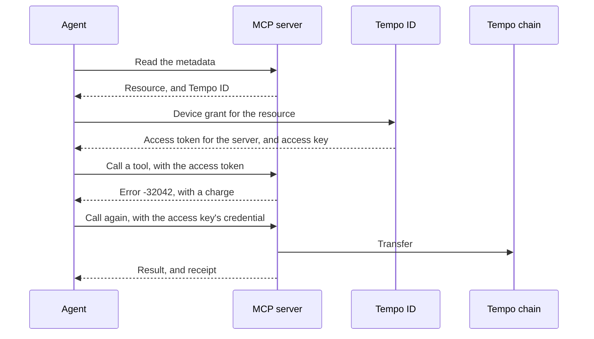

import { Cards } from 'vocs'
import { PageCard } from '../../../../components/PageCard.tsx'
import { SourceLink } from '../../../../components/SourceLink.tsx'
import { StepTag } from '../../../../components/StepTag.tsx'

# Charge tool calls [An MCP server authorizes each client through Tempo ID, and charges each tool call over MPP.]

## Overview

An MCP server names Tempo ID as its authorization server, and accepts only the access tokens for its own [registered resource](https://github.com/tempoxyz/id/blob/main/docs/resources.md). Each paid tool answers its call with a charge of the [Machine Payments Protocol](https://mpp.dev) (MPP), in the JSON-RPC response. The client pays the charge with the access key of its sign-in, then calls the tool again.

An agent thus signs in once. Each later call pays with no approval, until the access key's limit refuses a charge.



No demo runs in this page, since the client is a terminal program, and the server's resource needs a registration at Tempo ID. The terminal output is of one run of the [`mcp`](https://github.com/tempoxyz/accounts/tree/main/examples/mcp) example against a local Tempo ID and Tempo testnet.

```console [Terminal]
$ node --import tsx agent.ts login
Open http://localhost:8787/device?code=DSVS-PQBD and confirm the code DSVS-PQBD.
Signed in as alice-1794514374@example.com.
$ node --import tsx agent.ts call whoami
{"app":"cli:mcp-example","user":"user_01M78P9JQ7MW4PNQ1B94CWK7MN"}
$ node --import tsx agent.ts call fortune
The access key that spends little spends well.
Paid in 0x7f07443256a81f10541d3fd425c6ccbb7b7e07596d41f3ea1899c6df6bb0979f.
$ node --import tsx agent.ts call fortune
Today a payment required error turns into a result.
Paid in 0x2598b7638659b693f8dfee456ba7883b163bcd6e10bc5c6303d387c87d3da772.
$ node --import tsx agent.ts call report
The call failed: The charge of 5 exceeds the access key's limit of 0.977046 left for token 0x20c0000000000000000000006a37DA5C996874BE. Sign in with an access key whose limit covers the charge.
```

## Walkthrough

The [`mcp`](https://github.com/tempoxyz/accounts/tree/main/examples/mcp) example runs these steps: the server in `server.ts`, and the agent in `agent.ts`.

::::steps

### Register the resource

The resource's identifier is the `https` URL of the server's MCP endpoint, such as `https://mcp.example.com/mcp`. An admin of Tempo ID registers it. Each access token for it names it as `aud`, so no other API accepts the token.

The resource needs no [access key policy](https://github.com/tempoxyz/id/blob/main/docs/api-access-keys.md#access-key-policy), since each client pays with its own access key.

An MCP client that signs in with its own OAuth flow, such as with a [metadata document](https://github.com/tempoxyz/id/blob/main/docs/apps.md#metadata-document) or [dynamic client registration](https://github.com/tempoxyz/id/blob/main/docs/apps.md#dynamic-client-registration), holds no access key. The server then holds an access key for each user's connection instead, as [Pay for users](/docs/guides/connections/pay-for-users) describes.

### Install the packages

The server and the agent use the MCP SDK, and pay through [mppx](https://github.com/wevm/mppx).

:::code-group

```sh [npm]
npm install accounts @modelcontextprotocol/sdk hono mppx viem zod
```

```sh [pnpm]
pnpm add accounts @modelcontextprotocol/sdk hono mppx viem zod
```

```sh [bun]
bun add accounts @modelcontextprotocol/sdk hono mppx viem zod
```

:::

### Publish the metadata<StepTag kind="server" />

The server publishes its [protected resource metadata](https://www.rfc-editor.org/rfc/rfc9728), which names the resource and Tempo ID. Its path is the well-known path, then the resource's path.

```ts [server.ts]
import { Hono } from 'hono'

const resource = process.env.RESOURCE! // https://mcp.example.com/mcp
const metadataPath = `/.well-known/oauth-protected-resource${new URL(resource).pathname}`

const app = new Hono()

// [!code hl:start]
app.get(metadataPath, (c) =>
  c.json({
    authorization_servers: ['https://id.tempo.xyz'],
    bearer_methods_supported: ['header'],
    resource,
    scopes_supported: ['openid', 'email', 'offline_access'],
  }),
)
// [!code hl:end]

export default app
```

### Verify the access token<StepTag kind="server" />

The <SourceLink name="tokens" path="src/plugins/tokens.ts">`tokens`</SourceLink> plugin verifies the access token of each request. Any MCP client may call the server, so it accepts the token of every app with <SourceLink name="create.clientIds" path="src/AccessToken.ts">`clientIds`</SourceLink>, and only for the resource with <SourceLink name="create.audience" path="src/AccessToken.ts">`audience`</SourceLink>. The server's origin is its client ID, which needs no registration.

```ts [server.ts]
import { Accounts } from 'accounts'
import { tokens } from 'accounts/plugins'
import { Hono } from 'hono'

const resource = process.env.RESOURCE! // https://mcp.example.com/mcp
const metadataPath = `/.well-known/oauth-protected-resource${new URL(resource).pathname}`

// [!code hl:start]
const accounts = Accounts.create({
  clientId: new URL(resource).origin,
  plugins: [tokens({ audience: resource, clientIds: 'any' })],
})
// [!code hl:end]

const app = new Hono()

app.get(metadataPath, (c) =>
  c.json({
    authorization_servers: ['https://id.tempo.xyz'],
    bearer_methods_supported: ['header'],
    resource,
    scopes_supported: ['openid', 'email', 'offline_access'],
  }),
)

export default app
```

<SourceLink name="tokens.verifyAccessToken" path="src/plugins/tokens.ts">`accounts.tokens.verifyAccessToken`</SourceLink> returns the verified token, or nothing for a request without a valid one. It throws <SourceLink name="RequestError" path="src/Accounts.ts">`Accounts.RequestError`</SourceLink> with status 0 while Tempo ID's key set is unavailable. The server records no DPoP proof, so it refuses a DPoP token and accepts only Bearer tokens.

### Charge a tool<StepTag kind="server" />

mppx's MCP SDK transport carries the charge in the messages of the call. A call without a credential throws the challenge, which the client pays.

A paid call returns the result with its receipt. mppx verifies the credential and broadcasts its transfer, so the server holds no key.

```ts [tools.ts]
import { McpServer } from '@modelcontextprotocol/sdk/server/mcp.js'
import type { AccessToken } from 'accounts'
import { Transport } from 'mppx/mcp-sdk/server'
import { Mppx, tempo } from 'mppx/server'
import { Addresses } from 'viem/tempo'

const resource = process.env.RESOURCE! // https://mcp.example.com/mcp

const mppx = Mppx.create({
  methods: [
    tempo.charge({
      currencies: [Addresses.ousd],
      recipient: process.env.RECIPIENT as `0x${string}`,
      testnet: true,
    }),
  ],
  realm: new URL(resource).host,
  secretKey: process.env.MPP_SECRET_KEY,
  transport: Transport.mcpSdk(),
})

export function create(token: AccessToken.create.Token) {
  const server = new McpServer({ name: 'example', version: '1.0.0' })
  server.registerTool(
    'fortune',
    { description: 'Returns a fortune. Costs 0.01 OUSD.' },
    async (extra) => {
      // [!code hl:start]
      const result = await mppx.charge({ amount: '0.01' })(extra)
      if (result.status === 402) throw result.challenge
      // [!code hl:end]

      return result.withReceipt({
        content: [{ text: 'A small payment opens a large door.', type: 'text' }],
      })
    },
  )
  return server
}
```

A tool reads the caller from the token, such as its <SourceLink name="userId" path="src/AccessToken.ts">`userId`</SourceLink>. An MCP client usually has no registration, so its token names no Tempo Account.

### Serve the MCP endpoint<StepTag kind="server" />

A request without a valid token receives 401, whose challenge names the metadata. Each request holds its own server and transport, so the server keeps no MCP session.

:::code-group

```ts [server.ts]
import { WebStandardStreamableHTTPServerTransport } from '@modelcontextprotocol/sdk/server/webStandardStreamableHttp.js'
import { Accounts } from 'accounts'
import { tokens } from 'accounts/plugins'
import { Hono } from 'hono'
import { create } from './tools.js'

const resource = process.env.RESOURCE! // https://mcp.example.com/mcp
const metadataPath = `/.well-known/oauth-protected-resource${new URL(resource).pathname}`

const accounts = Accounts.create({
  clientId: new URL(resource).origin,
  plugins: [tokens({ audience: resource, clientIds: 'any' })],
})

const app = new Hono()

app.get(metadataPath, (c) =>
  c.json({
    authorization_servers: ['https://id.tempo.xyz'],
    bearer_methods_supported: ['header'],
    resource,
    scopes_supported: ['openid', 'email', 'offline_access'],
  }),
)

// [!code hl:start]
app.all('/mcp', async (c) => {
  const token = await accounts.tokens.verifyAccessToken(c.req.raw)
  // A DPoP token sets `boundTo`, and the server records no DPoP proof.
  if (!token || token.boundTo)
    return c.json({ error: 'invalid_token' }, 401, {
      'WWW-Authenticate': `Bearer resource_metadata="${new URL(metadataPath, resource)}"`,
    })

  const server = create(token)
  const transport = new WebStandardStreamableHTTPServerTransport({
    enableJsonResponse: true,
  })
  await server.connect(transport)
  return transport.handleRequest(c.req.raw)
})
// [!code hl:end]

export default app
```

```ts [tools.ts]
import { McpServer } from '@modelcontextprotocol/sdk/server/mcp.js'
import type { AccessToken } from 'accounts'
import { Transport } from 'mppx/mcp-sdk/server'
import { Mppx, tempo } from 'mppx/server'
import { Addresses } from 'viem/tempo'

const resource = process.env.RESOURCE! // https://mcp.example.com/mcp

const mppx = Mppx.create({
  methods: [
    tempo.charge({
      currencies: [Addresses.ousd],
      recipient: process.env.RECIPIENT as `0x${string}`,
      testnet: true,
    }),
  ],
  realm: new URL(resource).host,
  secretKey: process.env.MPP_SECRET_KEY,
  transport: Transport.mcpSdk(),
})

export function create(token: AccessToken.create.Token) {
  const server = new McpServer({ name: 'example', version: '1.0.0' })
  server.registerTool(
    'fortune',
    { description: 'Returns a fortune. Costs 0.01 OUSD.' },
    async (extra) => {
      const result = await mppx.charge({ amount: '0.01' })(extra)
      if (result.status === 402) throw result.challenge

      return result.withReceipt({
        content: [{ text: 'A small payment opens a large door.', type: 'text' }],
      })
    },
  )
  return server
}
```

:::

### Discover the server<StepTag kind="client" />

The agent reads the server's metadata. A token for another resource reaches another API, so the agent signs in only for the URL that it calls ([RFC 9728 §3.3](https://www.rfc-editor.org/rfc/rfc9728#section-3.3)), and only at Tempo ID.

```ts [agent.ts]
import { discoverOAuthProtectedResourceMetadata } from '@modelcontextprotocol/sdk/client/auth.js'

// [!code hl:start]
const url = new URL('https://mcp.example.com/mcp')
const metadata = await discoverOAuthProtectedResourceMetadata(url)
if (metadata.resource !== url.href)
  throw new Error(`The server names another resource, ${metadata.resource}.`)
if (!metadata.authorization_servers?.includes('https://id.tempo.xyz'))
  throw new Error('The server names another authorization server.')
// [!code hl:end]
```

### Sign in for the resource<StepTag kind="client" />

The sign-in names the resource, so each access token of the sign-in is for the server alone. The access key's limit caps what the agent spends.

The instance names no resource, so a sign-out needs no answer from the server. <SourceLink name="signIn" path="src/plugins/device.ts">`device.signIn`</SourceLink> runs the device grant, as the [CLI](/docs/guides/cli) guide describes.

:::code-group

```ts [agent.ts]
import { discoverOAuthProtectedResourceMetadata } from '@modelcontextprotocol/sdk/client/auth.js'
import { accounts } from './tempo.config.js'

const url = new URL('https://mcp.example.com/mcp')
const metadata = await discoverOAuthProtectedResourceMetadata(url)
if (metadata.resource !== url.href)
  throw new Error(`The server names another resource, ${metadata.resource}.`)
if (!metadata.authorization_servers?.includes('https://id.tempo.xyz'))
  throw new Error('The server names another authorization server.')

await accounts.device.signIn({ resource: metadata.resource }) // [!code hl]
```

```ts [tempo.config.ts]
import { Accounts } from 'accounts'
import { mpp } from 'accounts/mpp'
import { device } from 'accounts/plugins'

export const accounts = Accounts.create({
  // Each sign-in requests an access key that spends up to 1 OUSD for a day.
  accessKey: () => ({
    expiry: '1d',
    limits: [{ limit: '1', token: 'ousd' }],
  }),
  chain: 'testnet',
  clientId: 'cli:mcp-example',
  plugins: [
    device({
      onCode: (code) =>
        console.log(
          `Open ${code.verificationUriComplete} and confirm the code ${code.userCode}.`,
        ),
    }),
    mpp(),
  ],
})
```

:::

### Pay the tool calls<StepTag kind="client" />

<SourceLink name="session.fetch" path="src/Accounts.ts">`session.fetch`</SourceLink> sends each MCP request with the access token, and refreshes it before it expires. The <SourceLink name="mpp.mcp" path="src/mpp/index.ts">`mcp`</SourceLink> caller of the <SourceLink name="mpp" path="src/mpp/index.ts">`mpp`</SourceLink> plugin pays each charge with the access key of the session.

:::code-group

```ts [agent.ts]
import { discoverOAuthProtectedResourceMetadata } from '@modelcontextprotocol/sdk/client/auth.js'
import { Client } from '@modelcontextprotocol/sdk/client/index.js'
import { StreamableHTTPClientTransport } from '@modelcontextprotocol/sdk/client/streamableHttp.js'
import { accounts } from './tempo.config.js'

const url = new URL('https://mcp.example.com/mcp')
const metadata = await discoverOAuthProtectedResourceMetadata(url)
if (metadata.resource !== url.href)
  throw new Error(`The server names another resource, ${metadata.resource}.`)
if (!metadata.authorization_servers?.includes('https://id.tempo.xyz'))
  throw new Error('The server names another authorization server.')

await accounts.device.signIn({ resource: metadata.resource })

// [!code hl:start]
const client = new Client({ name: 'agent', version: '1.0.0' })
await client.connect(
  new StreamableHTTPClientTransport(url, {
    fetch: (input, init) => accounts.session.fetch({ init, url: input }),
  }),
)
// [!code hl:end]

// [!code hl:start]
const result = await accounts
  .mpp()
  .mcp(client)
  .callTool({ arguments: {}, name: 'fortune' })
// [!code hl:end]
console.log(result.content, result.receipt?.reference)
```

```ts [tempo.config.ts]
import { Accounts } from 'accounts'
import { mpp } from 'accounts/mpp'
import { device } from 'accounts/plugins'

export const accounts = Accounts.create({
  // Each sign-in requests an access key that spends up to 1 OUSD for a day.
  accessKey: () => ({
    expiry: '1d',
    limits: [{ limit: '1', token: 'ousd' }],
  }),
  chain: 'testnet',
  clientId: 'cli:mcp-example',
  plugins: [
    device({
      onCode: (code) =>
        console.log(
          `Open ${code.verificationUriComplete} and confirm the code ${code.userCode}.`,
        ),
    }),
    mpp(),
  ],
})
```

:::

A charge above what the access key's limit leaves throws <SourceLink name="LimitError" path="src/mpp/index.ts">`mpp.LimitError`</SourceLink> before the access key signs, so it pays nothing. The user then signs in again for a new access key.

::::

## Use cases

Each use case sets one option of the payer that <SourceLink name="mpp" path="src/mpp/index.ts">`accounts.mpp`</SourceLink> returns, whose <SourceLink name="mpp.mcp" path="src/mpp/index.ts">`mcp`</SourceLink> calls the tools, or of the sign-in for the resource.

### Cap each call

<SourceLink name="mpp.maxAmount" path="src/mpp/index.ts">`maxAmount`</SourceLink> caps each charge. A charge above it throws <SourceLink name="MaxAmountError" path="src/mpp/index.ts">`mpp.MaxAmountError`</SourceLink> before the access key signs.

A server can charge a call again after its payment, and one call pays at most three charges, so a call costs at most three times the cap. The access key's limit caps the total.

:::code-group

```ts [agent.ts]
import { discoverOAuthProtectedResourceMetadata } from '@modelcontextprotocol/sdk/client/auth.js'
import { Client } from '@modelcontextprotocol/sdk/client/index.js'
import { StreamableHTTPClientTransport } from '@modelcontextprotocol/sdk/client/streamableHttp.js'
import { accounts } from './tempo.config.js'

const url = new URL('https://mcp.example.com/mcp')
const metadata = await discoverOAuthProtectedResourceMetadata(url)
if (metadata.resource !== url.href)
  throw new Error(`The server names another resource, ${metadata.resource}.`)
if (!metadata.authorization_servers?.includes('https://id.tempo.xyz'))
  throw new Error('The server names another authorization server.')

await accounts.device.signIn({ resource: metadata.resource })

const client = new Client({ name: 'agent', version: '1.0.0' })
await client.connect(
  new StreamableHTTPClientTransport(url, {
    fetch: (input, init) => accounts.session.fetch({ init, url: input }),
  }),
)

const caller = accounts.mpp({ maxAmount: '0.1' }).mcp(client) // [!code hl]
const result = await caller.callTool({ arguments: {}, name: 'fortune' })
console.log(result.content, result.receipt?.reference)
```

```ts [tempo.config.ts]
import { Accounts } from 'accounts'
import { mpp } from 'accounts/mpp'
import { device } from 'accounts/plugins'

export const accounts = Accounts.create({
  // Each sign-in requests an access key that spends up to 1 OUSD for a day.
  accessKey: () => ({
    expiry: '1d',
    limits: [{ limit: '1', token: 'ousd' }],
  }),
  chain: 'testnet',
  clientId: 'cli:mcp-example',
  plugins: [
    device({
      onCode: (code) =>
        console.log(
          `Open ${code.verificationUriComplete} and confirm the code ${code.userCode}.`,
        ),
    }),
    mpp(),
  ],
})
```

:::

### Sign in from a page

A page signs in for the resource with <SourceLink name="signIn.resource" path="src/plugins/dialog.ts">`resource`</SourceLink> on <SourceLink name="signIn" path="src/plugins/dialog.ts">`dialog.signIn`</SourceLink>. Tempo ID's frame issues tokens for its own origin alone, so a sign-in with a resource opens a popup. Call it in a click handler.

:::code-group

```tsx [SignIn.tsx]
import { accounts } from './tempo.config.js'

export function SignIn() {
  return (
    <button
      onClick={() =>
        accounts.dialog.signIn({ resource: 'https://mcp.example.com/mcp' }) // [!code hl]
      }
      type="button"
    >
      Sign in with Tempo
    </button>
  )
}
```

```ts [tempo.config.ts]
import { Accounts } from 'accounts'
import { mpp } from 'accounts/mpp'

export const accounts = Accounts.create({
  // Each sign-in requests an access key that spends up to 1 OUSD for a day.
  accessKey: () => ({
    expiry: '1d',
    limits: [{ limit: '1', token: 'ousd' }],
  }),
  chain: 'testnet',
  plugins: [mpp()],
})
```

:::

### Attribute each payment

<SourceLink name="mpp.clientId" path="src/mpp/index.ts">`clientId`</SourceLink> names the app. Each charge's transfer memo then carries its fingerprint, so the server attributes the payment to the app.

```ts [tempo.config.ts]
import { Accounts } from 'accounts'
import { mpp } from 'accounts/mpp'
import { device } from 'accounts/plugins'

export const accounts = Accounts.create({
  // Each sign-in requests an access key that spends up to 1 OUSD for a day.
  accessKey: () => ({
    expiry: '1d',
    limits: [{ limit: '1', token: 'ousd' }],
  }),
  chain: 'testnet',
  clientId: 'cli:mcp-example',
  plugins: [
    device({
      onCode: (code) =>
        console.log(
          `Open ${code.verificationUriComplete} and confirm the code ${code.userCode}.`,
        ),
    }),
    mpp({ clientId: 'mcp-example' }), // [!code hl]
  ],
})
```

## Next steps

<Cards>
  <PageCard
    description="Sign a user in with a code that the user approves in a browser."
    icon="laptop"
    title="CLI"
    to="/docs/guides/cli"
  />
  <PageCard
    description="Pay the 402 charge of an MPP endpoint with the access key."
    icon="payment-flow"
    title="Pay MPP charges"
    to="/docs/guides/payments/mpp"
  />
  <PageCard
    description="Verify the access token of each request in an API."
    icon="server"
    title="Authenticate requests"
    to="/docs/guides/api-authentication/authenticate-requests"
  />
  <PageCard
    description="Pay for a user with an access key that the API holds for one connection."
    icon="link"
    title="Pay for users"
    to="/docs/guides/connections/pay-for-users"
  />
</Cards>
