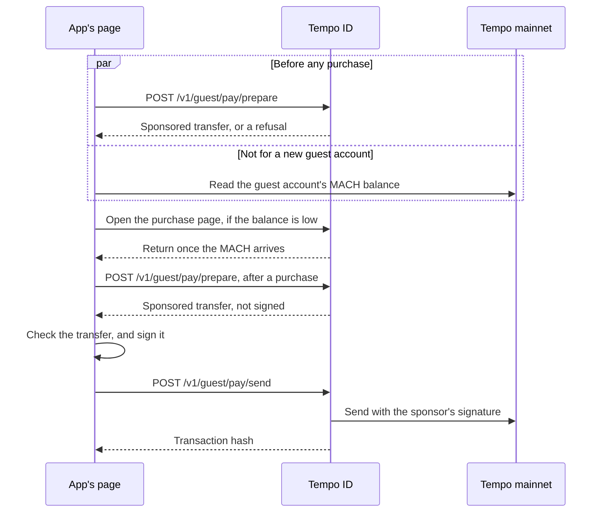

import { Cards } from 'vocs'
import { Demo } from '../../../../components/Demo.tsx'
import { PageCard } from '../../../../components/PageCard.tsx'
import { SourceLink } from '../../../../components/SourceLink.tsx'

# Accept guest payments [A visitor without a sign-in pays in MACH, which Apple Pay or Google Pay buys.]

## Overview

A guest payment is a MACH transfer from a guest account: a root Tempo Account whose owner is a non-extractable WebCrypto P256 key pair that the app's page keeps in its own store. The visitor signs in nowhere. As a card checkout charges a guest without an account, the app charges the visitor in one call.

<SourceLink name="pay" path="src/Accounts.ts">`accounts.pay`</SourceLink> with <SourceLink name="pay.guest" path="src/actions/account.ts">`guest: true`</SourceLink> creates the guest account at the first payment. Each payment first asks Tempo ID to prepare the transfer, so Tempo ID refuses a payment that no purchase fixes, such as to a recipient that MACH's transfer policy does not permit, before the visitor pays. If the guest account holds less MACH than the amount, Tempo ID's purchase page opens in a popup, and sells the MACH that it lacks with Apple Pay or Google Pay. The guest account then signs the transfer, and Tempo ID's sponsor pays the network fee.



The demo pays MACH as a guest, shows the guest account's address, and forgets the guest account. Its default recipient is the initial merchant of MACH, which MACH's transfer policy permits.

:::note
Guest payments run only on Tempo mainnet, so the demo runs there, unlike the other demos. Each purchase is a real charge of at least $5 to a card, Apple Pay, or Google Pay.
:::

<Demo name="AcceptGuestPayments" title="Accept a guest payment" />

## Walkthrough

::::steps

### Install the packages

:::code-group

```sh [npm]
npm install accounts react react-dom viem
```

```sh [pnpm]
pnpm add accounts react react-dom viem
```

```sh [bun]
bun add accounts react react-dom viem
```

:::

### Create the instance

A guest payment needs no plugin. The instance's chain defaults to Tempo mainnet, and its <SourceLink name="Config.store" path="src/Accounts.ts">`store`</SourceLink> defaults to IndexedDB, which keeps the non-extractable key pair as it is. Register the page's origin as a redirect URI of the app, since Tempo ID's guest routes answer only those origins.

```ts [tempo.config.ts]
import { Accounts } from 'accounts'

export const accounts = Accounts.create()
```

### Charge the visitor

Call <SourceLink name="pay" path="src/Accounts.ts">`accounts.pay`</SourceLink> in a click handler, so the purchase page's popup opens within the click. The preparation and the read before the purchase are requests, so if they outlast the click's user activation, a dialog offers the popup, and its Continue opens it. The call resolves with the guest account's <SourceLink name="pay.address" path="src/actions/guest.ts">`address`</SourceLink> and the <SourceLink name="pay.transaction" path="src/actions/guest.ts">`transaction`</SourceLink> hash, once the chain includes the transfer.

:::code-group

```tsx [Checkout.tsx]
import { useState } from 'react'
import { accounts } from './tempo.config.js'

export function Checkout() {
  const [transaction, setTransaction] = useState<string>()

  return (
    <>
      <button
        onClick={async () => {
          // [!code hl:start]
          const { transaction } = await accounts.pay({
            amount: '12.5',
            guest: true,
            to: '0x000000000000000000000000000000000000dEaD',
            token: 'mach',
          })
          // [!code hl:end]
          setTransaction(transaction)
        }}
        type="button"
      >
        Pay 12.50 MACH
      </button>
      {transaction && <p>Paid in {transaction}.</p>}
    </>
  )
}
```

```ts [tempo.config.ts]
import { Accounts } from 'accounts'

export const accounts = Accounts.create()
```

:::

The purchase page buys the larger of 5 MACH and the shortfall, rounded up to the cent, at most 100 MACH. The guest account keeps the rest for the next payment. If Tempo ID refuses the payment for another reason than the balance, such as the recipient, the app, the page's origin, or a rate limit, the call fails before the purchase page opens, also for a new guest account. The guest account signs only a transfer of the requested amount of MACH to <SourceLink name="pay.to" path="src/actions/account.ts">`to`</SourceLink>, and refuses any other transaction that Tempo ID returns.

A call fails in these cases, and the transfer does not send:

| The case                                                                                                                                  | The error                                                                                                                                                          |
| ----------------------------------------------------------------------------------------------------------------------------------------- | ------------------------------------------------------------------------------------------------------------------------------------------------------------------ |
| A token other than MACH                                                                                                                   | <SourceLink name="RequestError" path="src/Accounts.ts">`Accounts.RequestError`</SourceLink> with the reason `unsupported_token`, before any request                |
| A chain other than Tempo mainnet                                                                                                          | <SourceLink name="RequestError" path="src/Accounts.ts">`Accounts.RequestError`</SourceLink> with the reason `invalid_chain`, before any request                    |
| A shortfall above 100 MACH                                                                                                                | <SourceLink name="RequestError" path="src/Accounts.ts">`Accounts.RequestError`</SourceLink> with the reason `insufficient_balance`, before the purchase page opens |
| A store that holds its values only in the page, such as <SourceLink name="create" path="src/stores/Memory.ts">`Store.memory`</SourceLink> | <SourceLink name="RequestError" path="src/Accounts.ts">`Accounts.RequestError`</SourceLink> with the field `store`, before the guest account is created            |
| The visitor selects **Cancel** on the page                                                                                                | <SourceLink name="RequestError" path="src/Accounts.ts">`Accounts.RequestError`</SourceLink> with the code `access_denied`                                          |
| The visitor closes the popup or the dialog                                                                                                | A `DOMException` with the name `AbortError`                                                                                                                        |
| The browser blocks the popup                                                                                                              | <SourceLink name="BlockedError" path="src/actions/account.ts">`Actions.account.BlockedError`</SourceLink>                                                          |

<SourceLink name="pay" path="src/actions/guest.ts">`Actions.guest.pay`</SourceLink> lists each refusal of Tempo ID.

::::

## Use cases

Each use case sets one option of <SourceLink name="pay" path="src/Accounts.ts">`accounts.pay`</SourceLink>, or uses a member of <SourceLink name="guest" path="src/Accounts.ts">`accounts.guest`</SourceLink>.

### Attach a memo

<SourceLink name="pay.memo" path="src/actions/account.ts">`memo`</SourceLink> is the transfer's memo, such as an order ID: text, sent as its UTF-8 bytes, or hex, of 1 to 32 bytes.

```ts [pay.ts]
import { accounts } from './tempo.config.js'

export function pay(order: string) {
  return accounts.pay({
    amount: '12.5',
    guest: true,
    memo: order,
    to: '0x000000000000000000000000000000000000dEaD',
    token: 'mach',
  })
}
```

### Read the guest account

<SourceLink name="guest.get" path="src/Accounts.ts">`accounts.guest.get`</SourceLink> returns the guest account's address, or `undefined` before the first guest payment. The read creates no guest account.

```ts [guest.ts]
import { accounts } from './tempo.config.js'

export const address = await accounts.guest.get()
```

### Forget the guest account

<SourceLink name="guest.disconnect" path="src/Accounts.ts">`accounts.guest.disconnect`</SourceLink> removes the key pair from the store, and the next guest payment creates a new guest account. The MACH of the forgotten guest account stays on its address, and no key signs for it again.

```ts [forget.ts]
import { accounts } from './tempo.config.js'

export async function forget() {
  await accounts.guest.disconnect()
}
```

### Pay as the signed-in user

With a session, the call ignores `guest`, and the [session's Tempo Account](/docs/guides/payments/self-managed) pays. So one button charges a visitor and a signed-in user alike.

```ts [pay.ts]
import { accounts } from './tempo.config.js'

export function pay() {
  // A signed-in user pays from the session's Tempo Account.
  return accounts.pay({
    amount: '12.5',
    guest: true,
    to: '0x000000000000000000000000000000000000dEaD',
    token: 'mach',
  })
}
```

## Limitations

- A guest payment pays only in MACH, and only on Tempo mainnet.
- The guest account lives in the store of the page's origin. If the browser deletes the site's data, the guest account and its MACH are lost.
- No passkey or sign-in claims a guest account.

## Next steps

<Cards>
  <PageCard
    description="Send a payment with the access key, or on Tempo ID's payment page."
    icon="arrow-up-right"
    title="Send payments"
    to="/docs/guides/payments/self-managed"
  />
  <PageCard
    description="Pay the 402 charge of an MPP endpoint with the access key."
    icon="payment-flow"
    title="Pay MPP charges"
    to="/docs/guides/payments/mpp"
  />
</Cards>
