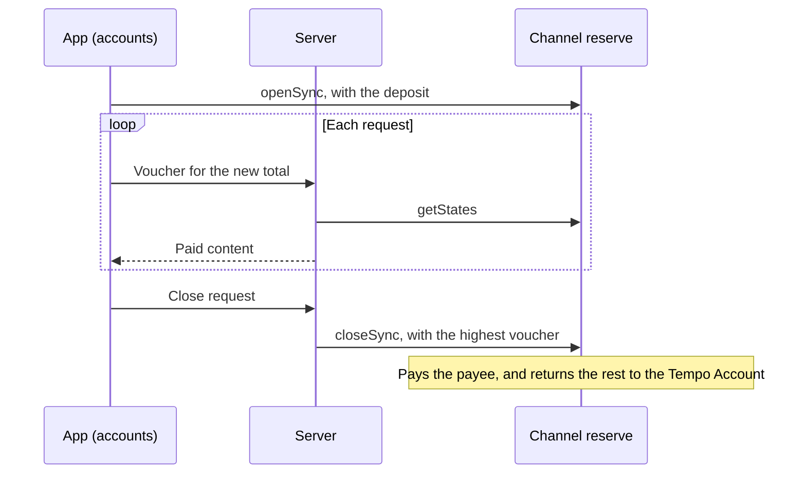

import { Cards } from 'vocs'
import { Demo } from '../../../../components/Demo.tsx'
import { PageCard } from '../../../../components/PageCard.tsx'
import { SourceLink } from '../../../../components/SourceLink.tsx'
import { StepTag } from '../../../../components/StepTag.tsx'

# Open payment channels [An app opens a payment channel, and pays for metered use with vouchers of the access key.]

## Overview

The "Sessions" guides cover payment sessions over payment channels, not the package's sign-in [session](/docs/guides/user-session).

A payment channel pays for metered use with one deposit and many offchain vouchers. The Tempo Account deposits in the chain's TIP-1034 channel reserve, an escrow, and the [access key](/docs/guides/access-keys) signs a voucher for each unit of use, with no prompt. The payee closes the channel with the highest voucher, and the reserve returns the rest.

This guide opens the channel with Viem and verifies vouchers on the app's server. [Pay with sessions](/docs/guides/sessions/mpp) leaves both to MPP, a protocol of HTTP 402 payments.

The demo opens a 0.05 OUSD channel on Tempo testnet, pays 0.001 OUSD for each fortune, and after the close shows what the server received and the channel returned.

<Demo name="OpenPaymentChannels" title="Open a payment channel" />

## Walkthrough

The steps build the demo's React app and server.



::::steps

### Install the packages

The server verifies each voucher with ox, and serves its routes with Hono.

:::code-group

```sh [npm]
npm install accounts@alpha hono ox react react-dom viem
```

```sh [pnpm]
pnpm add accounts@alpha hono ox react react-dom viem
```

```sh [bun]
bun add accounts@alpha hono ox react react-dom viem
```

:::

### Create the instance<StepTag kind="client" />

The <SourceLink name="viem" path="src/plugins/viem.ts">`viem`</SourceLink> plugin adds Viem's channel actions to the instance, as `accounts.channel`.

```ts [tempo.config.ts]
import { Accounts } from 'accounts'
import { viem } from 'accounts/plugins'
import { react } from 'accounts/react'

export const accounts = Accounts.create({
  // Each sign-in requests an access key that spends up to 1 OUSD for a day.
  accessKey: () => ({
    expiry: '1d',
    limits: [{ limit: '1', token: 'ousd' }],
  }),
  chain: 'testnet',
  plugins: [react(), viem()], // [!code hl]
})
```

Without <SourceLink name="Permissions.scopes" path="src/Permissions.ts">`scopes`</SourceLink>, the access key may open and top up a channel on the reserve, and each deposit counts against its token's limit.

### Sign the user in<StepTag kind="client" />

<SourceLink name="signIn" path="src/plugins/dialog.ts">`dialog.signIn`</SourceLink> opens Tempo ID's dialog over the page.

:::code-group

```tsx [App.tsx]
import { accounts } from './tempo.config.js'

export function App() {
  const { session } = accounts.useSession()

  // [!code hl:start]
  if (!session)
    return (
      <button onClick={() => accounts.dialog.signIn()} type="button">
        Sign in with Tempo
      </button>
    )
  // [!code hl:end]

  return <p>Signed in as {session.user.email}</p>
}
```

```ts [tempo.config.ts]
import { Accounts } from 'accounts'
import { viem } from 'accounts/plugins'
import { react } from 'accounts/react'

export const accounts = Accounts.create({
  // Each sign-in requests an access key that spends up to 1 OUSD for a day.
  accessKey: () => ({
    expiry: '1d',
    limits: [{ limit: '1', token: 'ousd' }],
  }),
  chain: 'testnet',
  plugins: [react(), viem()],
})
```

:::

### Open the channel<StepTag kind="client" />

`openSync` deposits in the reserve, and returns the fields that name the channel in each voucher, top-up, and close. The component keeps them in its state.

:::code-group

```tsx [Open.tsx]
import type { Channel } from 'ox/tempo'
import { useState } from 'react'
import { parseUnits } from 'viem'
import { Addresses } from 'viem/tempo'
import { accounts } from './tempo.config.js'

export function Open() {
  const { session } = accounts.useSession()
  const [channel, setChannel] = useState<Channel.Resolved>()

  if (channel) return <p>The channel is open.</p>

  return (
    <button
      onClick={async () => {
        // [!code hl:start]
        const { channelId, deposit, receipt, ...channel } =
          await accounts.channel.openSync({
            // The access key signs each voucher.
            authorizedSigner: session!.accessKey!.keyAuthorization.keyId,
            deposit: parseUnits('0.05', 6),
            feeToken: Addresses.ousd,
            // The address of the server's account.
            payee: '0x401a632ADBFCc5C8Ce7D2B80D16f7DFc47b642bc',
            token: Addresses.ousd,
          })
        // [!code hl:end]
        setChannel(channel)
      }}
      type="button"
    >
      Open a channel
    </button>
  )
}
```

```tsx [App.tsx]
import { Open } from './Open.js'
import { accounts } from './tempo.config.js'

export function App() {
  const { session } = accounts.useSession()

  if (!session)
    return (
      <button onClick={() => accounts.dialog.signIn()} type="button">
        Sign in with Tempo
      </button>
    )

  return <Open /> // [!code hl]
}
```

```ts [tempo.config.ts]
import { Accounts } from 'accounts'
import { viem } from 'accounts/plugins'
import { react } from 'accounts/react'

export const accounts = Accounts.create({
  // Each sign-in requests an access key that spends up to 1 OUSD for a day.
  accessKey: () => ({
    expiry: '1d',
    limits: [{ limit: '1', token: 'ousd' }],
  }),
  chain: 'testnet',
  plugins: [react(), viem()],
})
```

:::

- `authorizedSigner` names the access key as the voucher signer, or the reserve refuses its vouchers at the close.
- `feeToken` names a token of the access key's limits, since the access key pays fees in no other token. A transfer pays its fee in the token that it sends, but an open sends no token, so it names one.

### Pay with a voucher<StepTag kind="client" />

A voucher names the channel's cumulative total, so each voucher replaces the last.

:::code-group

```tsx [Pay.tsx]
import type { Channel } from 'ox/tempo'
import { useState } from 'react'
import { parseUnits } from 'viem'
import { accounts } from './tempo.config.js'

export function Pay(props: Pay.Props) {
  const { channel } = props
  const [fortune, setFortune] = useState<string>()
  // The total of the last voucher that the server accepted, in base units.
  const [spent, setSpent] = useState(0n)

  return (
    <>
      <button
        onClick={async () => {
          // [!code hl:start]
          const cumulativeAmount = spent + parseUnits('0.001', 6)
          const signature = await accounts.channel.signVoucher({
            channel,
            cumulativeAmount,
          })
          // [!code hl:end]

          const response = await fetch('/api/fortune', {
            body: JSON.stringify({
              channel,
              cumulativeAmount: cumulativeAmount.toString(),
              signature,
            }),
            headers: { 'content-type': 'application/json' },
            method: 'POST',
          })
          // A refused voucher keeps the last total.
          if (!response.ok) return

          const { fortune } = (await response.json()) as { fortune: string }
          setFortune(fortune)
          setSpent(cumulativeAmount)
        }}
        type="button"
      >
        Pay 0.001 OUSD
      </button>
      <p>{fortune}</p>
    </>
  )
}

export declare namespace Pay {
  type Props = {
    /** The channel, as its open returns it. */
    channel: Channel.Resolved
  }
}
```

```tsx [Open.tsx]
import type { Channel } from 'ox/tempo'
import { useState } from 'react'
import { parseUnits } from 'viem'
import { Addresses } from 'viem/tempo'
import { Pay } from './Pay.js'
import { accounts } from './tempo.config.js'

export function Open() {
  const { session } = accounts.useSession()
  const [channel, setChannel] = useState<Channel.Resolved>()

  // [!code hl:start]
  if (channel) return <Pay channel={channel} />
  // [!code hl:end]

  return (
    <button
      onClick={async () => {
        const { channelId, deposit, receipt, ...channel } =
          await accounts.channel.openSync({
            // The access key signs each voucher.
            authorizedSigner: session!.accessKey!.keyAuthorization.keyId,
            deposit: parseUnits('0.05', 6),
            feeToken: Addresses.ousd,
            // The address of the server's account.
            payee: '0x401a632ADBFCc5C8Ce7D2B80D16f7DFc47b642bc',
            token: Addresses.ousd,
          })
        setChannel(channel)
      }}
      type="button"
    >
      Open a channel
    </button>
  )
}
```

```ts [tempo.config.ts]
import { Accounts } from 'accounts'
import { viem } from 'accounts/plugins'
import { react } from 'accounts/react'

export const accounts = Accounts.create({
  // Each sign-in requests an access key that spends up to 1 OUSD for a day.
  accessKey: () => ({
    expiry: '1d',
    limits: [{ limit: '1', token: 'ousd' }],
  }),
  chain: 'testnet',
  plugins: [react(), viem()],
})
```

:::

### Verify the voucher on the server<StepTag kind="server" />

The server accepts a voucher only if it passes every check below, and keeps each channel's highest voucher in a store for the close. The later server steps import this module.

```ts [vouchers.ts]
import { Store } from 'accounts'
import { Address } from 'ox'
import { Channel, SignatureEnvelope } from 'ox/tempo'
import { createClient, type Hex, http, parseUnits } from 'viem'
import { privateKeyToAccount } from 'viem/accounts'
import { tempoModerato } from 'viem/chains'
import { Actions, Addresses } from 'viem/tempo'

export const client = createClient({
  account: privateKeyToAccount(process.env.PAYEE_PRIVATE_KEY as Hex),
  chain: tempoModerato.extend({ feeToken: Addresses.ousd }),
  transport: http(),
})

// The highest voucher of each channel.
export const store = Store.memory()

export type Voucher = {
  channel: Channel.Resolved
  cumulativeAmount: bigint
  signature: Hex
}

export async function accept(voucher: Voucher) {
  const { channel, cumulativeAmount, signature } = voucher
  const chainId = client.chain.id
  const channelId = Channel.computeId(channel, { chainId })

  if (!Address.isEqual(channel.payee, client.account.address)) return false
  if (!Address.isEqual(channel.token, Addresses.ousd)) return false

  const signed = SignatureEnvelope.verify(SignatureEnvelope.from(signature), {
    address: channel.authorizedSigner,
    payload: Channel.getVoucherSignPayload({
      chainId,
      channelId,
      cumulativeAmount,
    }),
  })
  if (!signed) return false

  const last = (await store.getItem(channelId)) as Voucher | undefined
  const paid = last?.cumulativeAmount ?? 0n
  if (cumulativeAmount < paid + parseUnits('0.001', 6)) return false

  const state = await Actions.channel.getStates(client, { channel: channelId })
  if (state.closeRequestedAt !== 0) return false
  if (cumulativeAmount > state.deposit) return false

  await store.setItem(channelId, voucher)
  return true
}
```

| Check           | Refuses                                               |
| --------------- | ----------------------------------------------------- |
| Payee and token | A channel that pays another account, or another token |
| Signature       | A voucher that the access key did not sign            |
| Amount          | A voucher that pays less than the price of the unit   |
| Close request   | A channel whose payer requested a close               |
| Deposit         | A voucher that the deposit does not cover             |

:::note

<SourceLink name="create" path="src/stores/Memory.ts">`Store.memory`</SourceLink> keeps the vouchers in the process, so a restart loses them. In production, use a store that each replica shares, such as <SourceLink name="create" path="src/stores/Postgres.ts">`Store.postgres`</SourceLink> or <SourceLink name="create" path="src/stores/Redis.ts">`Store.redis`</SourceLink>.
:::

:::warning
The store reads and writes in two calls, so two concurrent requests with one voucher can both pass. A server that answers one channel's requests in parallel updates the voucher atomically, such as in a Redis transaction.
:::

### Serve the paid route<StepTag kind="server" />

The route answers 402 for a refused voucher. `Channel.from` throws for a malformed channel.

:::code-group

```ts [server.ts]
import { Hono } from 'hono'
import { Channel } from 'ox/tempo'
import { accept } from './vouchers.js'

const app = new Hono()

// [!code hl:start]
app.post('/api/fortune', async (c) => {
  const body = await c.req.json()
  const paid = await accept({
    channel: Channel.from(body.channel),
    cumulativeAmount: BigInt(body.cumulativeAmount),
    signature: body.signature,
  })

  if (!paid) return c.json({ error: 'The voucher is refused.' }, 402)
  return c.json({ fortune: 'Pay for what you use.' })
})
// [!code hl:end]

export default app
```

```ts [vouchers.ts]
import { Store } from 'accounts'
import { Address } from 'ox'
import { Channel, SignatureEnvelope } from 'ox/tempo'
import { createClient, type Hex, http, parseUnits } from 'viem'
import { privateKeyToAccount } from 'viem/accounts'
import { tempoModerato } from 'viem/chains'
import { Actions, Addresses } from 'viem/tempo'

export const client = createClient({
  account: privateKeyToAccount(process.env.PAYEE_PRIVATE_KEY as Hex),
  chain: tempoModerato.extend({ feeToken: Addresses.ousd }),
  transport: http(),
})

// The highest voucher of each channel.
export const store = Store.memory()

export type Voucher = {
  channel: Channel.Resolved
  cumulativeAmount: bigint
  signature: Hex
}

export async function accept(voucher: Voucher) {
  const { channel, cumulativeAmount, signature } = voucher
  const chainId = client.chain.id
  const channelId = Channel.computeId(channel, { chainId })

  if (!Address.isEqual(channel.payee, client.account.address)) return false
  if (!Address.isEqual(channel.token, Addresses.ousd)) return false

  const signed = SignatureEnvelope.verify(SignatureEnvelope.from(signature), {
    address: channel.authorizedSigner,
    payload: Channel.getVoucherSignPayload({
      chainId,
      channelId,
      cumulativeAmount,
    }),
  })
  if (!signed) return false

  const last = (await store.getItem(channelId)) as Voucher | undefined
  const paid = last?.cumulativeAmount ?? 0n
  if (cumulativeAmount < paid + parseUnits('0.001', 6)) return false

  const state = await Actions.channel.getStates(client, { channel: channelId })
  if (state.closeRequestedAt !== 0) return false
  if (cumulativeAmount > state.deposit) return false

  await store.setItem(channelId, voucher)
  return true
}
```

:::

### Close the channel on the server<StepTag kind="server" />

`closeSync` sends the highest voucher to the reserve, which pays the payee its amount and returns the rest to the Tempo Account. The payee pays the fee, so its address holds OUSD.

:::code-group

```ts [server.ts]
import { Hono } from 'hono'
import { Channel } from 'ox/tempo'
import { Actions } from 'viem/tempo'
import { accept, client, store, type Voucher } from './vouchers.js'

const app = new Hono()

app.post('/api/fortune', async (c) => {
  const body = await c.req.json()
  const paid = await accept({
    channel: Channel.from(body.channel),
    cumulativeAmount: BigInt(body.cumulativeAmount),
    signature: body.signature,
  })

  if (!paid) return c.json({ error: 'The voucher is refused.' }, 402)
  return c.json({ fortune: 'Pay for what you use.' })
})

// [!code hl:start]
app.post('/api/close', async (c) => {
  const body = await c.req.json()
  const channelId = Channel.computeId(Channel.from(body.channel), {
    chainId: client.chain.id,
  })

  const voucher = (await store.getItem(channelId)) as Voucher | undefined
  if (!voucher) return c.json({ error: 'The channel holds no voucher.' }, 404)

  const { refundedToPayer, settledToPayee } = await Actions.channel.closeSync(
    client,
    { ...voucher, captureAmount: voucher.cumulativeAmount },
  )
  await store.removeItem(channelId)

  return c.json({
    refundedToPayer: refundedToPayer.toString(),
    settledToPayee: settledToPayee.toString(),
  })
})
// [!code hl:end]

export default app
```

```ts [vouchers.ts]
import { Store } from 'accounts'
import { Address } from 'ox'
import { Channel, SignatureEnvelope } from 'ox/tempo'
import { createClient, type Hex, http, parseUnits } from 'viem'
import { privateKeyToAccount } from 'viem/accounts'
import { tempoModerato } from 'viem/chains'
import { Actions, Addresses } from 'viem/tempo'

export const client = createClient({
  account: privateKeyToAccount(process.env.PAYEE_PRIVATE_KEY as Hex),
  chain: tempoModerato.extend({ feeToken: Addresses.ousd }),
  transport: http(),
})

// The highest voucher of each channel.
export const store = Store.memory()

export type Voucher = {
  channel: Channel.Resolved
  cumulativeAmount: bigint
  signature: Hex
}

export async function accept(voucher: Voucher) {
  const { channel, cumulativeAmount, signature } = voucher
  const chainId = client.chain.id
  const channelId = Channel.computeId(channel, { chainId })

  if (!Address.isEqual(channel.payee, client.account.address)) return false
  if (!Address.isEqual(channel.token, Addresses.ousd)) return false

  const signed = SignatureEnvelope.verify(SignatureEnvelope.from(signature), {
    address: channel.authorizedSigner,
    payload: Channel.getVoucherSignPayload({
      chainId,
      channelId,
      cumulativeAmount,
    }),
  })
  if (!signed) return false

  const last = (await store.getItem(channelId)) as Voucher | undefined
  const paid = last?.cumulativeAmount ?? 0n
  if (cumulativeAmount < paid + parseUnits('0.001', 6)) return false

  const state = await Actions.channel.getStates(client, { channel: channelId })
  if (state.closeRequestedAt !== 0) return false
  if (cumulativeAmount > state.deposit) return false

  await store.setItem(channelId, voucher)
  return true
}
```

:::

:::warning
A payer can close a channel without the payee: it calls `requestClose` on the channel reserve, and withdraws the unsettled deposit after 15 minutes. A server thus closes each channel within 15 minutes of its close request. Without <SourceLink name="Permissions.scopes" path="src/Permissions.ts">`scopes`</SourceLink>, the access key may make neither call.
:::

### Request the close<StepTag kind="client" />

`Close` posts the app's channel to the route.

:::code-group

```tsx [Close.tsx]
import type { Channel } from 'ox/tempo'

export function Close(props: Close.Props) {
  const { channel } = props

  return (
    <button
      onClick={() =>
        // [!code hl:start]
        fetch('/api/close', {
          body: JSON.stringify({ channel }),
          headers: { 'content-type': 'application/json' },
          method: 'POST',
        })
        // [!code hl:end]
      }
      type="button"
    >
      Close the channel
    </button>
  )
}

export declare namespace Close {
  type Props = {
    /** The channel, as its open returns it. */
    channel: Channel.Resolved
  }
}
```

```tsx [Open.tsx]
import type { Channel } from 'ox/tempo'
import { useState } from 'react'
import { parseUnits } from 'viem'
import { Addresses } from 'viem/tempo'
import { Close } from './Close.js'
import { Pay } from './Pay.js'
import { accounts } from './tempo.config.js'

export function Open() {
  const { session } = accounts.useSession()
  const [channel, setChannel] = useState<Channel.Resolved>()

  // [!code hl:start]
  if (channel)
    return (
      <>
        <Pay channel={channel} />
        <Close channel={channel} />
      </>
    )
  // [!code hl:end]

  return (
    <button
      onClick={async () => {
        const { channelId, deposit, receipt, ...channel } =
          await accounts.channel.openSync({
            // The access key signs each voucher.
            authorizedSigner: session!.accessKey!.keyAuthorization.keyId,
            deposit: parseUnits('0.05', 6),
            feeToken: Addresses.ousd,
            // The address of the server's account.
            payee: '0x401a632ADBFCc5C8Ce7D2B80D16f7DFc47b642bc',
            token: Addresses.ousd,
          })
        setChannel(channel)
      }}
      type="button"
    >
      Open a channel
    </button>
  )
}
```

```tsx [Pay.tsx]
import type { Channel } from 'ox/tempo'
import { useState } from 'react'
import { parseUnits } from 'viem'
import { accounts } from './tempo.config.js'

export function Pay(props: Pay.Props) {
  const { channel } = props
  const [fortune, setFortune] = useState<string>()
  // The total of the last voucher that the server accepted, in base units.
  const [spent, setSpent] = useState(0n)

  return (
    <>
      <button
        onClick={async () => {
          const cumulativeAmount = spent + parseUnits('0.001', 6)
          const signature = await accounts.channel.signVoucher({
            channel,
            cumulativeAmount,
          })

          const response = await fetch('/api/fortune', {
            body: JSON.stringify({
              channel,
              cumulativeAmount: cumulativeAmount.toString(),
              signature,
            }),
            headers: { 'content-type': 'application/json' },
            method: 'POST',
          })
          // A refused voucher keeps the last total.
          if (!response.ok) return

          const { fortune } = (await response.json()) as { fortune: string }
          setFortune(fortune)
          setSpent(cumulativeAmount)
        }}
        type="button"
      >
        Pay 0.001 OUSD
      </button>
      <p>{fortune}</p>
    </>
  )
}

export declare namespace Pay {
  type Props = {
    /** The channel, as its open returns it. */
    channel: Channel.Resolved
  }
}
```

```ts [tempo.config.ts]
import { Accounts } from 'accounts'
import { viem } from 'accounts/plugins'
import { react } from 'accounts/react'

export const accounts = Accounts.create({
  // Each sign-in requests an access key that spends up to 1 OUSD for a day.
  accessKey: () => ({
    expiry: '1d',
    limits: [{ limit: '1', token: 'ousd' }],
  }),
  chain: 'testnet',
  plugins: [react(), viem()],
})
```

:::

::::

## Use cases

Each use case calls one more channel action: on the page, through the client of the <SourceLink name="viem" path="src/plugins/viem.ts">`viem`</SourceLink> plugin, or on the server, through the payee's client.

### Top up the channel

`topUpSync` adds to the deposit, and the server reads the new deposit from `getStates`. Render `TopUp` beside `Pay`.

:::code-group

```tsx [TopUp.tsx]
import type { Channel } from 'ox/tempo'
import { parseUnits } from 'viem'
import { Addresses } from 'viem/tempo'
import { accounts } from './tempo.config.js'

export function TopUp(props: TopUp.Props) {
  const { channel } = props

  return (
    <button
      onClick={() =>
        // [!code hl:start]
        accounts.channel.topUpSync({
          additionalDeposit: parseUnits('0.05', 6),
          channel,
          feeToken: Addresses.ousd,
        })
        // [!code hl:end]
      }
      type="button"
    >
      Add 0.05 OUSD
    </button>
  )
}

export declare namespace TopUp {
  type Props = {
    /** The channel, as its open returns it. */
    channel: Channel.Resolved
  }
}
```

```ts [tempo.config.ts]
import { Accounts } from 'accounts'
import { viem } from 'accounts/plugins'
import { react } from 'accounts/react'

export const accounts = Accounts.create({
  // Each sign-in requests an access key that spends up to 1 OUSD for a day.
  accessKey: () => ({
    expiry: '1d',
    limits: [{ limit: '1', token: 'ousd' }],
  }),
  chain: 'testnet',
  plugins: [react(), viem()],
})
```

:::

### Settle before the close

`settleSync` collects up to a voucher from a long-lived channel, and keeps it open. Add `settle` to the server of the close step.

:::code-group

```ts [server.ts]
import { Hono } from 'hono'
import { Channel } from 'ox/tempo'
import type { Hex } from 'viem'
import { Actions } from 'viem/tempo'
import { accept, client, store, type Voucher } from './vouchers.js'

const app = new Hono()

app.post('/api/fortune', async (c) => {
  const body = await c.req.json()
  const paid = await accept({
    channel: Channel.from(body.channel),
    cumulativeAmount: BigInt(body.cumulativeAmount),
    signature: body.signature,
  })

  if (!paid) return c.json({ error: 'The voucher is refused.' }, 402)
  return c.json({ fortune: 'Pay for what you use.' })
})

app.post('/api/close', async (c) => {
  const body = await c.req.json()
  const channelId = Channel.computeId(Channel.from(body.channel), {
    chainId: client.chain.id,
  })

  const voucher = (await store.getItem(channelId)) as Voucher | undefined
  if (!voucher) return c.json({ error: 'The channel holds no voucher.' }, 404)

  const { refundedToPayer, settledToPayee } = await Actions.channel.closeSync(
    client,
    { ...voucher, captureAmount: voucher.cumulativeAmount },
  )
  await store.removeItem(channelId)

  return c.json({
    refundedToPayer: refundedToPayer.toString(),
    settledToPayee: settledToPayee.toString(),
  })
})

// [!code hl:start]
async function settle(channelId: Hex) {
  const voucher = (await store.getItem(channelId)) as Voucher | undefined
  if (!voucher) return undefined

  const { deltaPaid } = await Actions.channel.settleSync(client, voucher)
  return deltaPaid
}
// [!code hl:end]

export default app
```

```ts [vouchers.ts]
import { Store } from 'accounts'
import { Address } from 'ox'
import { Channel, SignatureEnvelope } from 'ox/tempo'
import { createClient, type Hex, http, parseUnits } from 'viem'
import { privateKeyToAccount } from 'viem/accounts'
import { tempoModerato } from 'viem/chains'
import { Actions, Addresses } from 'viem/tempo'

export const client = createClient({
  account: privateKeyToAccount(process.env.PAYEE_PRIVATE_KEY as Hex),
  chain: tempoModerato.extend({ feeToken: Addresses.ousd }),
  transport: http(),
})

// The highest voucher of each channel.
export const store = Store.memory()

export type Voucher = {
  channel: Channel.Resolved
  cumulativeAmount: bigint
  signature: Hex
}

export async function accept(voucher: Voucher) {
  const { channel, cumulativeAmount, signature } = voucher
  const chainId = client.chain.id
  const channelId = Channel.computeId(channel, { chainId })

  if (!Address.isEqual(channel.payee, client.account.address)) return false
  if (!Address.isEqual(channel.token, Addresses.ousd)) return false

  const signed = SignatureEnvelope.verify(SignatureEnvelope.from(signature), {
    address: channel.authorizedSigner,
    payload: Channel.getVoucherSignPayload({
      chainId,
      channelId,
      cumulativeAmount,
    }),
  })
  if (!signed) return false

  const last = (await store.getItem(channelId)) as Voucher | undefined
  const paid = last?.cumulativeAmount ?? 0n
  if (cumulativeAmount < paid + parseUnits('0.001', 6)) return false

  const state = await Actions.channel.getStates(client, { channel: channelId })
  if (state.closeRequestedAt !== 0) return false
  if (cumulativeAmount > state.deposit) return false

  await store.setItem(channelId, voucher)
  return true
}
```

:::

The reserve refuses a voucher that is not above the settled amount.

### Withdraw without the payee

If the server never closes the channel, the app takes the deposit back itself. `requestCloseSync` starts the reserve's timer, and the server then accepts no voucher. After 15 minutes, `withdrawSync` returns the deposit that no voucher settled.

The filled <SourceLink name="Permissions.scopes" path="src/Permissions.ts">`scopes`</SourceLink> allow neither call. Named scopes replace them, so the access key names each call of the reserve that it makes.

:::code-group

```tsx [Withdraw.tsx]
import type { Channel } from 'ox/tempo'
import { Addresses } from 'viem/tempo'
import { accounts } from './tempo.config.js'

export function Withdraw(props: Withdraw.Props) {
  const { channel } = props

  return (
    <>
      <button
        onClick={() =>
          accounts.channel.requestCloseSync({ channel, feeToken: Addresses.ousd }) // [!code hl]
        }
        type="button"
      >
        Request the close
      </button>
      {/* The reserve allows the withdrawal 15 minutes after the request. */}
      <button
        onClick={() =>
          accounts.channel.withdrawSync({ channel, feeToken: Addresses.ousd }) // [!code hl]
        }
        type="button"
      >
        Withdraw the deposit
      </button>
    </>
  )
}

export declare namespace Withdraw {
  type Props = {
    /** The channel, as its open returns it. */
    channel: Channel.Resolved
  }
}
```

```ts [tempo.config.ts]
import { Accounts } from 'accounts'
import { viem } from 'accounts/plugins'
import { react } from 'accounts/react'
import { Addresses, Scopes, Selectors } from 'viem/tempo'

const reserve = Scopes.contract(
  Addresses.tip20ChannelReserve,
  Selectors.tip20ChannelReserve,
)

export const accounts = Accounts.create({
  // Each sign-in requests an access key that spends up to 1 OUSD for a day.
  accessKey: () => ({
    expiry: '1d',
    limits: [{ limit: '1', token: 'ousd' }],
    // [!code hl:start]
    scopes: [
      reserve.open(),
      reserve.requestClose(),
      reserve.topUp(),
      reserve.withdraw(),
    ],
    // [!code hl:end]
  }),
  chain: 'testnet',
  plugins: [react(), viem()],
})
```

:::

## Next steps

<Cards>
  <PageCard
    description="Pay a metered MPP endpoint, with no channel code."
    icon="pulse"
    title="Pay with sessions"
    to="/docs/guides/sessions/mpp"
  />
  <PageCard
    description="Send a payment with the access key."
    icon="arrow-up-right"
    title="Send payments"
    to="/docs/guides/payments/self-managed"
  />
  <PageCard
    description="Charge a user each period, from a backend."
    icon="repeat"
    title="Charge each period"
    to="/docs/guides/subscriptions/self-managed"
  />
  <PageCard
    description="Name what an access key may spend, and request it at sign-in or later."
    icon="key"
    title="Authorize access keys"
    to="/docs/guides/access-keys/authorize-access-keys"
  />
</Cards>
